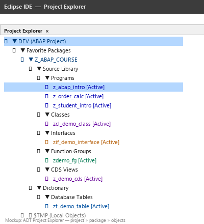
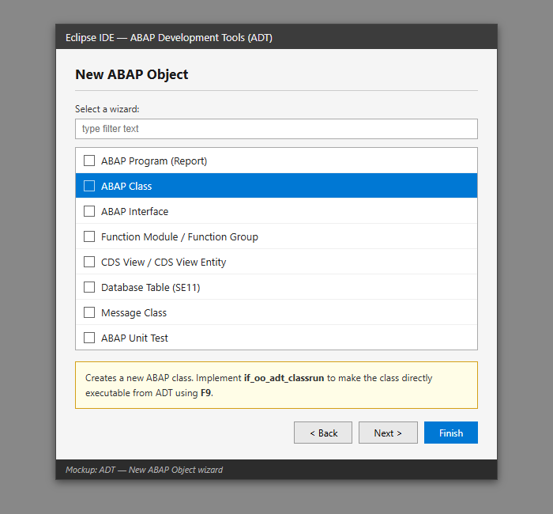
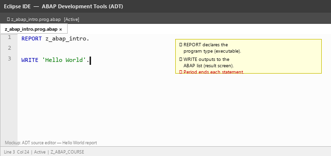
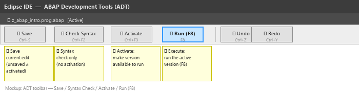
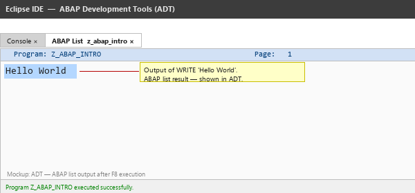
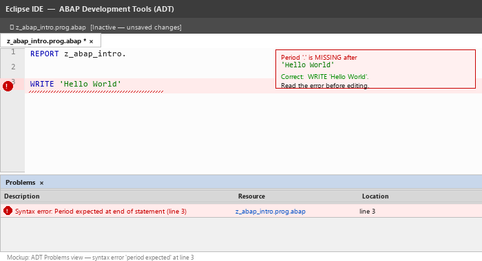

# Lecture 1 — Exercises: Your First ABAP Programs

**Module:** M-SAP-WP-1.2 Client-Server Communication with SAP ABAP  
**Programme:** SAP Engineering and Analytics (M.Sc.)

> **Before you start:** Read `Lecture_01_Theory.md` first for the background on SAP, ABAP, and the three-tier architecture.

---

## Learning Objectives

After these exercises, you should be able to:

1. Connect Eclipse ADT to the H01 SAP BTP ABAP system.
2. Create, activate, and execute a simple ABAP class.
3. Declare variables and assign values.
4. Display output using `out->write()` and string templates.
5. Perform basic arithmetic calculations in ABAP.
6. Apply those calculations to a simple business scenario.

---

## Part A: Getting Set Up in Eclipse

## 1. What You Need

Before starting, confirm you have the following installed:

| Component | Purpose |
|---|---|
| **Java JDK 17 or later** | Eclipse requires Java to run |
| **Eclipse IDE for Java and DSL Developers** | The base IDE |
| **SAP ABAP Development Tools (ADT)** | SAP plugin that adds ABAP capabilities to Eclipse |

If anything is missing, follow the [Installation Guide](#appendix-installation-guide) at the end of this document.

---

## 2. Opening Eclipse and Switching to the ABAP Perspective

1. Launch **Eclipse**.
2. Go to: **Window → Perspective → Open Perspective → Other...**
3. Select **ABAP** from the list and click **Open**.

You should now see the ABAP perspective with the **Project Explorer** panel on the left.



> **What is a perspective?** Eclipse is a general-purpose IDE. A *perspective* is a layout preset that shows the panels relevant for a specific type of work. The ABAP perspective shows the panels you need for ABAP development.

---

## 3. Connecting to the ABAP Cloud System (First Time Only)

You develop ABAP code *on the remote SAP BTP ABAP system* — Eclipse is just the editor. You need to create an **ABAP Cloud Project** that connects Eclipse to your BTP ABAP instance.

> **ABAP Cloud Project vs. ABAP Project:** ADT has two project types. **ABAP Project** is for classic on-premise SAP systems (System ID, Application Server, Port). **ABAP Cloud Project** is for SAP BTP ABAP Environment — you use this one. Do not confuse them.

**Step-by-step:**

1. In the **Project Explorer**, right-click in the empty area.
2. Select **New → ABAP Cloud Project**.
3. The connection wizard opens. Select **SAP BTP ABAP Environment** and click **Next**.
4. Enter the **Service Instance URL** your lecturer will provide:

   | Field | Value |
   |---|---|
   | **Service Instance URL** | `https://<your-tenant>.abap.<region>.hana.ondemand.com` |

   The URL is unique to your BTP ABAP tenant. Your lecturer will share it at the start of the session.

5. Click **Next**. Eclipse opens a **browser window** for SAP BTP authentication.
6. Log in with your SAP BTP credentials (email and password, or SSO if your institution uses it).
7. After successful login the browser confirms authentication and you return to Eclipse.
8. Click **Finish**.

The project now appears in your **Project Explorer** named after the tenant URL. Expand it — you will see a tree of packages and development objects.

> **Already connected?** If the BTP project already appears in your Project Explorer, skip this step and go to section 4.

---

## 4. Finding Your Package

Every development object belongs to a **package**. Your lecturer has assigned each student a personal package.

In the Project Explorer, expand your BTP project node:
```
<your-tenant-name>
  └── ZLOCAL
        └── Z_LEC01          ← your package is here (or as assigned)
```

If you cannot see it, type your package name into the search bar at the top of the Project Explorer.

---

## Part B: Exercise 1 — Hello World

This first exercise walks you through the **complete Eclipse workflow** for creating a class, writing code, activating it, and running it. Follow every step carefully.

---

### Step 1 — Create a New ABAP Class

1. In the Project Explorer, **right-click your package**.
2. Select **New → ABAP Class**.

   

3. Fill in the wizard:

   | Field | Value |
   |---|---|
   | **Name** | `Z_STUDENT_HELLO` |
   | **Description** | `My first ABAP class` |

4. Click **Next**, then **Finish**.

Eclipse creates the class and opens it in the editor with a skeleton.

---

### Step 2 — Replace the Code

Select all the generated code and replace it with:

```abap
CLASS z_student_hello DEFINITION PUBLIC FINAL CREATE PUBLIC.
  PUBLIC SECTION.
    INTERFACES if_oo_adt_classrun.
ENDCLASS.

CLASS z_student_hello IMPLEMENTATION.
  METHOD if_oo_adt_classrun~main.
    out->write( 'Hello, I am learning ABAP!' ).
  ENDMETHOD.
ENDCLASS.
```

The editor should look like this:



---

### Step 3 — Activate the Class

Press **Ctrl+F3** (or click the Activate button in the toolbar).



If there are no errors, the class activates and is ready to run.

> **Why activate?** Saving stores your source code. Activation *compiles and publishes* the class to the system. If you skip activation and press F9, the system runs the *previous* active version — your new code is completely ignored. This is the most common beginner mistake.

---

### Step 4 — Execute the Class

Press **F9** (or right-click in the editor → **Run As → ABAP Application (Console)**).

The **Console** tab appears at the bottom of Eclipse:



```
Hello, I am learning ABAP!
```

**You have just run your first ABAP program on a live SAP system.**

---

### Step 5 — Edit and Run Again

1. Change the message to your own name:
   ```abap
   out->write( 'Hello, I am Maria and I am learning ABAP!' ).
   ```
2. Press **Ctrl+F3** (Activate).
3. Press **F9** (Execute) — check the new output appears.

> Try pressing F9 *without* Ctrl+F3 first. You will see the old message. This demonstrates exactly why activation is required.

---

### Step 6 — Deliberately Break It

1. Remove the period at the end of `out->write(...)`.
2. Press **Ctrl+F2** (Syntax Check).
3. Read the error in the **Problems** panel at the bottom of Eclipse.



4. Put the period back and activate again.

> **Rule:** Every ABAP statement ends with a **period (`.`)**. ADT shows exactly which line is missing it. Do not panic at error messages — read them first.

---

## 5. The Development Cycle

Every time you make a change, follow this sequence:

```
Write / edit code
    → Ctrl+F2  (Syntax Check — optional, catches errors early)
    → Ctrl+F3  (Activate — required before F9)
    → F9       (Execute — runs the class on the server)
    → Read console output
    → Repeat
```

| Action | Shortcut | What It Does |
|---|---|---|
| Save | Ctrl+S | Stores source code — does not make it runnable |
| Syntax Check | Ctrl+F2 | Checks grammar without activating |
| **Activate** | **Ctrl+F3** | Compiles and publishes — **required before F9** |
| **Execute** | **F9** | Runs the class and shows console output |

---

## Part C: Understanding the Code

## 6. Decode the Class Template

Every class in this module follows the same structure:

```abap
CLASS z_your_class_name DEFINITION PUBLIC FINAL CREATE PUBLIC.
  PUBLIC SECTION.
    INTERFACES if_oo_adt_classrun.
ENDCLASS.

CLASS z_your_class_name IMPLEMENTATION.
  METHOD if_oo_adt_classrun~main.

    " ─── your code goes here ───────────────────────────

    out->write( 'Hello' ).

  ENDMETHOD.
ENDCLASS.
```

| Part | What It Means |
|---|---|
| `CLASS z_... DEFINITION` | Declares the class structure |
| `PUBLIC FINAL CREATE PUBLIC` | Visibility modifiers — use as-is for now |
| `INTERFACES if_oo_adt_classrun` | Makes the class runnable with **F9** |
| `CLASS z_... IMPLEMENTATION` | Contains the executable code |
| `METHOD if_oo_adt_classrun~main` | Entry point — this method runs when you press F9 |
| `out->write( ... )` | Sends one line to the console |
| `.` | **Every ABAP statement ends with a period** |

> **Naming rule:** All your objects must start with `Z_`. This is SAP's convention for customer-created objects: `Z_STUDENT_HELLO`, `Z_CALCULATOR`, etc.

---

## Part D: Variables and Output

## 7. Declaring a Variable

Programs store and process data using variables.

```abap
DATA lv_name TYPE string.
```

Assign a value:
```abap
lv_name = 'Maria'.
```

Display it:
```abap
out->write( lv_name ).
```

The pattern is always:
```
DECLARE  →  ASSIGN  →  USE
```

---

## 8. String Templates — Combining Text and Variables

When you want to mix fixed text and variables in a single output line, use **string templates**:

```abap
DATA lv_name TYPE string.
DATA lv_age  TYPE i.

lv_name = 'Maria'.
lv_age  = 24.

out->write( |Name: { lv_name }| ).
out->write( |Age: { lv_age }| ).
out->write( |{ lv_name } is { lv_age } years old.| ).
```

A string template is wrapped in **pipe characters `|...|`**. Variables inside `{ }` are inserted automatically.

If you know Python or JavaScript, this is the same idea:

| Language | Syntax | Example |
|---|---|---|
| Python f-string | `f"..."` | `f"Name: {name}"` |
| JavaScript template literal | `` `...` `` | `` `Name: ${name}` `` |
| **ABAP string template** | `\|...\|` | `\|Name: { lv_name }\|` |

---

## 9. Basic Data Types

Four types are enough for today:

| Type | Used For | Example Value |
|---|---|---|
| `TYPE i` | Whole numbers | Quantity, count, age |
| `TYPE string` | Text of any length | Name, description |
| `TYPE c LENGTH n` | Fixed-length character field | Codes, IDs |
| `TYPE p LENGTH 8 DECIMALS 2` | Decimal numbers | Price, amount |

```abap
DATA lv_quantity TYPE i.
DATA lv_name     TYPE string.
DATA lv_price    TYPE p LENGTH 8 DECIMALS 2.

lv_quantity = 10.
lv_name     = 'Monitor'.
lv_price    = '250.00'.
```

Lecture 2 covers the full ABAP type system in depth. For now, choose the type that fits the data.

---

## 10. Naming Conventions

SAP developers use standard prefixes so the purpose of a variable is immediately clear:

| Prefix | Meaning |
|---|---|
| `lv_` | local variable |
| `lt_` | local internal table (Lecture 2) |
| `ls_` | local structure (Lecture 2) |
| `lo_` | local object reference (Lecture 3) |

---

### Exercise 2: Introduce Yourself ✋

> **Goal:** Declare variables and display them with string templates.
>
> Create class `Z_STUDENT_INTRO` in your package:
>
> ```abap
> CLASS z_student_intro DEFINITION PUBLIC FINAL CREATE PUBLIC.
>   PUBLIC SECTION.
>     INTERFACES if_oo_adt_classrun.
> ENDCLASS.
>
> CLASS z_student_intro IMPLEMENTATION.
>   METHOD if_oo_adt_classrun~main.
>     DATA lv_name       TYPE string.
>     DATA lv_program    TYPE string.
>     DATA lv_university TYPE string.
>
>     lv_name       = 'Maria'.
>     lv_program    = 'SAP Engineering and Analytics'.
>     lv_university = 'Hochschule Fresenius'.
>
>     out->write( |Name:       { lv_name }| ).
>     out->write( |Program:    { lv_program }| ).
>     out->write( |University: { lv_university }| ).
>   ENDMETHOD.
> ENDCLASS.
> ```
>
> Replace the values with your own. Activate (Ctrl+F3) and execute (F9).
>
> **Questions:**
> 1. Where are variables declared — before or inside the method?
> 2. What does `out->write( '' ).` do if you add it between two output lines?

---

## Part E: Basic Calculations

## 11. Arithmetic

```abap
DATA lv_number1 TYPE i.
DATA lv_number2 TYPE i.
DATA lv_result  TYPE i.

lv_number1 = 20.
lv_number2 = 5.

lv_result = lv_number1 + lv_number2.

out->write( |Result: { lv_result }| ).
```

| Operator | Operation |
|---|---|
| `+` | Addition |
| `-` | Subtraction |
| `*` | Multiplication |
| `/` | Division |

The fundamental flow in every program:
```
INPUT / DATA  →  PROCESSING  →  OUTPUT
```

---

### Exercise 3: Simple Calculator ✋

> **Goal:** Declare two integer variables and output addition, subtraction, and multiplication.
>
> Create class `Z_SIMPLE_CALCULATOR`. **Try writing it yourself before looking at the solution.**

<details>
<summary>Solution — click to expand</summary>

```abap
CLASS z_simple_calculator DEFINITION PUBLIC FINAL CREATE PUBLIC.
  PUBLIC SECTION.
    INTERFACES if_oo_adt_classrun.
ENDCLASS.

CLASS z_simple_calculator IMPLEMENTATION.
  METHOD if_oo_adt_classrun~main.
    DATA lv_num1       TYPE i VALUE 20.
    DATA lv_num2       TYPE i VALUE 5.
    DATA lv_sum        TYPE i.
    DATA lv_difference TYPE i.
    DATA lv_product    TYPE i.

    lv_sum        = lv_num1 + lv_num2.
    lv_difference = lv_num1 - lv_num2.
    lv_product    = lv_num1 * lv_num2.

    out->write( |Number 1:       { lv_num1 }| ).
    out->write( |Number 2:       { lv_num2 }| ).
    out->write( |Addition:       { lv_sum }| ).
    out->write( |Subtraction:    { lv_difference }| ).
    out->write( |Multiplication: { lv_product }| ).
  ENDMETHOD.
ENDCLASS.
```

</details>

> **Note on `VALUE`:** `DATA lv_num1 TYPE i VALUE 20.` assigns an initial value at declaration time instead of needing a separate assignment statement.

---

### Exercise 4: First Business Problem — Order Calculation ✋

#### Scenario

A company sells computer monitors.

- Product: Monitor
- Quantity ordered: 12
- Unit price: EUR 250.00

Write class `Z_ORDER_CALCULATION` that calculates and displays the total order value.

#### Think Before Coding

Which variables do you need?

- Product name → `TYPE string`
- Quantity → `TYPE i`
- Unit price → `TYPE p LENGTH 8 DECIMALS 2`
- Total value → `TYPE p LENGTH 10 DECIMALS 2`

<details>
<summary>Solution — click to expand</summary>

```abap
CLASS z_order_calculation DEFINITION PUBLIC FINAL CREATE PUBLIC.
  PUBLIC SECTION.
    INTERFACES if_oo_adt_classrun.
ENDCLASS.

CLASS z_order_calculation IMPLEMENTATION.
  METHOD if_oo_adt_classrun~main.
    DATA lv_product  TYPE string VALUE 'Monitor'.
    DATA lv_quantity TYPE i VALUE 12.
    DATA lv_price    TYPE p LENGTH 8 DECIMALS 2 VALUE '250.00'.
    DATA lv_total    TYPE p LENGTH 10 DECIMALS 2.

    lv_total = lv_quantity * lv_price.

    out->write( |Product:     { lv_product }| ).
    out->write( |Quantity:    { lv_quantity }| ).
    out->write( |Unit Price:  { lv_price } EUR| ).
    out->write( |Order Value: { lv_total } EUR| ).
  ENDMETHOD.
ENDCLASS.
```

</details>

#### Why This Exercise Matters

In Exercise 3, the multiplication was abstract:
```
number1 × number2 = result
```

Here, the same operation carries real business meaning:
```
quantity × unit price = order value
```

This is the connection between syntax and the SAP business context from the theory file — the same arithmetic that runs in millions of SAP sales order transactions every day.

---

## Part F: Independent Challenge

## 12. Student Grade Calculator

Work through this independently before looking for hints.

### Create a class `Z_GRADE_CALCULATOR` with variables for:

- Student name
- Course name
- Assignment score 1
- Assignment score 2
- Assignment score 3

### Calculate and display:

- Total score
- Average score

### Expected output:

```
Student: Maria
Course: SAP ABAP

Assignment 1: 80
Assignment 2: 70
Assignment 3: 90

Total:   240
Average: 80
```

### Hints

- Use `out->write( '' ).` to print a blank line between sections.
- Declare `lv_average` as `TYPE i` first. Then change it to `TYPE p LENGTH 8 DECIMALS 2` and see how the output changes.

### Bonus Question

What happens if the average is not a whole number but the variable is `TYPE i`?

For example: scores 80, 70, 85 → average = 78.33...

Keep this in mind — it leads directly into Lecture 2.

---

## Part G: Common Mistakes

## 13. Missing a Period

```abap
DATA lv_number TYPE i    " ← error: period missing
```

Every statement ends with `.`. ADT shows exactly which line is missing it.

---

## 14. Forgetting to Activate Before Executing

After editing, always press **Ctrl+F3** (Activate) before **F9** (Execute). If you skip activation, the system runs the previous active version and your change has no effect. This causes the most confusion for beginners.

---

## 15. Using an Undeclared Variable

All variables must be declared with `DATA` before use. If you reference a variable that was never declared, the syntax check will report a "not known in this program" error on that line.

---

## Session Summary

| Key Point | What to Remember |
|---|---|
| **Eclipse connects to the remote server** | Code runs on H01, not on your laptop |
| **Development cycle** | Edit → Ctrl+F3 Activate → F9 Execute |
| **Activation is required** | Saving ≠ activating; skip it and the old code runs |
| **Every statement ends with a period** | Missing `.` is the most common syntax error |
| **Class template** | `if_oo_adt_classrun` is the standard pattern for all programs in this module |
| **String templates** | `\|text { variable }\|` combines text and variables |
| **Business context** | `quantity × unit price = order value` — the same arithmetic as abstract numbers, now with meaning |

---

## Preparation for Lecture 2

Make sure you can write and run this class independently without referring to the notes:

```abap
CLASS z_price_calculation DEFINITION PUBLIC FINAL CREATE PUBLIC.
  PUBLIC SECTION.
    INTERFACES if_oo_adt_classrun.
ENDCLASS.

CLASS z_price_calculation IMPLEMENTATION.
  METHOD if_oo_adt_classrun~main.
    DATA lv_price    TYPE p LENGTH 8 DECIMALS 2.
    DATA lv_quantity TYPE i.
    DATA lv_total    TYPE p LENGTH 10 DECIMALS 2.

    lv_price    = '25.50'.
    lv_quantity = 10.
    lv_total    = lv_price * lv_quantity.

    out->write( |Price:    { lv_price } EUR| ).
    out->write( |Quantity: { lv_quantity }| ).
    out->write( |Total:    { lv_total } EUR| ).
  ENDMETHOD.
ENDCLASS.
```

You do not need to fully understand `TYPE p`, `LENGTH`, or `DECIMALS` yet — that is exactly where Lecture 2 begins.

---

## Suggested References

- Horst Keller, *ABAP Objects: Introduction to Programming SAP Applications*, 4th Edition, SAP PRESS, 2020.
- Paul Hardy, *ABAP to the Future*, 3rd Edition, SAP PRESS, 2019.
- ABAP Keyword Documentation: [help.sap.com — ABAP Language Reference](https://help.sap.com/doc/abapdocu_latest_index_htm/latest/en-US/index.htm)

---

## Appendix: Installation Guide

### Step 1 — Install Java JDK

Eclipse requires Java 17 or later. Download **Eclipse Temurin (OpenJDK)**:

**[https://adoptium.net/temurin/releases/](https://adoptium.net/temurin/releases/)**

Select your OS, architecture (x64 for most laptops), and choose **JDK — version 21 LTS**.

On Windows, tick **"Set JAVA_HOME variable"** during installation.

Verify with:
```
java -version
```
Expected: `openjdk version "21.x.x ..."`

---

### Step 2 — Download Eclipse

Download **Eclipse IDE for Java and DSL Developers** (not just "Eclipse IDE for Java Developers"):

**[https://www.eclipse.org/downloads/packages/](https://www.eclipse.org/downloads/packages/)**

> The "DSL Developers" variant includes the Xtext framework that ADT depends on. The plain Java package is missing this.

Unzip to a permanent location (e.g. `C:\eclipse`). Eclipse needs no installer — unzip and run.

---

### Step 3 — Install SAP ADT Plugin

1. Launch Eclipse.
2. Menu: **Help → Install New Software...**
3. In **"Work with:"**, paste and press Enter:

   **[https://tools.hana.ondemand.com/latest](https://tools.hana.ondemand.com/latest)**

4. Expand **"ABAP Development Tools"**, tick the checkbox.
5. Click **Next**, accept the license, complete installation.
6. Restart Eclipse when prompted.

---

### Troubleshooting

| Problem | Solution |
|---|---|
| Eclipse won't start | Verify Java 17+ is installed and JAVA_HOME is set |
| ADT update site times out | Try from a different network (university Wi-Fi or mobile hotspot) |
| "Requires Java 17 or higher" | Remove older Java, install JDK 21 from adoptium.net |
| ADT not visible after install | Window → Perspective → Open Perspective → ABAP |
