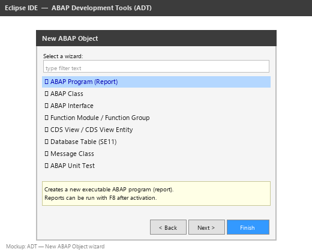
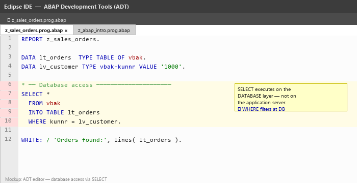
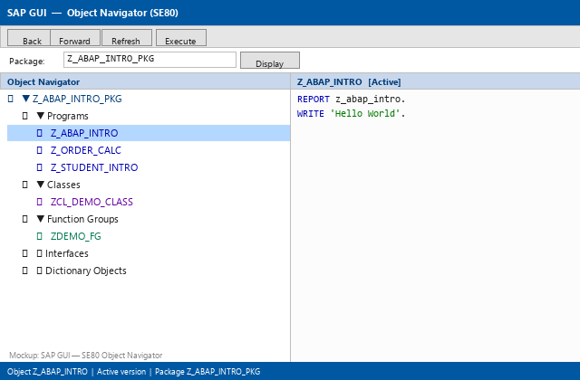
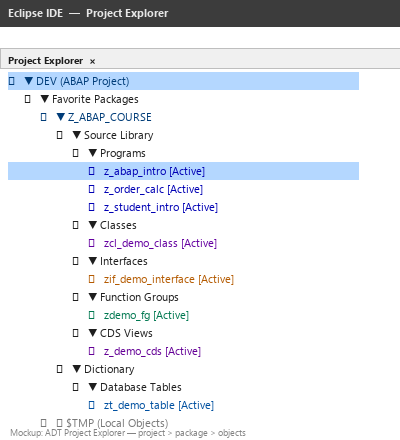
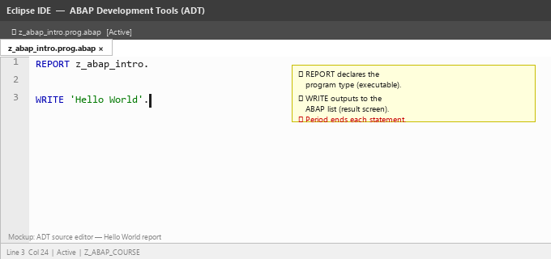
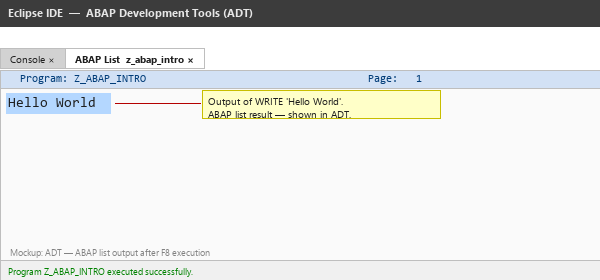
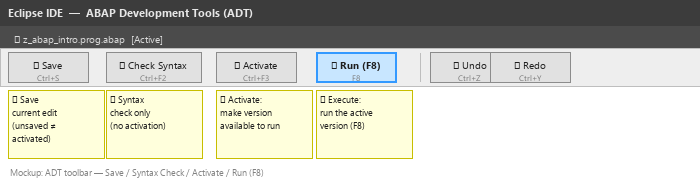
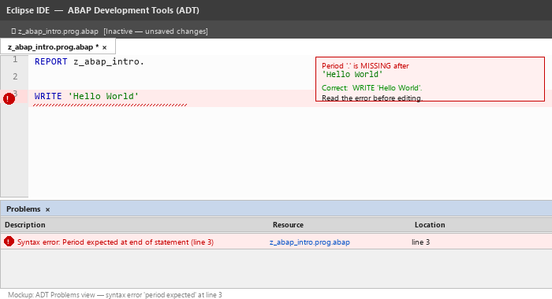

# Lecture 1: Introduction to SAP and ABAP Programming

**Module:** M-SAP-WP-1.2 Client-Server Communication with SAP ABAP  
**Programme:** SAP Engineering and Analytics (M.Sc.)  
**Language:** English  
**Session duration:** 2 hours  
**Audience:** Students with no previous SAP or ABAP experience

---

## 1. Learning Objectives

After this session, you should be able to:

1. Explain at a high level what SAP and ERP systems are.
2. Recognize major SAP business areas such as FI, CO, MM, SD, SCM, SRM, and HCM/HR.
3. Explain why organizations may require custom ABAP development.
4. Describe the basic client, application server, and database architecture of an ABAP system.
5. Explain what ABAP is and where ABAP programs execute.
6. Recognize SAP GUI/ABAP Workbench and Eclipse ADT as ABAP development environments.
7. Create, syntax-check, activate, and execute a simple ABAP program.
8. Declare simple variables, assign values, perform basic calculations, and display output.

---

# Part A: SAP in 10 Minutes

## 2. What Are SAP and ERP?

An **Enterprise Resource Planning (ERP)** system integrates business processes and business data across an organization.

Instead of imagining Finance, Sales, Procurement, Warehousing, Production, and HR as completely isolated systems, ERP allows business processes to work across organizational boundaries.

### Simple Business Scenario

Imagine a company receives an order for **10 laptops**.

That one transaction may involve:

1. **Sales** receiving the customer order.
2. **Inventory / Logistics** checking availability.
3. **Procurement** obtaining missing products or components.
4. **Warehouse** preparing the delivery.
5. **Finance** recording the financial impact.
6. **Management / Analytics** evaluating revenue, costs, and performance.

### Key Idea

> A single business transaction can affect multiple business processes and data objects.

For this ABAP course, you do **not** need to become an expert in all SAP functional areas. You only need enough business context to understand where ABAP applications are used.

---

## 3. Examples of SAP Business Areas

During your SAP career, you may encounter abbreviations such as:

- **FI** – Financial Accounting
- **CO** – Controlling
- **MM** – Materials Management / Procurement
- **SD** – Sales and Distribution
- **SCM** – Supply Chain Management
- **SRM** – Supplier Relationship Management
- **HCM / HR** – Human Resources

A useful beginner's distinction is:

- **Business functionality** supports processes such as finance, sales, procurement, and logistics.
- **ABAP development** allows developers to build, extend, integrate, automate, and report on applications in an ABAP environment.

### Why Is Custom Development Needed?

Organizations may require development for:

- Company-specific requirements
- Custom reports
- Additional checks and validations
- Interfaces and integrations
- Process automation
- Extensions of standard applications
- Custom business applications
- Specialized data processing

### Think About It

If an ERP product already contains standard functionality, **why might two companies using the same product still need different custom development?**

---

# Part B: Entering the ABAP World

## 4. What Is ABAP?

**ABAP** is SAP's programming language for developing applications that run in an **Application Server ABAP (AS ABAP)** environment.

As a beginner, keep this mental model in mind:

- Python code runs in a Python runtime.
- Java applications run in a Java runtime/JVM.
- ABAP code executes in an ABAP application-server environment.

This comparison is only a learning aid. The architectures and programming models are not identical.

ABAP can be used for areas such as:

- Business applications
- Reports
- Data processing
- Database access
- Interfaces
- Extensions
- Object-oriented applications
- Business services

The image below shows some of the development object types available in Eclipse ADT — including programs (reports), classes, interfaces, function modules, and CDS views:



Throughout this module, we will start with ABAP fundamentals and progressively connect them to more advanced and modern SAP development concepts.

---

## 5. Client-Server Architecture

The title of this module includes **Client-Server Communication**, so we begin with a simplified architecture.

```text
CLIENT / USER INTERFACE
        |
        | Request
        v
ABAP APPLICATION SERVER
        |
        | Data request
        v
DATABASE
        |
        | Data
        v
ABAP APPLICATION SERVER
        |
        | Result
        v
CLIENT / USER INTERFACE
```

The following image shows an example of an ABAP program performing a SELECT statement — illustrating the point where application-server logic reaches down to the database layer:



### Example

A user asks:

> Show all relevant sales orders for Customer 1000.

Conceptually:

1. The user initiates the request from a client or user interface.
2. The request reaches the application layer.
3. ABAP application logic processes the request.
4. Required information is retrieved from the database.
5. Business logic is applied.
6. The result is returned to the user interface.

### Important Question

Whenever you learn a new ABAP concept this semester, ask:

> **Where is this operation happening?**

This will become especially important when we study database access and performance.

---

# Part C: ABAP Development Environments

## 6. Classic ABAP Workbench

Traditional ABAP development is strongly associated with SAP GUI and ABAP Workbench tools.

Some transactions you may encounter later are:

- `SE38` – ABAP programs / editor
- `SE80` – Object Navigator
- `SE11` – ABAP Dictionary
- `SE24` – Class Builder
- `SE37` – Function Builder

You do **not** need to memorize these transaction codes today.

The objective is simply to recognize that SAP provides development tools for different types of ABAP development objects.



---

## 7. Eclipse ADT

**ADT** means **ABAP Development Tools** for Eclipse.

A simplified development structure is:

```text
Eclipse / ADT
    |
    +-- ABAP Project
          |
          +-- Package
                |
                +-- Development Objects
```

The image below shows the ADT Project Explorer with an ABAP project expanded to reveal a package and its development objects:



Depending on the ABAP system and development scenario, development objects can include programs, classes, interfaces, and modern artifacts such as CDS-related objects.

### Course Perspective

We will understand important traditional ABAP concepts while also connecting them to modern ABAP development practices.

---

# Part D: Your First ABAP Program

## 8. Hello World

Consider the following simple executable program:

```abap
REPORT z_abap_intro.

WRITE 'Hello World'.
```

The image below shows this program open in the ADT source editor:



### What Does It Mean?

```abap
REPORT z_abap_intro.
```

For our introductory example, this identifies an executable report program.

```abap
WRITE 'Hello World'.
```

This produces simple list output.

The following image shows the program output — the ABAP list result after execution:



### Important ABAP Syntax Rule

ABAP statements normally end with a **period (`.`)**.

Correct:

```abap
WRITE 'Hello ABAP'.
```

Incorrect:

```abap
WRITE 'Hello ABAP'
```

---

## 9. The Development Cycle

Your first important ABAP development habit is to understand the workflow:

```text
Create
  -> Write code
  -> Syntax check
  -> Activate
  -> Execute
  -> Test
  -> Correct
```

### Save, Activate, and Execute Are Different

- **Save** stores your current change.
- **Syntax Check** checks whether the source code follows ABAP syntax rules.
- **Activate** makes the development object's active version available.
- **Execute** runs the program.

The toolbar in ADT provides all of these actions. The image below highlights the Save, Check, Activate, and Run (F8) buttons:



### Deliberate Error Exercise

Start with:

```abap
WRITE 'Hello World'.
```

Now temporarily remove the period:

```abap
WRITE 'Hello World'
```

Run the syntax check and read the message carefully.

The image below shows the ADT Problems view after a syntax error — note how the error message points to the exact line where the period is missing:



Then correct the program.

### Developer Habit

> Do not panic when you see an error. Read the error message first.

---

# Part E: Variables and Output

## 10. Declaring a Variable

Programs normally need to store and process information.

```abap
DATA lv_name TYPE string.
```

This declares a variable called `lv_name` with type `string`.

Now assign a value:

```abap
lv_name = 'Maria'.
```

Then display it:

```abap
WRITE lv_name.
```

The basic pattern is:

```text
DECLARE -> ASSIGN -> USE
```

---

## 11. A Few Basic Types

We will study the ABAP type system properly in Lecture 2. For today, we only need a few types.

### Integer

```abap
DATA lv_number TYPE i.

lv_number = 100.
```

### String

```abap
DATA lv_text TYPE string.

lv_text = 'Learning ABAP'.
```

### Character Field

```abap
DATA lv_code TYPE c LENGTH 10.

lv_code = 'SAP'.
```

### Packed Number With Decimals

```abap
DATA lv_price TYPE p LENGTH 8 DECIMALS 2.

lv_price = '100.50'.
```

Do not worry yet about all details of `TYPE p`, `LENGTH`, and `DECIMALS`. They will be discussed in the next lecture.

---

## 12. Simple Naming Conventions

You will often encounter prefixes that make the purpose of variables easier to recognize.

For example:

- `lv_` – local variable
- `lt_` – local internal table
- `ls_` – local structure
- `lo_` – local object reference

Example:

```abap
DATA lv_name   TYPE string.
DATA lv_age    TYPE i.
DATA lv_salary TYPE p LENGTH 8 DECIMALS 2.
```

We will use readable names throughout the course.

---

## 13. Displaying Multiple Values

```abap
DATA lv_name   TYPE string.
DATA lv_age    TYPE i.
DATA lv_course TYPE string.

lv_name   = 'Maria'.
lv_age    = 24.
lv_course = 'SAP Engineering and Analytics'.

WRITE: / 'Student:', lv_name,
       / 'Age:',     lv_age,
       / 'Course:',  lv_course.
```

For now, note that `/` can be used with `WRITE` to begin output on a new line.

---

# Part F: Basic Calculations

## 14. Arithmetic

```abap
DATA lv_number1 TYPE i.
DATA lv_number2 TYPE i.
DATA lv_result  TYPE i.

lv_number1 = 20.
lv_number2 = 5.

lv_result = lv_number1 + lv_number2.

WRITE: / 'Result:', lv_result.
```

You can also experiment with:

```abap
lv_result = lv_number1 - lv_number2.
lv_result = lv_number1 * lv_number2.
lv_result = lv_number1 / lv_number2.
```

The basic programming idea is:

```text
INPUT / DATA -> PROCESSING -> OUTPUT
```

---

# Part G: Hands-On Exercises

## 15. Exercise 1: My First ABAP Program

### Objective

Create, activate, and execute your first ABAP program.

Suggested source:

```abap
REPORT z_student_hello.

WRITE 'Hello, I am learning ABAP!'.
```

### Steps

1. Create the program in your assigned development environment.
2. Enter the code.
3. Save it.
4. Run a syntax check.
5. Activate it.
6. Execute it.
7. Change the displayed message.
8. Activate and execute it again.

### Checkpoint

Can you explain the difference between **syntax check**, **activate**, and **execute**?

---

## 16. Exercise 2: Introduce Yourself

Create a program with three variables:

- Your name
- Your degree programme
- Your university

Example:

```abap
REPORT z_student_intro.

DATA lv_name       TYPE string.
DATA lv_program    TYPE string.
DATA lv_university TYPE string.

lv_name       = 'Maria'.
lv_program    = 'SAP Engineering and Analytics'.
lv_university = 'Hochschule Fresenius'.

WRITE: / 'Name:',       lv_name,
       / 'Program:',    lv_program,
       / 'University:', lv_university.
```

Replace the example values with your own information.

### Questions

1. Where are the variables declared?
2. Where do we assign values?
3. Which statement generates output?
4. What happens if you use a variable that has not been declared?

---

## 17. Exercise 3: Simple Calculator

### Requirement

Create two integer variables and calculate:

- Addition
- Subtraction
- Multiplication

Try it yourself before looking at the solution below.

### Example Solution

```abap
REPORT z_simple_calculator.

DATA lv_num1       TYPE i VALUE 20.
DATA lv_num2       TYPE i VALUE 5.
DATA lv_sum        TYPE i.
DATA lv_difference TYPE i.
DATA lv_product    TYPE i.

lv_sum        = lv_num1 + lv_num2.
lv_difference = lv_num1 - lv_num2.
lv_product    = lv_num1 * lv_num2.

WRITE: / 'Number 1:',       lv_num1,
       / 'Number 2:',       lv_num2,
       / 'Addition:',       lv_sum,
       / 'Subtraction:',    lv_difference,
       / 'Multiplication:', lv_product.
```

### Experiment

Change the input numbers and execute the program again.

---

## 18. Exercise 4: First ERP-Style Business Problem

### Scenario

A company sells computer monitors.

- Product: Monitor
- Quantity ordered: 12
- Unit price: EUR 250.00

Write a program that calculates the total order value.

### Think Before Coding

Which data objects do you need?

At minimum:

- Product
- Quantity
- Unit price
- Total value

### Example Solution

```abap
REPORT z_order_calculation.

DATA lv_product  TYPE string VALUE 'Monitor'.
DATA lv_quantity TYPE i VALUE 12.
DATA lv_price    TYPE p LENGTH 8 DECIMALS 2 VALUE '250.00'.
DATA lv_total    TYPE p LENGTH 10 DECIMALS 2.

lv_total = lv_quantity * lv_price.

WRITE: / 'Product:',     lv_product,
       / 'Quantity:',    lv_quantity,
       / 'Unit Price:',  lv_price,
       / 'Order Value:', lv_total.
```

### Why This Exercise Matters

Earlier, multiplication was simply:

```text
number1 * number2
```

Here, exactly the same programming concept has business meaning:

```text
quantity * unit price = order value
```

That is our first small step from learning syntax toward developing business applications.

---

# Part H: Independent Challenge

## 19. Student Grade Calculator

Do this exercise independently before searching for an example solution.

### Create Variables For

- Student name
- Course name
- Assignment score 1
- Assignment score 2
- Assignment score 3

### Calculate

- Total score
- Average score

### Example Expected Output

```text
Student: Maria
Course: SAP ABAP

Assignment 1: 80
Assignment 2: 70
Assignment 3: 90

Total: 240
Average: 80
```

### Bonus Question

What happens if the mathematical average is **not a whole number**, but the result variable is declared as:

```abap
TYPE i
```

Keep this question in mind. It leads directly into our next lecture.

---

# Part I: Common Beginner Mistakes

## 20. Missing a Period

Incorrect:

```abap
DATA lv_number TYPE i
```

Correct:

```abap
DATA lv_number TYPE i.
```

---

## 21. Using an Undeclared Variable

If you write something like:

```abap
lv_total = lv_price * lv_quantity.
```

then all required variables must have valid declarations in the appropriate context.

---

## 22. Choosing an Unsuitable Data Type

Business data has meaning.

Examples:

- Quantity may be numeric.
- Description is text.
- Price requires appropriate numeric precision.
- Dates should not simply be treated as arbitrary text.

We will investigate this properly in Lecture 2.

---

# Part J: Knowledge Check

## 23. SAP and ERP

You should be able to answer:

1. What is an ERP system?
2. Why is integration between business functions useful?
3. Name at least three SAP business areas.
4. Why might a company require custom ABAP development?

## 24. Architecture

5. What is the role of the client/user interface?
6. What is the role of the application server?
7. What is the role of the database?
8. Where does ABAP application logic execute?

## 25. ABAP Basics

9. What is ABAP?
10. What is Eclipse ADT?
11. What normally terminates an ABAP statement?
12. How do you declare a variable?
13. How do you assign a value?
14. How can simple output be displayed?
15. What is the difference between saving, activating, and executing?

---

# Part K: Preparation for Lecture 2

## 26. Before the Next Session

Make sure you can independently understand and reproduce a small calculation similar to:

```abap
DATA lv_price    TYPE p LENGTH 8 DECIMALS 2.
DATA lv_quantity TYPE i.
DATA lv_total    TYPE p LENGTH 10 DECIMALS 2.

lv_price    = '25.50'.
lv_quantity = 10.

lv_total = lv_price * lv_quantity.

WRITE lv_total.
```

You do not need to fully understand `TYPE p`, `LENGTH`, or `DECIMALS` yet.

That is where Lecture 2 begins.

---

# Next Lecture

## Lecture 2: ABAP Data Types and Data Objects

We will cover:

- Elementary ABAP data types
- Data objects
- Constants
- Numeric and character-like data
- Dates and times
- `TYPE` and related declarations
- Type conversion
- Structures
- Modern declaration syntax
- Preparation for internal tables

---

# Suggested References

For technical reference during the module, students should use SAP's official ABAP documentation and the reading list provided in the module description.

**Mandatory reading from the module handbook:**

- Horst Keller, *ABAP Objects: Introduction to Programming SAP Applications*, 4th Edition, SAP PRESS, 2020.

**Further reading listed in the module handbook:**

- Paul Hardy, *ABAP to the Future*, 3rd Edition, SAP PRESS, 2019.
- Thomas Schneider, *Getting Started with ABAP: Beginner's Guide to SAP ABAP*, SAP PRESS, 2016.
- James Wood, *Object-Oriented Programming with ABAP Objects*, 2nd Edition, SAP PRESS, 2015.
- Bernd Matzke, *SAP ABAP: Hands-on Test Projects with Business Scenarios*, Galileo Press, 2016.

---

## Session Summary

After Lecture 1, the most important ideas to remember are:

1. SAP applications support integrated business processes.
2. ABAP is used to develop applications and extensions in an ABAP environment.
3. ABAP programs execute in the application-server environment.
4. Development follows a cycle of coding, checking, activating, executing, and testing.
5. Even simple programming concepts such as variables and arithmetic become useful when they represent real business information.

**Next step:** In Lecture 2 we move from simple variables to understanding how ABAP represents and manages different kinds of data.
