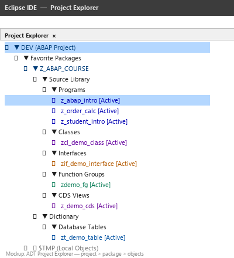

# Lecture 1 — Theory: Introduction to SAP and ABAP

**Module:** M-SAP-WP-1.2 Client-Server Communication with SAP ABAP  
**Programme:** SAP Engineering and Analytics (M.Sc.)  
**Language:** English  
**Audience:** Students with no previous SAP or ABAP experience

> Read this before the exercises. The goal is to understand *what* SAP is, *what* ABAP is, and *why* you are learning it — so that the code you write in the exercises has business context behind it.

---

## Learning Objectives

After this session, you should be able to:

1. Explain at a high level what SAP and ERP systems are.
2. Recognize major SAP business areas such as FI, CO, MM, SD, SCM, and HCM/HR.
3. Explain why organizations may require custom ABAP development.
4. Describe the three-tier architecture of an ABAP system.
5. Explain what ABAP is and where ABAP code executes.
6. Describe the difference between classic on-premise ABAP and SAP BTP ABAP Environment.

---

## 1. What Is an ERP System?

An **Enterprise Resource Planning (ERP)** system integrates business processes and data across an entire organization.

Without an ERP system, each department manages its own data in isolation:

```
Finance     →  spreadsheets
Sales       →  CRM system
Warehouse   →  stock management system
Procurement →  supplier portal
HR          →  payroll system
```

Each system has its own database. When a sale happens, someone manually updates the warehouse system. When stock runs low, someone manually tells procurement. Data is duplicated, delayed, and inconsistent.

**An ERP system replaces these silos with one integrated platform where all departments share the same data in real time.**

---

## 2. A Concrete Example — The Laptop Order

Imagine a company receives an order for **10 laptops**.

That single transaction triggers processes across multiple departments:

| Step | Department | What Happens |
|---|---|---|
| 1 | **Sales** | Customer order is recorded in the system |
| 2 | **Inventory / Logistics** | Stock is checked — are 10 laptops available? |
| 3 | **Procurement** | If stock is short, a purchase order is created automatically |
| 4 | **Warehouse** | Delivery note is generated, goods are picked and packed |
| 5 | **Finance** | Revenue is posted, cost of goods is recorded |
| 6 | **Management / Analytics** | Performance data is updated in real time |

### Key Idea

> A **single business event** affects multiple departments, multiple processes, and multiple data records — all within one integrated system, without manual handoffs.

In a non-integrated environment, each step above would require a human to pass information from one system to another. Errors, delays, and duplicated data are inevitable.

---

## 3. SAP — The Market Leader in ERP

**SAP** (Systems, Applications and Products in Data Processing) is the world's leading ERP software vendor. SAP's flagship ERP product today is **SAP S/4HANA**.

Organizations that run SAP include manufacturers, retailers, banks, utilities, public sector organizations, and logistics companies — essentially any organization large enough to have complex, interconnected business processes.

### SAP Business Modules

During your SAP career you will encounter these abbreviations constantly:

| Module | Full Name | Typical Use |
|---|---|---|
| **FI** | Financial Accounting | General ledger, accounts payable/receivable, asset accounting |
| **CO** | Controlling | Internal cost management, profitability analysis |
| **MM** | Materials Management | Procurement, inventory, goods movements |
| **SD** | Sales and Distribution | Sales orders, deliveries, billing |
| **SCM** | Supply Chain Management | Planning, logistics, transport |
| **SRM** | Supplier Relationship Management | Supplier evaluation, strategic sourcing |
| **HCM / HR** | Human Capital Management | Payroll, organizational management, recruitment |

You do not need to understand these modules in depth now. What matters is that **ABAP developers often work across several of these modules**, writing code that connects Finance to Logistics, or Procurement to HR.

---

## 4. Why Is Custom ABAP Development Needed?

A common question: *If SAP already ships comprehensive standard software, why do companies need to write their own code?*

Every organization has unique processes that the standard software does not cover exactly:

- **Company-specific business rules**: a retailer calculates customer discounts differently from how SAP's standard logic works
- **Custom reports and dashboards**: management wants data presented in a specific format not covered by standard reports
- **System integrations**: SAP must exchange data with a non-SAP system (legacy systems, specialist tools, external partners)
- **Process automation**: custom workflows, approval chains, automatic notifications
- **Extensions of standard functionality**: adding fields, changing default behaviour, adding validations

### Think About It

> Two companies can both run SAP S/4HANA for finance and still need completely different custom code. Why?

---

## 5. What Is ABAP?

**ABAP** (Advanced Business Application Programming) is SAP's programming language. It was created specifically for building business applications on the SAP platform.

ABAP code runs inside an **ABAP Application Server (AS ABAP)** — not on the user's machine.

A useful comparison:

| Language | Where It Runs |
|---|---|
| Python | Python runtime / interpreter |
| Java | Java Virtual Machine (JVM) |
| JavaScript | Browser / Node.js runtime |
| **ABAP** | **ABAP Application Server** |

ABAP is used for:

- Custom business logic and validations
- Database access and data processing
- Custom reports and analytics
- Interfaces and API integrations
- Object-oriented applications (classes, interfaces)
- Extensions of SAP standard functionality

ABAP has been evolving for over 40 years. The language you learn in this module is **modern ABAP** — object-oriented, cloud-ready, and aligned with SAP's current direction.

---

## 6. Three-Tier Architecture

Every SAP system follows a **three-tier architecture**:

```
┌─────────────────────────────────┐
│       CLIENT / PRESENTATION     │  ← User's screen (Eclipse, browser, Fiori app)
└─────────────────┬───────────────┘
                  │ Request
                  ▼
┌─────────────────────────────────┐
│     ABAP APPLICATION SERVER     │  ← ABAP code executes here
└─────────────────┬───────────────┘
                  │ SQL / data request
                  ▼
┌─────────────────────────────────┐
│           DATABASE              │  ← Data lives here (HANA, etc.)
└─────────────────────────────────┘
```

**Each tier has a distinct role:**

| Tier | Role | Examples |
|---|---|---|
| **Client** | User interaction | Eclipse ADT, Fiori browser app, SAP GUI |
| **Application Server** | Business logic | ABAP classes, function modules, BAPIs |
| **Database** | Data persistence | SAP HANA, tables, CDS views |

### Example: Fetching Sales Orders

A user requests: *"Show all sales orders for Customer 1000."*

1. The user clicks in Eclipse (client).
2. The request travels to the Application Server.
3. ABAP code runs on the Application Server — it builds a database query.
4. The database returns the matching records.
5. ABAP processes the records and formats the output.
6. The result is sent back to the client (your Eclipse console).

### The Architectural Question

> **Where is this operation happening — on the Application Server, or in the database?**

This question will become central in Lecture 7 (Performance Tuning). Code that moves work to the wrong tier is one of the most common causes of slow SAP systems.

---

## 7. SAP BTP ABAP Environment — This Course

This course uses **SAP BTP ABAP Environment** (also called "ABAP Cloud" or "Steampunk"). It is SAP's modern cloud platform for ABAP development.

BTP ABAP enforces **clean, cloud-ready practices**. This means some things that exist on older on-premise SAP systems are simply not available here — by design:

| Aspect | Classic ABAP (on-premise) | BTP ABAP Environment (this course) |
|---|---|---|
| Program type | `REPORT` with `WRITE` statements | Classes implementing `if_oo_adt_classrun` |
| Development tool | SE38 / SE80 / SE24 transactions in SAP GUI | Eclipse ADT only |
| Selection screens | Classical `PARAMETERS` / `SELECT-OPTIONS` | Not available |
| Classic ALV | `REUSE_ALV_GRID_DISPLAY` | Not available |
| Database access | All SAP tables | Restricted to released APIs |

**In this course, all code examples are classes.** This is the correct approach for BTP ABAP and is aligned with the direction SAP is taking all new development.

> You may encounter older tutorials or books that show `REPORT` programs with `WRITE` statements. These do not work in BTP ABAP Environment. Always use the class pattern shown in this module.

---

## 8. Eclipse ADT — Your Development Tool

All ABAP development in this course is done in **ADT — ABAP Development Tools for Eclipse**.

Eclipse is an open-source IDE. SAP has extended it with ABAP-specific plugins. **ADT connects directly to the remote SAP system over the network** — you write code in Eclipse on your laptop, but the code runs on the SAP server.

The development structure:

```
Eclipse / ADT (on your laptop)
    │
    └── ABAP Project  (connects to the H01 SAP system over the network)
              │
              └── Package  (groups related objects, like a folder)
                        │
                        ├── ABAP Class
                        ├── Interface
                        ├── CDS View
                        └── ...
```



When you press **F9** in Eclipse, your request travels over the network to the H01 server, the ABAP class runs there, and the output is sent back to your Eclipse console. Nothing executes on your laptop.

### Note on Classic SAP Transactions

On older on-premise SAP systems you may encounter:

- `SE38` — ABAP programs / editor
- `SE80` — Object Navigator
- `SE11` — ABAP Dictionary
- `SE24` — Class Builder

These are **not available on SAP BTP ABAP Environment**. All development in this course is through Eclipse ADT.

---

## 9. Summary — Key Concepts from the Theory

| Concept | What to Remember |
|---|---|
| **ERP** | Integrates business processes and data across an organization |
| **SAP** | World-leading ERP vendor; S/4HANA is the flagship product |
| **ABAP** | SAP's programming language; runs on the Application Server, not the client |
| **Three-tier architecture** | Client → Application Server → Database |
| **SAP BTP ABAP Environment** | Cloud platform for ABAP; enforces class-based, cloud-ready code |
| **Eclipse ADT** | The IDE for BTP ABAP development; connects to the remote system |

---

## Before the Exercises

Make sure you can answer these before starting the exercise file:

1. What problem does an ERP system solve?
2. In the laptop order example, which department is affected by every step?
3. Why might a company need custom ABAP even when SAP covers the standard process?
4. Where does ABAP code execute — on your laptop, the Application Server, or the database?
5. What is the key difference between a classic on-premise ABAP program and a BTP ABAP class?

> **Continue to:** `Lecture_01_Exercises.md`
