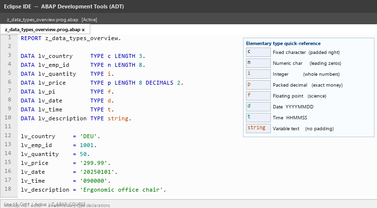
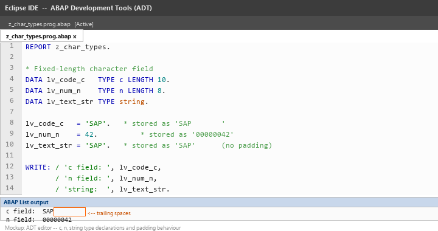
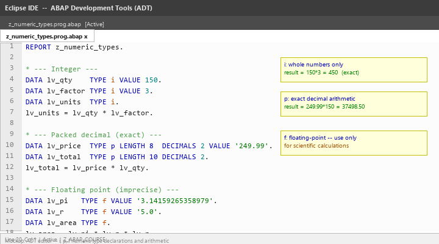
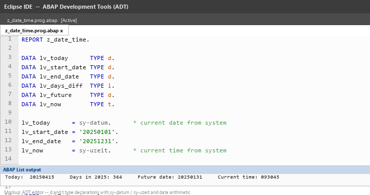
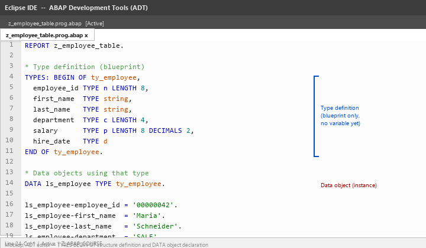
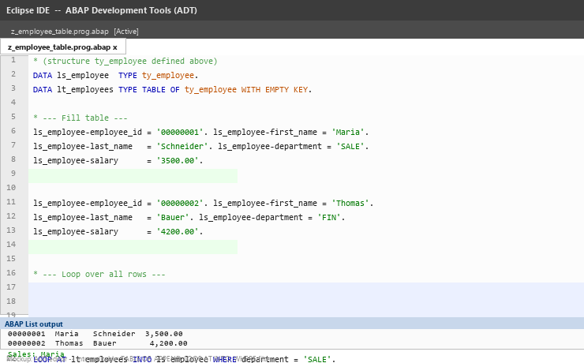
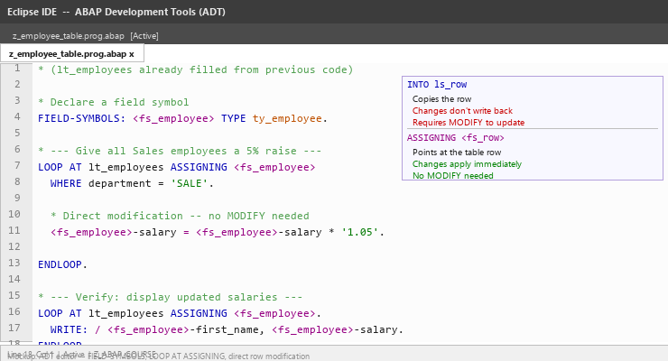
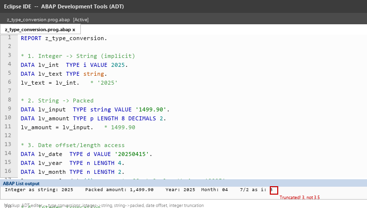

# Lecture 2: ABAP Data Types and Data Objects

**Module:** M-SAP-WP-1.2 Client-Server Communication with SAP ABAP  
**Programme:** SAP Engineering and Analytics (M.Sc.)  
**Language:** English  
**Session duration:** 2 hours  
**Audience:** Students who have completed Lecture 1

---

## 1. Learning Objectives

After this session, you should be able to:

1. Explain the purpose of data types in ABAP and how they differ from data objects.
2. Declare variables using the elementary types `c`, `n`, `i`, `p`, `f`, `d`, `t`, and `string`.
3. Understand the difference between character-like, numeric, and date/time types.
4. Define and use a structure with `TYPES: BEGIN OF ... END OF`.
5. Declare and populate a basic internal table.
6. Perform LOOP AT operations over an internal table.
7. Use field symbols to modify internal table rows directly.
8. Recognise implicit type conversions and understand when they may cause problems.

---

# Part A: The ABAP Type System

## 2. Types vs. Data Objects

In ABAP, it is important to distinguish between two related but different concepts.

| Term | What it is | Example |
|---|---|---|
| **Data type** | A description of the structure and length | `TYPE string`, `TYPE i` |
| **Data object** | An actual variable that holds a value at runtime | `DATA lv_name TYPE string.` |

Think of a data type as a blueprint, and a data object as the actual instance created from that blueprint.

```abap
" Type definition (blueprint)
TYPES ty_product_name TYPE string.

" Data object (actual variable using that type)
DATA lv_product TYPE ty_product_name.
```

This distinction matters because ABAP allows you to define your own named types and reuse them across many variables and structures.

---

## 3. Overview of Elementary Data Types

Elementary types are the building blocks of all ABAP data.

| Type | Category | Default Length | Typical Use |
|---|---|---|---|
| `c` | Character | 1 | Fixed-length text fields, codes |
| `n` | Numeric character | 1 | Numeric strings: IDs, document numbers |
| `i` | Integer | 4 bytes | Whole numbers, counters, quantities |
| `p` | Packed decimal | 8 bytes | Financial amounts, precise decimals |
| `f` | Floating point | 8 bytes | Scientific calculations |
| `d` | Date | 8 chars | Dates stored as YYYYMMDD |
| `t` | Time | 6 chars | Times stored as HHMMSS |
| `string` | Variable string | dynamic | Flexible text, descriptions |
| `xstring` | Variable hex | dynamic | Binary data, file contents |

The image below shows several variables declared with different elementary types in the ADT editor:



> **Key idea:** The type you choose must fit the kind of data you are storing. Using the wrong type leads to data loss, incorrect calculations, or comparison errors.

---

# Part B: Character-like Types

## 4. Type C — Fixed-Length Character

`c` is a fixed-length character field. If you do not specify a length, the default is 1.

```abap
DATA lv_status    TYPE c LENGTH 1.
DATA lv_doc_type  TYPE c LENGTH 4.
DATA lv_country   TYPE c LENGTH 3.

lv_status   = 'A'.
lv_doc_type = 'ZORD'.
lv_country  = 'DE'.
```

Short values assigned to a longer `c` field are **left-justified and padded with spaces** on the right.

```abap
DATA lv_padded TYPE c LENGTH 10.
lv_padded = 'SAP'.
" Result: 'SAP       '  (7 trailing spaces)
```

---

## 5. Type N — Numeric Character

`n` stores **digit characters only** (0–9). It is not an arithmetic type — it is a character field that only accepts digits. The value is right-justified and padded with **leading zeros**.

```abap
DATA lv_employee_id  TYPE n LENGTH 8.
DATA lv_order_number TYPE n LENGTH 10.

lv_employee_id  = 12345.
lv_order_number = '0000987654'.

WRITE: / 'Employee ID:', lv_employee_id.
" Output: Employee ID: 00012345
```

`n` is appropriate for SAP document numbers, employee IDs, and material numbers — values that look numeric but are stored and compared as character strings.

---

## 6. Type STRING — Variable-Length Text

`string` holds text of any length. Unlike `c`, it is not padded with spaces.

```abap
DATA lv_description TYPE string.
DATA lv_full_name   TYPE string.

lv_description = 'High-performance laptop with 16 GB RAM'.
lv_full_name   = 'Maria Schneider'.

WRITE: / lv_full_name, '-', lv_description.
```

### C vs. STRING

| Feature | `c LENGTH n` | `string` |
|---|---|---|
| Length | Fixed at declaration | Dynamic at runtime |
| Trailing spaces | Padded automatically | Not padded |
| Performance | Slightly faster for short fixed values | Better for variable-length text |
| Typical use | Codes, keys, short fields | Descriptions, messages, long text |

The image below shows both `c` and `string` variables declared side by side in the ADT editor, with output demonstrating the trailing-space difference:



---

# Part C: Numeric Types

## 7. Type I — Integer

`i` is a 32-bit signed integer. It stores whole numbers from approximately −2 billion to +2 billion.

```abap
DATA lv_quantity  TYPE i.
DATA lv_count     TYPE i.
DATA lv_result    TYPE i.

lv_quantity = 150.
lv_count    = 3.
lv_result   = lv_quantity * lv_count.

WRITE: / 'Total units:', lv_result.
" Output: Total units: 450
```

Use `i` for counts, quantities, loop counters, and anything that is always a whole number.

---

## 8. Type P — Packed Decimal

`p` stores numbers with an exact decimal representation using BCD (Binary Coded Decimal) encoding. This makes it suitable for financial amounts where floating-point rounding errors are unacceptable.

```abap
DATA lv_unit_price  TYPE p LENGTH 8  DECIMALS 2.
DATA lv_quantity    TYPE i.
DATA lv_total_value TYPE p LENGTH 10 DECIMALS 2.

lv_unit_price = '249.99'.
lv_quantity   = 7.
lv_total_value = lv_unit_price * lv_quantity.

WRITE: / 'Unit price: ', lv_unit_price,
       / 'Quantity:   ', lv_quantity,
       / 'Total:      ', lv_total_value.
```

### LENGTH and DECIMALS

- `LENGTH` defines the byte length of the stored value (max 16 bytes, up to 31 significant digits).
- `DECIMALS` defines how many of those digits appear after the decimal point.

```abap
" 8 bytes, 2 decimal places — suitable for monetary amounts
DATA lv_price  TYPE p LENGTH 8  DECIMALS 2.

" 10 bytes, 4 decimal places — suitable for exchange rates
DATA lv_rate   TYPE p LENGTH 10 DECIMALS 4.
```

---

## 9. Type F — Floating Point

`f` is an 8-byte IEEE 754 double. It is suitable for scientific calculations but **not** for financial amounts because it cannot represent all decimal fractions exactly.

```abap
DATA lv_pi     TYPE f VALUE '3.14159265358979'.
DATA lv_radius TYPE f VALUE '5.0'.
DATA lv_area   TYPE f.

lv_area = lv_pi * lv_radius * lv_radius.
WRITE: / 'Circle area:', lv_area.
```

> **Rule of thumb:** Use `p` for money and business amounts. Use `f` only when the calculation genuinely requires floating-point range (e.g. physics, statistics).

The image below shows `i`, `p`, and `f` variable declarations in the ADT editor with a short calculation program:



---

# Part D: Date and Time Types

## 10. Type D — Date

`d` stores dates as an 8-character field in the format `YYYYMMDD`.

```abap
DATA lv_today      TYPE d.
DATA lv_start_date TYPE d.
DATA lv_end_date   TYPE d.

lv_today      = sy-datum.      " System date
lv_start_date = '20250101'.
lv_end_date   = '20251231'.
```

`sy-datum` is a system field that always holds the current date.

### Date Arithmetic

Because `d` is internally stored as a character string that sorts correctly, ABAP allows direct arithmetic:

```abap
DATA lv_days_diff TYPE i.
DATA lv_future    TYPE d.

lv_days_diff = lv_end_date - lv_start_date.   " Number of days between dates
lv_future    = lv_start_date + 30.            " 30 days after start

WRITE: / 'Days in period:', lv_days_diff,
       / '30 days later: ', lv_future.
```

---

## 11. Type T — Time

`t` stores time as a 6-character field in the format `HHMMSS`.

```abap
DATA lv_now        TYPE t.
DATA lv_start_time TYPE t.

lv_now        = sy-uzeit.   " System time
lv_start_time = '083000'.   " 08:30:00

WRITE: / 'Current time:', lv_now.
```

`sy-uzeit` is the system field for the current time.

The image below shows `d` and `t` variables in use alongside the system fields `sy-datum` and `sy-uzeit`:



---

# Part E: Structures

## 12. What Is a Structure?

A **structure** groups several fields under one named type. It is the ABAP equivalent of a struct in C or a record in other languages.

```abap
TYPES: BEGIN OF ty_employee,
  employee_id TYPE n LENGTH 8,
  first_name  TYPE string,
  last_name   TYPE string,
  department  TYPE c LENGTH 4,
  salary      TYPE p LENGTH 8 DECIMALS 2,
  hire_date   TYPE d,
END OF ty_employee.
```

This defines a **type** called `ty_employee`. No variable exists yet.

Now declare a **data object** of that type:

```abap
DATA ls_employee TYPE ty_employee.
```

Access the fields with the `-` component selector:

```abap
ls_employee-employee_id = '00000042'.
ls_employee-first_name  = 'Maria'.
ls_employee-last_name   = 'Schneider'.
ls_employee-department  = 'SALE'.
ls_employee-salary      = '3500.00'.
ls_employee-hire_date   = '20230901'.

WRITE: / 'Employee:', ls_employee-first_name, ls_employee-last_name,
       / 'Dept:',     ls_employee-department,
       / 'Salary:',   ls_employee-salary.
```

### Naming Convention Reminder

The prefix `ty_` marks a **type definition**. The prefix `ls_` marks a **local structure** variable.

The image below shows a full structure type definition and a data object declaration in the ADT editor:



---

# Part F: Internal Tables

## 13. What Is an Internal Table?

An **internal table** is a dynamic list of rows, where each row has the same structure. Internal tables exist only at runtime — they are ABAP's primary way to hold sets of records in memory.

Think of an internal table as a spreadsheet held in memory: it has columns (defined by a structure) and any number of rows.

```abap
DATA lt_employees TYPE TABLE OF ty_employee WITH EMPTY KEY.
```

`lt_` is the naming convention prefix for a **local table**.

---

## 14. Adding Rows — APPEND

```abap
DATA ls_employee TYPE ty_employee.
DATA lt_employees TYPE TABLE OF ty_employee WITH EMPTY KEY.

" Fill a work structure, then append it
ls_employee-employee_id = '00000001'.
ls_employee-first_name  = 'Maria'.
ls_employee-last_name   = 'Schneider'.
ls_employee-department  = 'SALE'.
ls_employee-salary      = '3500.00'.
ls_employee-hire_date   = '20230901'.
APPEND ls_employee TO lt_employees.

ls_employee-employee_id = '00000002'.
ls_employee-first_name  = 'Thomas'.
ls_employee-last_name   = 'Bauer'.
ls_employee-department  = 'FIN'.
ls_employee-salary      = '4200.00'.
ls_employee-hire_date   = '20210615'.
APPEND ls_employee TO lt_employees.
```

---

## 15. Reading Rows — LOOP AT

`LOOP AT ... INTO` iterates over every row, copying each row into a work structure:

```abap
LOOP AT lt_employees INTO ls_employee.
  WRITE: / ls_employee-employee_id,
           ls_employee-first_name,
           ls_employee-last_name,
           ls_employee-salary.
ENDLOOP.
```

### Filtering with WHERE

```abap
LOOP AT lt_employees INTO ls_employee WHERE department = 'SALE'.
  WRITE: / 'Sales employee:', ls_employee-first_name.
ENDLOOP.
```

### SORT and DELETE

```abap
SORT lt_employees BY last_name.

DELETE lt_employees WHERE department = 'FIN'.
```

The image below shows an internal table declaration, APPEND statements, and a LOOP AT in the ADT editor:



---

# Part G: Field Symbols

## 16. What Is a Field Symbol?

A **field symbol** is similar to a pointer or reference. Instead of copying a row into a work structure, a field symbol points directly at the row inside the table. This means:

- Changes through the field symbol modify the table row **immediately**.
- No copy is made — useful for large data volumes.

```abap
FIELD-SYMBOLS: <fs_employee> TYPE ty_employee.

LOOP AT lt_employees ASSIGNING <fs_employee>.
  " Modify the row directly — no separate MODIFY statement needed
  <fs_employee>-salary = <fs_employee>-salary * '1.05'.
ENDLOOP.
```

The `<angle-bracket>` syntax is the ABAP convention for field symbols.

### INTO vs. ASSIGNING

| `LOOP AT ... INTO ls_row` | `LOOP AT ... ASSIGNING <fs_row>` |
|---|---|
| Copies the row into `ls_row` | Points `<fs_row>` at the table row |
| Changes to `ls_row` require `MODIFY` to write back | Changes apply to the table immediately |
| Safe — original is unaffected until MODIFY | Direct — always modifies the original |
| Beginner-friendly | Preferred for modifications, better performance |

```abap
" Give every Sales employee a 5% salary increase
LOOP AT lt_employees ASSIGNING <fs_employee>
  WHERE department = 'SALE'.
  <fs_employee>-salary = <fs_employee>-salary * '1.05'.
ENDLOOP.
```

The image below shows the field symbol declaration and ASSIGNING loop pattern in the ADT editor:



---

# Part H: Type Conversions and Casting

## 17. Implicit Type Conversion

ABAP often converts between compatible types automatically.

```abap
DATA lv_number TYPE i VALUE 42.
DATA lv_text   TYPE string.

lv_text = lv_number.   " Integer -> String: '42'
WRITE lv_text.
```

```abap
DATA lv_price_text TYPE string VALUE '199.99'.
DATA lv_price      TYPE p LENGTH 8 DECIMALS 2.

lv_price = lv_price_text.   " String -> Packed: 199.99
WRITE lv_price.
```

These conversions follow strict ABAP rules. When the conversion is not possible, a **runtime error (dump)** occurs.

---

## 18. Conversion Traps

### Integer Truncation

```abap
DATA lv_result TYPE i.
lv_result = 7 / 2.   " Result: 3  (not 3.5)
WRITE lv_result.
```

When dividing integers, the decimal part is **truncated**, not rounded. This was the bonus question from Lecture 1.

### String to Number

```abap
DATA lv_input  TYPE string VALUE 'ABC'.
DATA lv_number TYPE i.

" lv_number = lv_input.   " Runtime error: CONVT_NO_NUMBER
```

If the string does not contain a valid number, ABAP raises a runtime dump.

### Date Conversions

```abap
DATA lv_date  TYPE d VALUE '20250115'.
DATA lv_year  TYPE n LENGTH 4.
DATA lv_month TYPE n LENGTH 2.
DATA lv_day   TYPE n LENGTH 2.

lv_year  = lv_date(4).    " First 4 characters: '2025'
lv_month = lv_date+4(2).  " Characters 5-6:     '01'
lv_day   = lv_date+6(2).  " Characters 7-8:     '15'

WRITE: / 'Year:', lv_year, 'Month:', lv_month, 'Day:', lv_day.
```

The syntax `variable+offset(length)` is called **offset/length access** and works on any character-like type.

---

## 19. Explicit Casting with CAST

In modern ABAP (object-oriented context), `CAST` converts object references between types:

```abap
DATA lo_object TYPE REF TO object.
DATA lo_vehicle TYPE REF TO zcl_vehicle.

" Downcast — will fail at runtime if the object is not actually a vehicle
lo_vehicle = CAST zcl_vehicle( lo_object ).
```

We will explore `CAST` in more depth when we reach object-oriented ABAP. For now, understand that explicit casting is used when you need to treat a general reference as a more specific type.

The image below shows a type conversion program in the ADT editor — integer truncation, string-to-number, and date offset access:



---

# Part I: Hands-On Exercises

## 20. Exercise 1: Declare and Display All Elementary Types

Create a program that declares one variable for each of the following types and assigns a meaningful value:

- `c LENGTH 3` — a country code
- `n LENGTH 8` — an employee ID
- `i` — a quantity
- `p LENGTH 8 DECIMALS 2` — a unit price
- `d` — a date
- `t` — a time
- `string` — a product description

Display all variables with appropriate labels.

### Suggested start:

```abap
REPORT z_data_types_overview.

DATA lv_country     TYPE c LENGTH 3.
DATA lv_emp_id      TYPE n LENGTH 8.
DATA lv_quantity    TYPE i.
DATA lv_price       TYPE p LENGTH 8 DECIMALS 2.
DATA lv_date        TYPE d.
DATA lv_time        TYPE t.
DATA lv_description TYPE string.

lv_country     = 'DEU'.
lv_emp_id      = 1001.
lv_quantity    = 50.
lv_price       = '299.99'.
lv_date        = '20250101'.
lv_time        = '090000'.
lv_description = 'Ergonomic office chair'.

WRITE: / 'Country:    ', lv_country,
       / 'Employee ID:', lv_emp_id,
       / 'Quantity:   ', lv_quantity,
       / 'Price:      ', lv_price,
       / 'Date:       ', lv_date,
       / 'Time:       ', lv_time,
       / 'Description:', lv_description.
```

### Questions

1. What output do you see for `lv_emp_id = 1001`? Why?
2. What happens if you assign `lv_emp_id = 'ABCD'`?

---

## 21. Exercise 2: Employee Table Simulation

### Objective

Create a structure for an employee, build a small internal table, and display its contents.

```abap
REPORT z_employee_table.

TYPES: BEGIN OF ty_employee,
  employee_id TYPE n LENGTH 8,
  first_name  TYPE string,
  last_name   TYPE string,
  department  TYPE c LENGTH 4,
  salary      TYPE p LENGTH 8 DECIMALS 2,
  hire_date   TYPE d,
END OF ty_employee.

DATA ls_employee  TYPE ty_employee.
DATA lt_employees TYPE TABLE OF ty_employee WITH EMPTY KEY.

" Employee 1
ls_employee-employee_id = '00000001'.
ls_employee-first_name  = 'Maria'.
ls_employee-last_name   = 'Schneider'.
ls_employee-department  = 'SALE'.
ls_employee-salary      = '3500.00'.
ls_employee-hire_date   = '20230901'.
APPEND ls_employee TO lt_employees.

" Employee 2
ls_employee-employee_id = '00000002'.
ls_employee-first_name  = 'Thomas'.
ls_employee-last_name   = 'Bauer'.
ls_employee-department  = 'FIN'.
ls_employee-salary      = '4200.00'.
ls_employee-hire_date   = '20210615'.
APPEND ls_employee TO lt_employees.

" Employee 3
ls_employee-employee_id = '00000003'.
ls_employee-first_name  = 'Aiko'.
ls_employee-last_name   = 'Tanaka'.
ls_employee-department  = 'SALE'.
ls_employee-salary      = '3800.00'.
ls_employee-hire_date   = '20220301'.
APPEND ls_employee TO lt_employees.

" Display all employees
WRITE: / '--- All Employees ---'.
LOOP AT lt_employees INTO ls_employee.
  WRITE: / ls_employee-employee_id,
           ls_employee-first_name,
           ls_employee-last_name,
           ls_employee-department,
           ls_employee-salary.
ENDLOOP.

" Display Sales employees only
WRITE: / '--- Sales Department ---'.
LOOP AT lt_employees INTO ls_employee WHERE department = 'SALE'.
  WRITE: / ls_employee-first_name, ls_employee-last_name.
ENDLOOP.
```

### Questions

1. How many rows does `lt_employees` contain after the three APPENDs?
2. Which employees appear in the second LOOP?
3. What happens if you add `SORT lt_employees BY last_name.` before the first LOOP?

---

## 22. Exercise 3: Internal Table Operations

Extend the employee table program from Exercise 2:

1. After building the table, give every Sales employee a **5% salary increase** using a field symbol loop.
2. Display the table again after the increase.
3. Sort the table by `salary` descending before the final display.

### Hint for step 1:

```abap
FIELD-SYMBOLS: <fs_employee> TYPE ty_employee.

LOOP AT lt_employees ASSIGNING <fs_employee>
  WHERE department = 'SALE'.
  <fs_employee>-salary = <fs_employee>-salary * '1.05'.
ENDLOOP.
```

### Questions

1. Why is `ASSIGNING <fs_employee>` used instead of `INTO ls_employee` here?
2. What statement is **not** needed when using `ASSIGNING`?

---

## 23. Exercise 4: Data Conversion Examples

Create a program that demonstrates each of the following:

1. Assign an integer to a string variable and display it.
2. Assign a string containing a number to a packed decimal variable.
3. Extract the year, month, and day from a date variable using offset/length access.
4. Demonstrate integer truncation by dividing two integers.

### Example solution:

```abap
REPORT z_type_conversion.

DATA lv_int     TYPE i     VALUE 2025.
DATA lv_text    TYPE string.
DATA lv_amount  TYPE p LENGTH 8 DECIMALS 2.
DATA lv_input   TYPE string VALUE '1499.90'.
DATA lv_date    TYPE d VALUE '20250401'.
DATA lv_year    TYPE n LENGTH 4.
DATA lv_month   TYPE n LENGTH 2.
DATA lv_result  TYPE i.

" 1. Integer to string
lv_text = lv_int.
WRITE: / 'Integer as string:', lv_text.

" 2. String to packed decimal
lv_amount = lv_input.
WRITE: / 'Packed amount:', lv_amount.

" 3. Date parts via offset access
lv_year  = lv_date(4).
lv_month = lv_date+4(2).
WRITE: / 'Year:', lv_year, '  Month:', lv_month.

" 4. Integer truncation
lv_result = 7 / 2.
WRITE: / '7 / 2 as integer:', lv_result.
```

---

# Part J: Independent Challenge

## 24. Payroll Calculation

Do this exercise independently before looking for example solutions.

### Create a structure for an employee record containing:

- Employee ID (`n LENGTH 8`)
- Full name (`string`)
- Department (`c LENGTH 4`)
- Monthly base salary (`p LENGTH 8 DECIMALS 2`)
- Bonus percentage (`p LENGTH 5 DECIMALS 2`)
- Employment start date (`d`)

### Build an internal table with at least four employees from at least two departments.

### Calculate and display:

- Each employee's annual gross salary (monthly × 12)
- Each employee's bonus amount (salary × bonus percentage / 100)
- Total payroll cost across all employees
- Number of employees per department

### Bonus question

What is the difference between these two loops, and which is more appropriate here?

```abap
" Loop A
LOOP AT lt_employees INTO ls_employee.
  ls_employee-salary = ls_employee-salary * 2.
ENDLOOP.

" Loop B
LOOP AT lt_employees ASSIGNING <fs_employee>.
  <fs_employee>-salary = <fs_employee>-salary * 2.
ENDLOOP.
```

---

# Part K: Common Beginner Mistakes

## 25. Choosing `i` for a Monetary Amount

Incorrect:

```abap
DATA lv_price TYPE i.
lv_price = '19.99'.   " Stored as 19 — decimal part lost
```

Correct:

```abap
DATA lv_price TYPE p LENGTH 8 DECIMALS 2.
lv_price = '19.99'.
```

---

## 26. Using `c` Where `n` Is More Appropriate

Document numbers and IDs that consist entirely of digits should use `n`, not `c`, because `n` enforces digit-only content, pads with leading zeros, and sorts correctly.

Incorrect:

```abap
DATA lv_order_id TYPE c LENGTH 10.
lv_order_id = '42'.   " Stored as '42        ' — trailing spaces
```

Correct:

```abap
DATA lv_order_id TYPE n LENGTH 10.
lv_order_id = 42.   " Stored as '0000000042' — leading zeros
```

---

## 27. Forgetting APPEND

A common mistake is filling the work structure but never appending it to the table:

Incorrect:

```abap
ls_employee-first_name = 'Maria'.
ls_employee-salary     = '3500.00'.
" APPEND ls_employee TO lt_employees.   <- forgotten!
LOOP AT lt_employees INTO ls_employee.
  WRITE: / ls_employee-first_name.    " Nothing is displayed
ENDLOOP.
```

Always check `lines( lt_employees )` during testing to confirm rows were added.

---

## 28. Modifying Rows with INTO Instead of ASSIGNING

Incorrect (row is changed but the table is not updated):

```abap
LOOP AT lt_employees INTO ls_employee.
  ls_employee-salary = ls_employee-salary * '1.05'.
  " Missing: MODIFY lt_employees FROM ls_employee.
ENDLOOP.
```

Correct option 1 — add MODIFY:

```abap
LOOP AT lt_employees INTO ls_employee.
  ls_employee-salary = ls_employee-salary * '1.05'.
  MODIFY lt_employees FROM ls_employee.
ENDLOOP.
```

Correct option 2 — use ASSIGNING instead:

```abap
LOOP AT lt_employees ASSIGNING <fs_employee>.
  <fs_employee>-salary = <fs_employee>-salary * '1.05'.
ENDLOOP.
```

---

# Part L: Knowledge Check

## 29. Data Types

You should be able to answer:

1. What is the difference between a data type and a data object?
2. Which type would you use for a monetary amount requiring two decimal places?
3. Which type stores digits as character values with leading zeros?
4. What format does `d` use to store dates?
5. What is the difference between `c` and `string`?
6. What does `sy-datum` contain?

## 30. Structures and Internal Tables

7. What keyword introduces a structure type definition?
8. How do you access the field `salary` of a structure variable `ls_employee`?
9. What does `APPEND ls_employee TO lt_employees` do?
10. What does `LOOP AT lt_employees INTO ls_employee` do?
11. How do you loop over only the employees in department `'SALE'`?
12. What does `SORT lt_employees BY salary` do?

## 31. Field Symbols and Conversions

13. What is the naming convention for field symbols?
14. What is the difference between `INTO ls_row` and `ASSIGNING <fs_row>`?
15. What happens when you divide two `i` variables and the result is not a whole number?
16. What runtime error occurs when you assign a non-numeric string to an `i` variable?

---

# Part M: Preparation for Lecture 3

## 32. Before the Next Session

Make sure you can independently write a program that:

1. Defines a structure with at least four fields of different types.
2. Creates an internal table of that structure type.
3. Appends at least three rows.
4. Loops over all rows and displays the fields.
5. Uses a field symbol loop to modify one numeric field in every row.

You do not need to use READ TABLE or secondary table keys yet.

That is where Lecture 3 begins.

---

# Next Lecture

## Lecture 3: Control Structures and Modularisation

We will cover:

- Conditional processing: `IF`, `ELSEIF`, `ELSE`, `CASE`
- Loop control: `DO`, `WHILE`, `CHECK`, `EXIT`, `CONTINUE`
- Subroutines (FORM/ENDFORM) — legacy context
- Function modules — structure and calling conventions
- Methods and the basics of ABAP OO
- Local classes in a report
- Error handling basics

---

# Suggested References

For technical reference during the module, students should use SAP's official ABAP documentation and the reading list provided in the module description.

**Mandatory reading from the module handbook:**

- Horst Keller, *ABAP Objects: Introduction to Programming SAP Applications*, 4th Edition, SAP PRESS, 2020.  
  Chapters 4–5 cover data types and internal tables in depth.

**Further reading:**

- Paul Hardy, *ABAP to the Future*, 3rd Edition, SAP PRESS, 2019.  
  Chapter 3 covers modern ABAP data declarations.
- Thomas Schneider, *Getting Started with ABAP: Beginner's Guide to SAP ABAP*, SAP PRESS, 2016.  
  Chapters 3–4 cover elementary types and structures with worked examples.

---

## Session Summary

After Lecture 2, the most important ideas to remember are:

1. ABAP has a rich set of elementary types — choose the one that matches your data: `p` for money, `n` for IDs, `d` for dates, `string` for variable text.
2. A structure groups fields into a named record type. A data object of that structure type holds actual values.
3. An internal table is a runtime list of rows. `APPEND` adds rows; `LOOP AT ... INTO` reads them; `LOOP AT ... ASSIGNING` reads and modifies them in place.
4. Field symbols point directly at table rows — no copy, direct modification.
5. Implicit type conversion is convenient but dangerous: integer division truncates, and assigning a non-numeric string to a number variable causes a runtime dump.

**Next step:** In Lecture 3 we add the ability to make decisions and repeat actions — the control structures that turn a sequence of statements into real program logic.
