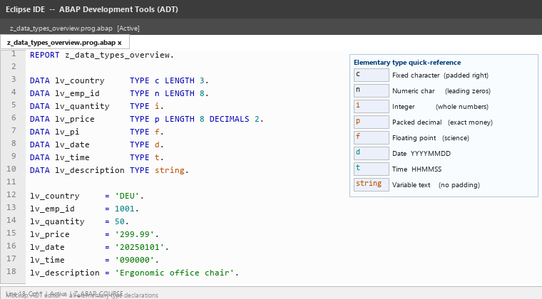
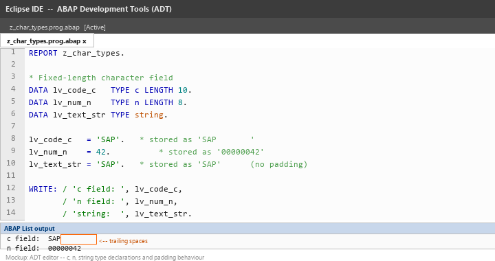
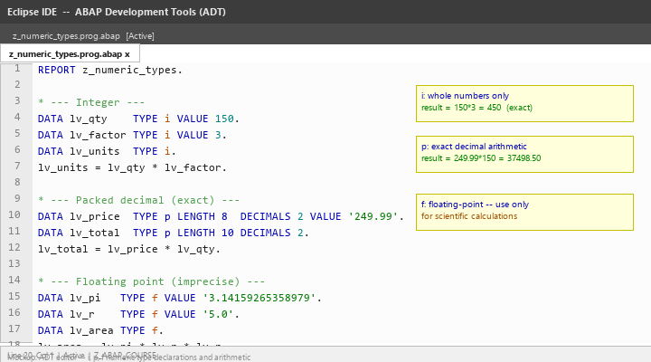
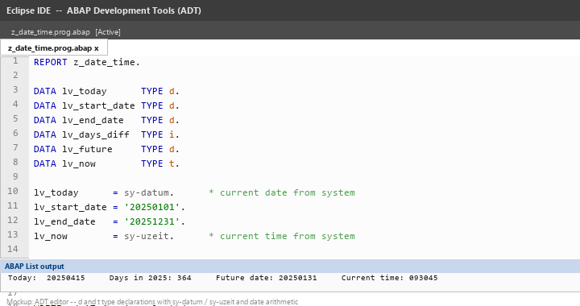
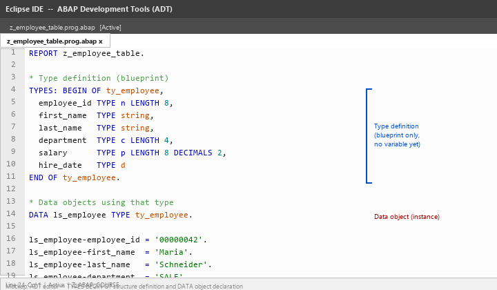
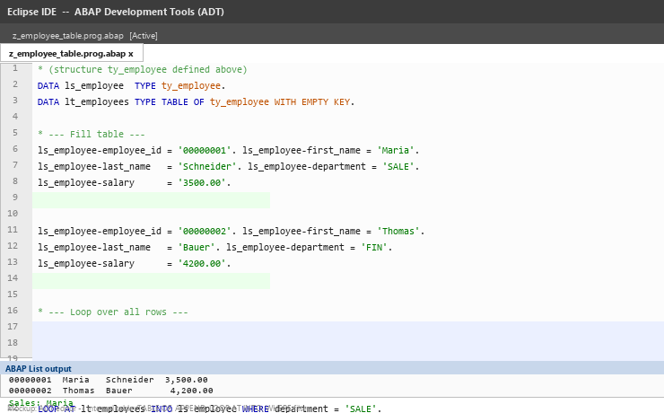
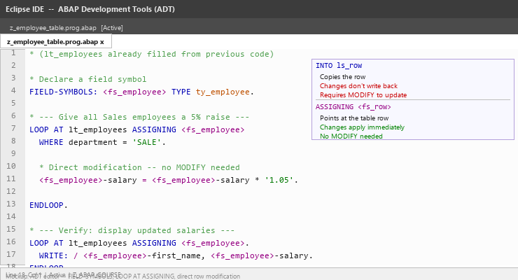
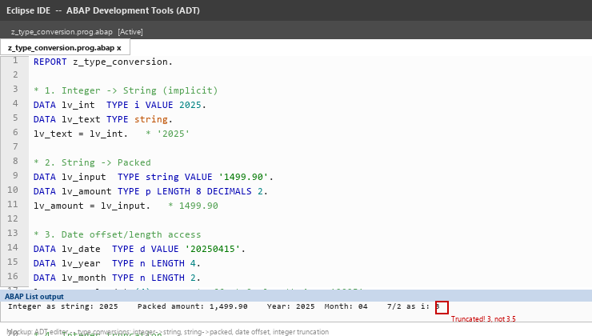

# Lecture 2 — Theory: ABAP Data Types and Data Objects

**Module:** M-SAP-WP-1.2 Client-Server Communication with SAP ABAP  
**Programme:** SAP Engineering and Analytics (M.Sc.)  
**Prerequisite:** Lecture 1 — Introduction to SAP and ABAP

> Read this before the exercises. The goal is to understand the ABAP type system, how data is structured and grouped, and what happens when types are converted — so that when you write code in the exercises you understand what the declarations actually mean.

---

## Learning Objectives

After this session, you should be able to:

1. Explain the difference between a data type and a data object.
2. Declare variables using the elementary types `c`, `n`, `i`, `p`, `f`, `d`, `t`, and `string`.
3. Understand the difference between character-like, numeric, and date/time types.
4. Define and use a structure with `TYPES: BEGIN OF ... END OF`.
5. Declare and populate a basic internal table.
6. Perform `LOOP AT` operations over an internal table.
7. Use field symbols to modify internal table rows directly.
8. Recognise implicit type conversions and understand when they cause problems.

---

## 1. Types vs. Data Objects

In ABAP, it is important to distinguish between two related but different concepts:

| Term | What It Is | Example |
|---|---|---|
| **Data type** | A description of structure and length — a blueprint | `TYPE string`, `TYPE i` |
| **Data object** | An actual variable that holds a value at runtime | `DATA lv_name TYPE string.` |

Think of a data type as a cookie cutter and a data object as the cookie made from it.

```abap
" Type definition — blueprint only, no memory allocated
TYPES ty_product_name TYPE string.

" Data object — actual variable created from that blueprint
DATA lv_product TYPE ty_product_name.
```

This distinction matters because ABAP allows you to define your own named types and reuse them across many variables and structures. This is especially useful once you start defining structures (section 6).

---

## 2. Overview of Elementary Data Types

Elementary types are the building blocks of all ABAP data. Every variable ultimately has one of these at its core.

| Type | Category | Storage | Typical Use |
|---|---|---|---|
| `c` | Character | Fixed length (default 1) | Codes, keys, short text fields |
| `n` | Numeric character | Fixed length (default 1) | Document numbers, employee IDs |
| `i` | Integer | 4 bytes | Quantities, counts, whole numbers |
| `p` | Packed decimal | Up to 16 bytes | Financial amounts, precise decimals |
| `f` | Floating point | 8 bytes | Scientific calculations |
| `d` | Date | 8 characters | Dates stored as `YYYYMMDD` |
| `t` | Time | 6 characters | Times stored as `HHMMSS` |
| `string` | Variable string | Dynamic | Descriptions, messages, long text |
| `xstring` | Variable hex | Dynamic | Binary data, file contents |



> **Key principle:** Choose the type that matches the nature of the data. Using the wrong type leads to data loss, incorrect calculations, or comparison errors.

---

## Part A: Character-Like Types

## 3. Type C — Fixed-Length Character

`c` is a fixed-length character field. You must specify the length; the default if omitted is 1.

```abap
DATA lv_status   TYPE c LENGTH 1.
DATA lv_doc_type TYPE c LENGTH 4.
DATA lv_country  TYPE c LENGTH 3.

lv_status   = 'A'.
lv_doc_type = 'ZORD'.
lv_country  = 'DE'.
```

If you assign a value **shorter** than the declared length, the field is **left-justified and padded with spaces** on the right:

```abap
DATA lv_padded TYPE c LENGTH 10.
lv_padded = 'SAP'.
" Stored as: 'SAP       '  (7 trailing spaces)
```

This trailing-space behaviour has practical consequences when comparing `c` fields — two fields that look the same may compare differently if one has trailing spaces.

---

## 4. Type N — Numeric Character

`n` stores **digit characters only** (0–9). It looks like a number but is not an arithmetic type — it is a character field that only accepts digits. Values are **right-justified and padded with leading zeros**.

```abap
DATA lv_employee_id  TYPE n LENGTH 8.
DATA lv_order_number TYPE n LENGTH 10.

lv_employee_id  = 12345.
lv_order_number = '0000987654'.

" lv_employee_id contains: '00012345'
" lv_order_number contains: '0000987654'
```

`n` is the correct type for SAP document numbers, employee IDs, and material numbers — values that look numeric but need leading zeros and are compared as character strings, not as numbers.

### Why not just use `i`?

An `i` variable holding `12345` and an `n LENGTH 8` variable holding `'00012345'` may look similar, but:
- `i` cannot represent leading zeros
- `i` cannot be directly used in string comparisons the way SAP document numbers are
- `n` enforces that only digits 0–9 are stored

---

## 5. Type STRING — Variable-Length Text

`string` holds text of any length. Unlike `c`, it is **not padded with spaces** and its memory size adjusts to the actual content.

```abap
DATA lv_description TYPE string.
DATA lv_full_name   TYPE string.

lv_description = 'High-performance laptop with 16 GB RAM'.
lv_full_name   = 'Maria Schneider'.
```

### C vs. STRING — When to Use Which

| Feature | `c LENGTH n` | `string` |
|---|---|---|
| Length | Fixed at declaration | Dynamic at runtime |
| Trailing spaces | Padded automatically | Not padded |
| Typical use | Short codes, keys, fixed-format fields | Descriptions, messages, variable-length text |



---

## Part B: Numeric Types

## 6. Type I — Integer

`i` is a 32-bit signed integer. It stores whole numbers from approximately −2 billion to +2 billion.

```abap
DATA lv_quantity TYPE i.
DATA lv_count    TYPE i.
DATA lv_result   TYPE i.

lv_quantity = 150.
lv_count    = 3.
lv_result   = lv_quantity * lv_count.   " 450
```

Use `i` for quantities, counters, loop counts, and anything that is always a whole number with no decimal part.

---

## 7. Type P — Packed Decimal

`p` stores numbers with **exact decimal precision** using BCD (Binary Coded Decimal) encoding. This makes it the correct type for financial amounts, where floating-point rounding errors are unacceptable.

```abap
DATA lv_unit_price  TYPE p LENGTH 8  DECIMALS 2.
DATA lv_total_value TYPE p LENGTH 10 DECIMALS 2.

lv_unit_price  = '249.99'.
lv_total_value = lv_unit_price * 7.   " 1749.93 — exact
```

### LENGTH and DECIMALS

- `LENGTH` defines the byte length of the stored value (1–16 bytes, up to 31 significant digits).
- `DECIMALS` defines how many digits appear after the decimal point.

```abap
" Monetary amounts — 2 decimal places
DATA lv_price    TYPE p LENGTH 8  DECIMALS 2.

" Exchange rates — 4 decimal places
DATA lv_fx_rate  TYPE p LENGTH 10 DECIMALS 4.

" Percentages — 2 decimal places
DATA lv_discount TYPE p LENGTH 5  DECIMALS 2.
```

---

## 8. Type F — Floating Point

`f` is an 8-byte IEEE 754 double. It covers a very wide numeric range but **cannot represent all decimal fractions exactly**.

```abap
DATA lv_pi   TYPE f VALUE '3.14159265358979'.
DATA lv_area TYPE f.

lv_area = lv_pi * 5 * 5.   " Approximately 78.539...
```

> **Rule:** Use `p` for money and business amounts where exact decimal representation matters. Use `f` only for scientific or statistical calculations that need floating-point range.



---

## Part C: Date and Time Types

## 9. Type D — Date

`d` stores dates as an 8-character field in the format **`YYYYMMDD`**.

```abap
DATA lv_today      TYPE d.
DATA lv_start_date TYPE d.
DATA lv_end_date   TYPE d.

lv_today      = sy-datum.       " System field: today's date
lv_start_date = '20250101'.
lv_end_date   = '20251231'.
```

`sy-datum` is a **system field** always containing the current date.

### Date Arithmetic

Because `d` values sort correctly as strings, ABAP supports direct arithmetic:

```abap
DATA lv_days_diff TYPE i.
DATA lv_future    TYPE d.

lv_days_diff = lv_end_date - lv_start_date.   " Number of days between dates
lv_future    = lv_start_date + 30.            " 30 days after start date
```

This makes date range calculations straightforward — no libraries or helpers needed.

---

## 10. Type T — Time

`t` stores time as a 6-character field in the format **`HHMMSS`**.

```abap
DATA lv_now        TYPE t.
DATA lv_start_time TYPE t.

lv_now        = sy-uzeit.   " System field: current time
lv_start_time = '083000'.   " 08:30:00
```

`sy-uzeit` is the system field containing the current time.



---

## Part D: Structures

## 11. What Is a Structure?

A **structure** groups several related fields under one named type — it is ABAP's equivalent of a record, struct, or row type.

```abap
TYPES: BEGIN OF ty_employee,
  employee_id TYPE n LENGTH 8,
  first_name  TYPE string,
  last_name   TYPE string,
  department  TYPE c LENGTH 4,
  salary      TYPE p LENGTH 8 DECIMALS 2,
  hire_date   TYPE d,
END OF ty_employee.
```

This defines the **type** `ty_employee`. No variable exists yet — this is only the blueprint.

Now declare a **data object** of that type:

```abap
DATA ls_employee TYPE ty_employee.
```

Access individual fields using the **`-` component selector**:

```abap
ls_employee-employee_id = '00000042'.
ls_employee-first_name  = 'Maria'.
ls_employee-last_name   = 'Schneider'.
ls_employee-department  = 'SALE'.
ls_employee-salary      = '3500.00'.
ls_employee-hire_date   = '20230901'.
```

### Naming Convention

| Prefix | Meaning |
|---|---|
| `ty_` | Type definition (blueprint) |
| `ls_` | Local structure (data object) |



---

## Part E: Internal Tables

## 12. What Is an Internal Table?

An **internal table** is a dynamic list of rows where every row has the same structure. It exists only at runtime in memory — it is ABAP's primary way to hold a set of records before processing or displaying them.

Think of it as a spreadsheet held in memory: the columns are defined by a structure type, and you can add any number of rows.

```abap
DATA lt_employees TYPE TABLE OF ty_employee WITH EMPTY KEY.
```

`lt_` is the naming prefix for a **local table**.

---

## 13. Adding Rows — APPEND

Fill a work structure, then append it to the table:

```abap
DATA ls_employee  TYPE ty_employee.
DATA lt_employees TYPE TABLE OF ty_employee WITH EMPTY KEY.

ls_employee-employee_id = '00000001'.
ls_employee-first_name  = 'Maria'.
ls_employee-last_name   = 'Schneider'.
ls_employee-department  = 'SALE'.
ls_employee-salary      = '3500.00'.
ls_employee-hire_date   = '20230901'.
APPEND ls_employee TO lt_employees.   " Row 1 added

ls_employee-employee_id = '00000002'.
ls_employee-first_name  = 'Thomas'.
ls_employee-last_name   = 'Bauer'.
ls_employee-department  = 'FIN'.
ls_employee-salary      = '4200.00'.
ls_employee-hire_date   = '20210615'.
APPEND ls_employee TO lt_employees.   " Row 2 added
```

> The work structure `ls_employee` is reused each time — you fill it with the next row's data and APPEND it. The table receives a copy of the structure contents.

---

## 14. Reading Rows — LOOP AT

`LOOP AT ... INTO` iterates over every row, copying each row into the work structure:

```abap
LOOP AT lt_employees INTO ls_employee.
  " Process ls_employee here
ENDLOOP.
```

### Filtering with WHERE

```abap
LOOP AT lt_employees INTO ls_employee WHERE department = 'SALE'.
  " Only rows where department = 'SALE' enter this loop
ENDLOOP.
```

### Sorting and Deleting

```abap
SORT lt_employees BY last_name.              " Sort alphabetically by last name
SORT lt_employees BY salary DESCENDING.     " Sort highest salary first

DELETE lt_employees WHERE department = 'FIN'.   " Remove all FIN rows
```



---

## Part F: Field Symbols

## 15. What Is a Field Symbol?

A **field symbol** is a reference that points directly at a row inside a table — instead of copying the row into a work structure. This has two practical consequences:

1. Changes through the field symbol modify the table row **immediately** — no separate `MODIFY` statement needed.
2. No copy is made — more efficient when processing large volumes of data.

```abap
FIELD-SYMBOLS: <fs_employee> TYPE ty_employee.

LOOP AT lt_employees ASSIGNING <fs_employee>.
  <fs_employee>-salary = <fs_employee>-salary * '1.05'.   " Direct modification
ENDLOOP.
```

The `<angle-bracket>` syntax is the ABAP convention for field symbols.

### INTO vs. ASSIGNING

| | `LOOP AT ... INTO ls_row` | `LOOP AT ... ASSIGNING <fs_row>` |
|---|---|---|
| What happens | Row is **copied** into `ls_row` | `<fs_row>` **points at** the table row |
| To update the table | Must call `MODIFY lt_table FROM ls_row` | Changes apply to the table **immediately** |
| Risk | Original row unaffected until MODIFY | Always modifies the original — no undo |
| Best for | Reading only | Modifying rows in place |

```abap
" Give every Sales employee a 5% salary increase
LOOP AT lt_employees ASSIGNING <fs_employee>
  WHERE department = 'SALE'.
  <fs_employee>-salary = <fs_employee>-salary * '1.05'.
ENDLOOP.
```



---

## Part G: Type Conversions

## 16. Implicit Type Conversion

ABAP automatically converts between compatible types in many situations:

```abap
" Integer → String
DATA lv_number TYPE i VALUE 42.
DATA lv_text   TYPE string.

lv_text = lv_number.   " lv_text = '42'
```

```abap
" String → Packed decimal
DATA lv_price_text TYPE string VALUE '199.99'.
DATA lv_price      TYPE p LENGTH 8 DECIMALS 2.

lv_price = lv_price_text.   " lv_price = 199.99
```

These conversions follow strict rules. When a conversion is impossible (e.g. assigning `'ABC'` to an integer), a **runtime error (dump)** occurs.

---

## 17. Conversion Traps to Know

### Integer Truncation

When dividing two integers, the decimal part is **truncated** — not rounded:

```abap
DATA lv_result TYPE i.
lv_result = 7 / 2.   " Result: 3  (not 3.5)
```

This was the bonus question from Lecture 1. If you declare `lv_average TYPE i` and the average is 78.33, you will see 78 — the `.33` is silently lost.

**Fix:** Use `TYPE p LENGTH 8 DECIMALS 2` for any variable that should hold a decimal result.

### Non-Numeric String to Number

```abap
DATA lv_input  TYPE string VALUE 'ABC'.
DATA lv_number TYPE i.

lv_number = lv_input.   " Runtime dump: CONVT_NO_NUMBER
```

If the string does not contain a valid number, ABAP raises a dump.

### Offset / Length Access on Dates

A common pattern to extract parts of a date:

```abap
DATA lv_date  TYPE d VALUE '20250115'.
DATA lv_year  TYPE n LENGTH 4.
DATA lv_month TYPE n LENGTH 2.
DATA lv_day   TYPE n LENGTH 2.

lv_year  = lv_date(4).     " Characters 1–4:   '2025'
lv_month = lv_date+4(2).   " Characters 5–6:   '01'
lv_day   = lv_date+6(2).   " Characters 7–8:   '15'
```

The syntax `variable+offset(length)` works on any character-like type and is commonly used with date and time fields.



---

## Summary — Key Concepts from the Theory

| Concept | What to Remember |
|---|---|
| **Data type vs. data object** | Type is the blueprint; data object is the variable created from it |
| **`c` vs `string`** | `c` is fixed-length and padded; `string` is dynamic and not padded |
| **`n` for IDs** | Use `n` for document numbers and IDs that need leading zeros |
| **`p` for money** | Use `p` (not `f`) for any financial amount requiring exact decimals |
| **`d` and `t`** | Date stored as `YYYYMMDD`; time as `HHMMSS`; arithmetic works directly |
| **Structure** | Groups fields under one type; fields accessed with `-` selector |
| **Internal table** | Runtime list of rows; `APPEND` adds, `LOOP AT ... INTO` reads |
| **Field symbol** | Points at a table row directly; changes apply immediately without MODIFY |
| **Integer truncation** | `7 / 2 = 3` in ABAP — use `p` if you need the decimal |

---

## Before the Exercises

Make sure you can answer these before starting the exercise file:

1. What is the difference between a data type and a data object?
2. You need to store a price of `19.99`. Which type do you use and why not `TYPE i`?
3. You need to store an employee number like `00012345`. Which type do you use?
4. What does `APPEND ls_row TO lt_table` do?
5. You loop over a table and want to give every row a 10% increase. Do you use `INTO` or `ASSIGNING`? Why?
6. `DATA lv_result TYPE i. lv_result = 10 / 3.` — what is the value of `lv_result`?

> **Continue to:** `Lecture_02_Exercises.md`
