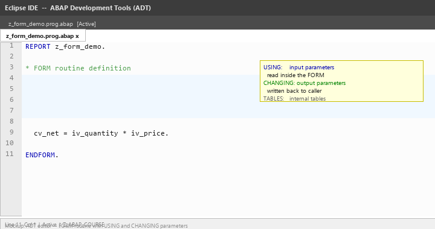
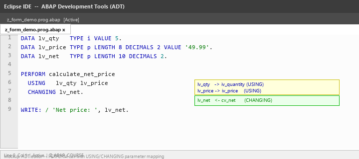
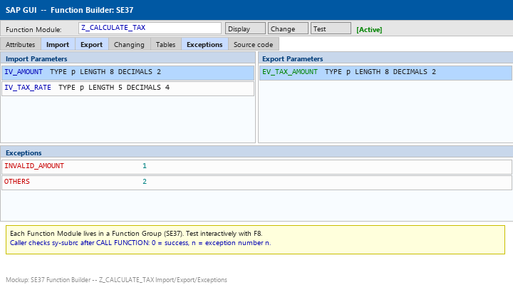
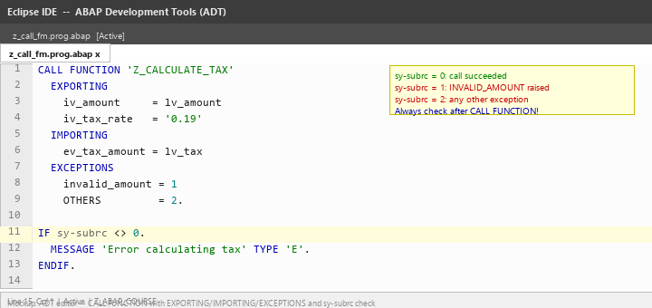
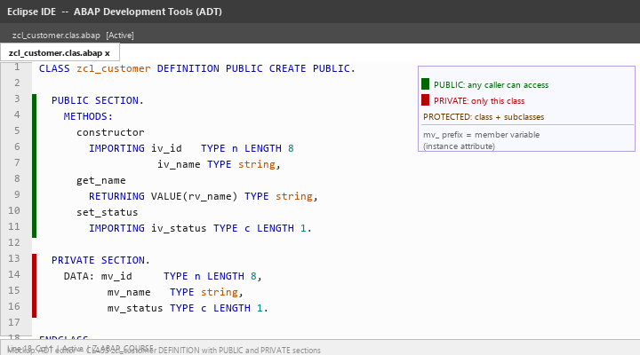
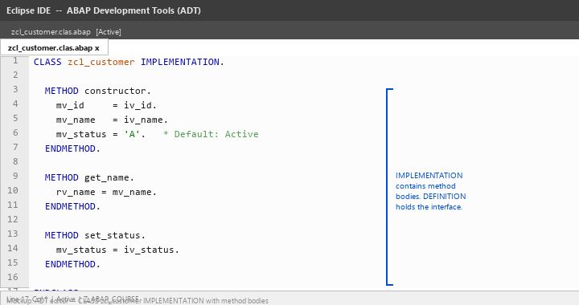
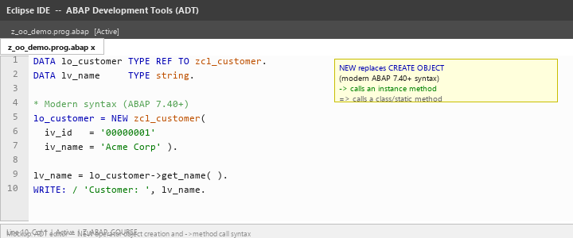
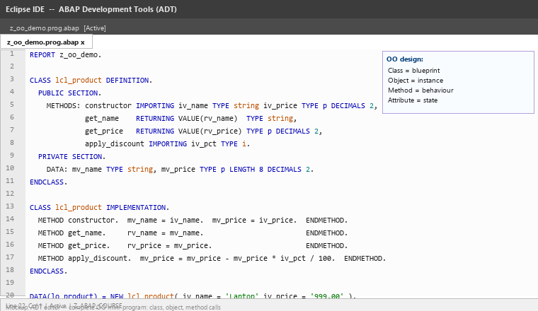

# Lecture 3: Modularization Techniques

**Module:** M-SAP-WP-1.2 Client-Server Communication with SAP ABAP  
**Programme:** SAP Engineering and Analytics (M.Sc.)  
**Language:** English  
**Session duration:** 2 hours  
**Audience:** Students who have completed Lecture 2

---

## 1. Learning Objectives

After this session, you should be able to:

1. Explain why modularization is essential in professional ABAP development.
2. Write and call a FORM routine with USING and CHANGING parameters.
3. Describe the structure of a Function Module and call one using CALL FUNCTION.
4. Use INCLUDE programs to organize large reports.
5. Define a class with PUBLIC and PRIVATE sections.
6. Implement methods with IMPORTING, EXPORTING, RETURNING, and CHANGING parameters.
7. Create and use objects using the modern NEW operator.
8. Distinguish between procedural modularization (FORM, FM) and object-oriented modularization (classes).

---

# Part A: Why Modularize?

## 2. The Problem with Monolithic Programs

A program written as one long sequence of statements quickly becomes:

- Hard to read and understand
- Difficult to test in isolation
- Impossible to reuse in other programs
- Dangerous to change without breaking other parts

### Top-Down Design

Modularization means breaking a program into smaller, named units of work. Each unit:

- Has a clear purpose
- Receives inputs and produces outputs
- Can be tested independently
- Can be reused by different callers

```text
Main Program
  |
  +-- Calculate Net Price
  +-- Format Output Line
  +-- Validate Customer Data
  +-- Write to Log
```

> **Key idea:** A well-modularized program reads like a table of contents. The main flow is short and clear; the details live in named units.

---

# Part B: FORM Routines

## 3. What Is a FORM Routine?

A **FORM routine** (also called a subroutine) is a named block of code defined within a program using `FORM` / `ENDFORM`. It is called with `PERFORM`.

FORM routines are a legacy modularization technique — still found in many existing ABAP systems — but they have been superseded by methods in object-oriented ABAP.

### Simple FORM

```abap
FORM write_separator.
  WRITE: / '-----------------------------'.
ENDFORM.

" Call it:
PERFORM write_separator.
```

---

## 4. FORM Parameters: USING and CHANGING

`USING` passes parameters **into** the routine (read-only intent).  
`CHANGING` passes parameters that the routine can **modify** (output or in/out).

```abap
FORM calculate_net_price
  USING    iv_quantity TYPE i
           iv_price    TYPE p DECIMALS 2
  CHANGING cv_net      TYPE p DECIMALS 2.

  cv_net = iv_quantity * iv_price.

ENDFORM.
```

Calling the routine:

```abap
DATA lv_qty   TYPE i VALUE 5.
DATA lv_price TYPE p LENGTH 8 DECIMALS 2 VALUE '49.99'.
DATA lv_net   TYPE p LENGTH 10 DECIMALS 2.

PERFORM calculate_net_price
  USING   lv_qty lv_price
  CHANGING lv_net.

WRITE: / 'Net price:', lv_net.
" Output: Net price: 249.95
```

For internal tables, use `TABLES`:

```abap
FORM display_employees
  TABLES it_employees TYPE STANDARD TABLE.
  " ...
ENDFORM.
```

The image below shows a FORM routine definition in the ADT editor with annotated USING and CHANGING parameters:



The following image shows the corresponding PERFORM call with parameter mapping:



---

# Part C: Function Modules

## 5. What Is a Function Module?

A **Function Module (FM)** is a reusable program unit stored in the ABAP Repository — not inside a single program. Any program in the system can call it.

Function Modules live inside **Function Groups** (technical containers). They are created and tested in transaction **SE37** (or in ADT).

### FM Interface

| Section | Direction | Purpose |
|---|---|---|
| IMPORTING | Input | Values passed in by the caller |
| EXPORTING | Output | Values returned to the caller |
| TABLES | In/Out | Internal tables passed by reference |
| EXCEPTIONS | Error | Named error conditions the FM can raise |

The image below shows the Function Builder (SE37) interface for `Z_CALCULATE_TAX`:



---

## 6. Calling a Function Module

```abap
DATA lv_amount     TYPE p LENGTH 8 DECIMALS 2 VALUE '1000.00'.
DATA lv_tax        TYPE p LENGTH 8 DECIMALS 2.

CALL FUNCTION 'Z_CALCULATE_TAX'
  EXPORTING
    iv_amount     = lv_amount
    iv_tax_rate   = '0.19'
  IMPORTING
    ev_tax_amount = lv_tax
  EXCEPTIONS
    invalid_amount = 1
    OTHERS         = 2.

IF sy-subrc <> 0.
  MESSAGE 'Error calculating tax' TYPE 'E'.
ENDIF.

WRITE: / 'Tax amount:', lv_tax.
```

`sy-subrc` is 0 if the call succeeded, or the exception number if a named exception was raised.

### Inside the Function Module — RAISE

```abap
FUNCTION z_calculate_tax.
  IF iv_amount <= 0.
    RAISE invalid_amount.
  ENDIF.
  ev_tax_amount = iv_amount * iv_tax_rate.
ENDFUNCTION.
```

The image below shows the CALL FUNCTION statement with the sy-subrc check highlighted:



---

# Part D: Include Programs

## 7. What Are Includes?

An **Include program** is a source code fragment that can be inserted into other programs using the `INCLUDE` statement. They have no independent execution — they are always part of a host program.

Include programs are used to split large reports into logical sections.

### Common Naming Pattern

For a main program `ZABC_MAIN`:

| Include | Purpose |
|---|---|
| `ZABC_TOP` | Global data declarations |
| `ZABC_F01` | FORM routines |
| `ZABC_O01` | PBO modules (screen processing) |
| `ZABC_I01` | PAI modules (screen processing) |

### Example

Main program:
```abap
REPORT zabc_main.

INCLUDE zabc_top.   " Global data
INCLUDE zabc_f01.   " FORM routines
```

`ZABC_TOP`:
```abap
DATA lt_employees TYPE TABLE OF ty_employee WITH EMPTY KEY.
DATA lv_company   TYPE string VALUE 'SAP AG'.
```

`ZABC_F01`:
```abap
FORM display_all_employees.
  LOOP AT lt_employees INTO DATA(ls_emp).
    WRITE: / ls_emp-first_name, ls_emp-last_name.
  ENDLOOP.
ENDFORM.
```

> **Note:** In modern ADT-based development, large programs are decomposed using classes rather than includes. However, include programs remain widely used in classic reports and screen programs.

---

# Part E: Macros

## 8. DEFINE … END-OF-DEFINITION

A **macro** is an inline text substitution defined with `DEFINE` and called like a statement.

```abap
DEFINE write_line.
  WRITE: / &1, &2.
END-OF-DEFINITION.

write_line 'Name:' lv_name.
write_line 'Dept:' lv_department.
```

`&1`, `&2` are positional placeholders replaced at compilation time.

### When to Use — and When Not To

**Appropriate:** Very short, purely repetitive output patterns (2–3 lines maximum).

**Avoid because:**
- No type checking on parameters
- Hard to debug (no breakpoints inside macros)
- Methods provide all the same benefits with proper typing and debuggability

> **Rule:** If you are writing more than 2–3 lines in a macro, write a method instead.

---

# Part F: OO ABAP — Classes

## 9. Classes and the ABAP Object Model

A **class** is a blueprint that defines:

- **Attributes** — data (state)
- **Methods** — behaviour (operations)

An **object** is an instance of a class created at runtime.

```text
Class zcl_customer          (blueprint)
  Attributes: mv_id, mv_name, mv_status
  Methods: constructor, get_name, set_status

Object lo_customer1         (instance)
  mv_id    = '00000001'
  mv_name  = 'Acme Corp'

Object lo_customer2         (instance)
  mv_id    = '00000002'
  mv_name  = 'Beta GmbH'
```

---

## 10. Class Structure: DEFINITION Section

```abap
CLASS zcl_customer DEFINITION PUBLIC CREATE PUBLIC.

  PUBLIC SECTION.
    METHODS:
      constructor
        IMPORTING iv_id   TYPE n LENGTH 8
                  iv_name TYPE string,
      get_name
        RETURNING VALUE(rv_name) TYPE string,
      set_status
        IMPORTING iv_status TYPE c LENGTH 1.

  PRIVATE SECTION.
    DATA: mv_id     TYPE n LENGTH 8,
          mv_name   TYPE string,
          mv_status TYPE c LENGTH 1.

ENDCLASS.
```

| Section | Accessible from |
|---|---|
| `PUBLIC` | Any caller (inside or outside the class) |
| `PROTECTED` | The class itself and subclasses |
| `PRIVATE` | Only within the class itself |

The image below shows the class definition in the ADT editor with section annotations:



---

## 11. Static vs. Instance Members

- **Instance attributes/methods** — belong to each object separately. Access with `->`.
- **Class (static) attributes/methods** — shared across all objects. Access with `=>`.

```abap
CLASS zcl_counter DEFINITION PUBLIC.
  PUBLIC SECTION.
    CLASS-DATA  cv_total_created TYPE i.        " Shared across all instances
    DATA        mv_count         TYPE i.        " Per-object

    CLASS-METHODS get_total RETURNING VALUE(rv_total) TYPE i.
    METHODS       increment.
ENDCLASS.
```

---

# Part G: OO ABAP — Methods

## 12. IMPLEMENTATION Section and Method Bodies

```abap
CLASS zcl_customer IMPLEMENTATION.

  METHOD constructor.
    mv_id     = iv_id.
    mv_name   = iv_name.
    mv_status = 'A'.             " Default: Active
  ENDMETHOD.

  METHOD get_name.
    rv_name = mv_name.
  ENDMETHOD.

  METHOD set_status.
    mv_status = iv_status.
  ENDMETHOD.

ENDCLASS.
```

The image below shows the implementation section in the ADT editor:



---

## 13. Method Parameter Types

| Keyword | Direction | Notes |
|---|---|---|
| `IMPORTING` | Input | Caller passes values in |
| `EXPORTING` | Output | Method returns values to caller |
| `RETURNING VALUE(rv_x) TYPE t` | Single return | Enables functional call style |
| `CHANGING` | In/Out | Caller passes; method may modify |
| `RAISING` | Exception | Method may raise this exception class |

```abap
METHODS calculate_discount
  IMPORTING iv_original  TYPE p DECIMALS 2
            iv_pct       TYPE i
  RETURNING VALUE(rv_discounted) TYPE p DECIMALS 2.
```

Call with RETURNING as a functional expression:

```abap
lv_discounted = lo_product->calculate_discount(
  iv_original = lv_price
  iv_pct      = 10 ).
```

---

# Part H: Objects — Creation and Use

## 14. Creating Objects

**Classic syntax (pre-ABAP 7.40):**

```abap
DATA lo_customer TYPE REF TO zcl_customer.
CREATE OBJECT lo_customer
  EXPORTING
    iv_id   = '00000001'
    iv_name = 'Acme Corp'.
```

**Modern syntax (ABAP 7.40+, preferred):**

```abap
DATA lo_customer TYPE REF TO zcl_customer.
lo_customer = NEW zcl_customer(
  iv_id   = '00000001'
  iv_name = 'Acme Corp' ).
```

**Inline declaration (most concise):**

```abap
DATA(lo_customer) = NEW zcl_customer(
  iv_id   = '00000001'
  iv_name = 'Acme Corp' ).
```

The image below shows both syntaxes and a method call in the ADT editor:



---

## 15. Using Objects: Method Calls and Reference Checks

**Instance method call:**

```abap
lv_name = lo_customer->get_name( ).
lo_customer->set_status( iv_status = 'I' ).
```

**Static method call:**

```abap
lv_total = zcl_counter=>get_total( ).
```

**Checking whether a reference is still valid:**

```abap
IF lo_customer IS BOUND.
  WRITE: / lo_customer->get_name( ).
ENDIF.
```

**Releasing an object:**

```abap
CLEAR lo_customer.   " Reference set to initial; GC reclaims object if no other references exist
```

The image below shows a complete small OO program from REPORT to output:



---

# Part I: Hands-On Exercises

## 16. Exercise 1: FORM Utility — Total Salary

Write a FORM routine `calculate_total_salary` that:
- Accepts an internal table of employees via `TABLES`
- Returns the sum of all salaries via `CHANGING`

```abap
REPORT z_form_salary.

TYPES: BEGIN OF ty_employee,
  first_name TYPE string,
  salary     TYPE p LENGTH 8 DECIMALS 2,
END OF ty_employee.

DATA lt_employees TYPE STANDARD TABLE OF ty_employee WITH EMPTY KEY.
DATA lv_total     TYPE p LENGTH 10 DECIMALS 2.

" Populate table
APPEND VALUE #( first_name = 'Maria' salary = '3500.00' ) TO lt_employees.
APPEND VALUE #( first_name = 'Thomas' salary = '4200.00' ) TO lt_employees.
APPEND VALUE #( first_name = 'Aiko'  salary = '3800.00' ) TO lt_employees.

PERFORM calculate_total_salary
  TABLES   lt_employees
  CHANGING lv_total.

WRITE: / 'Total payroll:', lv_total.

*----------------------------------------------------------------------
FORM calculate_total_salary
  TABLES   it_employees TYPE STANDARD TABLE
  CHANGING cv_total     TYPE p.

  DATA ls_employee LIKE LINE OF it_employees.
  cv_total = 0.
  LOOP AT it_employees INTO ls_employee.
    cv_total = cv_total + ls_employee-salary.
  ENDLOOP.
ENDFORM.
```

### Questions

1. What is the difference between `USING` and `CHANGING`?
2. What does `LIKE LINE OF it_employees` do?
3. How would you change this to calculate average salary instead?

---

## 17. Exercise 2: Calling a Function Module

Write the CALL FUNCTION stub for a fictitious `Z_GET_CUSTOMER_DATA` function module that:
- Exports: `IV_CUSTOMER_ID TYPE n LENGTH 8`
- Imports: `EV_CUSTOMER_NAME TYPE string`, `EV_CREDIT_LIMIT TYPE p DECIMALS 2`
- Exception: `CUSTOMER_NOT_FOUND = 1`

```abap
REPORT z_call_fm_demo.

DATA lv_customer_id   TYPE n LENGTH 8 VALUE '00001000'.
DATA lv_customer_name TYPE string.
DATA lv_credit_limit  TYPE p LENGTH 8 DECIMALS 2.

CALL FUNCTION 'Z_GET_CUSTOMER_DATA'
  EXPORTING
    iv_customer_id    = lv_customer_id
  IMPORTING
    ev_customer_name  = lv_customer_name
    ev_credit_limit   = lv_credit_limit
  EXCEPTIONS
    customer_not_found = 1
    OTHERS             = 2.

IF sy-subrc = 1.
  WRITE: / 'Customer', lv_customer_id, 'not found.'.
ELSEIF sy-subrc = 0.
  WRITE: / 'Customer:', lv_customer_name,
         / 'Credit limit:', lv_credit_limit.
ENDIF.
```

### Questions

1. What value does `sy-subrc` hold if the function module completes normally?
2. What keyword inside the FM body triggers the `customer_not_found` exception?
3. What would happen if you forgot the `IF sy-subrc` check?

---

## 18. Exercise 3: Simple Product Class

Create a local class `lcl_product` in a report with:
- Private attributes: `mv_name TYPE string`, `mv_price TYPE p LENGTH 8 DECIMALS 2`
- Constructor (imports name and price)
- `get_price` returning the price
- `apply_discount` that reduces the price by a given percentage

```abap
REPORT z_product_class.

CLASS lcl_product DEFINITION.
  PUBLIC SECTION.
    METHODS:
      constructor
        IMPORTING iv_name  TYPE string
                  iv_price TYPE p DECIMALS 2,
      get_name
        RETURNING VALUE(rv_name) TYPE string,
      get_price
        RETURNING VALUE(rv_price) TYPE p DECIMALS 2,
      apply_discount
        IMPORTING iv_pct TYPE i.
  PRIVATE SECTION.
    DATA: mv_name  TYPE string,
          mv_price TYPE p LENGTH 8 DECIMALS 2.
ENDCLASS.

CLASS lcl_product IMPLEMENTATION.
  METHOD constructor.
    mv_name  = iv_name.
    mv_price = iv_price.
  ENDMETHOD.
  METHOD get_name.
    rv_name = mv_name.
  ENDMETHOD.
  METHOD get_price.
    rv_price = mv_price.
  ENDMETHOD.
  METHOD apply_discount.
    mv_price = mv_price - ( mv_price * iv_pct / 100 ).
  ENDMETHOD.
ENDCLASS.

DATA(lo_product) = NEW lcl_product( iv_name = 'Laptop' iv_price = '999.00' ).
WRITE: / 'Before discount:', lo_product->get_price( ).
lo_product->apply_discount( iv_pct = 10 ).
WRITE: / 'After 10% discount:', lo_product->get_price( ).
```

### Questions

1. Why is `mv_price` declared `PRIVATE`?
2. What is the purpose of the `constructor` method?
3. How does `get_price` return its value without an explicit assignment statement in the caller?

---

## 19. Exercise 4: Customer Management Class

Extend `lcl_product` into a `lcl_customer` class that maintains an internal list of orders:

```abap
REPORT z_customer_class.

TYPES: BEGIN OF ty_order,
  order_id TYPE n LENGTH 10,
  amount   TYPE p LENGTH 8 DECIMALS 2,
END OF ty_order.

CLASS lcl_customer DEFINITION.
  PUBLIC SECTION.
    METHODS:
      constructor
        IMPORTING iv_name TYPE string,
      add_order
        IMPORTING iv_order_id TYPE n LENGTH 10
                  iv_amount   TYPE p DECIMALS 2,
      get_order_count
        RETURNING VALUE(rv_count) TYPE i,
      get_total_value
        RETURNING VALUE(rv_total) TYPE p DECIMALS 2,
      display_all.
  PRIVATE SECTION.
    DATA: mv_name    TYPE string,
          lt_orders  TYPE TABLE OF ty_order WITH EMPTY KEY.
ENDCLASS.

CLASS lcl_customer IMPLEMENTATION.
  METHOD constructor.
    mv_name = iv_name.
  ENDMETHOD.
  METHOD add_order.
    APPEND VALUE #( order_id = iv_order_id amount = iv_amount )
           TO lt_orders.
  ENDMETHOD.
  METHOD get_order_count.
    rv_count = lines( lt_orders ).
  ENDMETHOD.
  METHOD get_total_value.
    LOOP AT lt_orders INTO DATA(ls_order).
      rv_total = rv_total + ls_order-amount.
    ENDLOOP.
  ENDMETHOD.
  METHOD display_all.
    WRITE: / 'Customer:', mv_name.
    LOOP AT lt_orders INTO DATA(ls_order).
      WRITE: / '  Order:', ls_order-order_id, ls_order-amount.
    ENDLOOP.
    WRITE: / 'Total:', get_total_value( ).
  ENDMETHOD.
ENDCLASS.

DATA(lo_cust) = NEW lcl_customer( iv_name = 'Acme Corp' ).
lo_cust->add_order( iv_order_id = '0000000001' iv_amount = '500.00' ).
lo_cust->add_order( iv_order_id = '0000000002' iv_amount = '1200.00' ).
lo_cust->display_all( ).
WRITE: / 'Order count:', lo_cust->get_order_count( ).
```

### Questions

1. `lt_orders` is private. How does the caller add orders?
2. Why is it better to keep `lt_orders` private rather than public?
3. What is `lines( lt_orders )`?

---

# Part J: Independent Challenge

## 20. Bank Account System

Do this exercise independently.

### Create class `lcl_bank_account` with:

- Private attribute `mv_balance TYPE p LENGTH 10 DECIMALS 2`
- Private attribute `mv_owner TYPE string`
- `constructor` setting owner and initial balance
- `deposit` importing `iv_amount` — adds to balance
- `withdraw` importing `iv_amount` — subtracts from balance; if `iv_amount > mv_balance`, display an error message and do NOT change the balance
- `get_balance` returning current balance
- `display_statement` writing owner name and current balance

### Create a test program that:

1. Creates two accounts: one for 'Alice' (initial: EUR 1,000) and one for 'Bob' (initial: EUR 500)
2. Alice deposits EUR 200
3. Bob withdraws EUR 100
4. Alice transfers EUR 300 to Bob (withdraw from Alice, deposit to Bob)
5. Bob attempts to withdraw EUR 1,000 (should be refused)
6. Displays the final statement for both accounts

### Expected output (approximate):

```text
Account: Alice    Balance: 900.00
Account: Bob      Balance: 700.00
ERROR: Insufficient funds for withdrawal of 1,000.00
```

### Bonus question

How would you redesign `withdraw` to communicate failure back to the caller without writing a message directly — so the caller decides what to display?

---

# Part K: Common Beginner Mistakes

## 21. Forgetting sy-subrc After CALL FUNCTION

Every CALL FUNCTION that lists EXCEPTIONS must be followed by an `IF sy-subrc` check. Omitting it means the program silently continues even when the function module reported an error.

---

## 22. Modifying a USING Parameter

`USING` parameters in FORM routines are **passed by reference by default** in classic ABAP (unless `BY VALUE` is specified). Changing a USING parameter changes the original variable — which may surprise you.

```abap
" Dangerous: iv_amount is actually a reference alias
FORM double_amount USING iv_amount TYPE p.
  iv_amount = iv_amount * 2.   " This modifies the caller's variable!
ENDFORM.
```

Use `CHANGING` explicitly when you intend to modify, and `USING ... BY VALUE` when you do not.

---

## 23. Accessing Private Attributes from Outside

```abap
WRITE lo_customer->mv_name.   " Syntax error: mv_name is PRIVATE
```

Private attributes can only be accessed through PUBLIC methods (`get_name`, `set_name`). This is intentional — it protects the internal state.

---

## 24. Class Not Instantiated Before Method Call

```abap
DATA lo_customer TYPE REF TO lcl_customer.
" lo_customer is INITIAL here — not yet an object

lo_customer->display_all( ).   " Runtime error: NULL reference
```

Always create the object before calling its methods. Use `IS BOUND` to check before calling if the reference may be initial.

---

# Part L: Knowledge Check

## 25. Modularization Concepts

1. Name two advantages of modularizing a program.
2. What is the difference between a FORM routine and a Function Module?
3. What keyword is used to call a FORM routine?
4. What does `sy-subrc = 0` mean after a CALL FUNCTION?
5. What keyword inside a Function Module raises a named exception?
6. What is an Include program used for?
7. Why are macros generally discouraged in modern ABAP?

## 26. OO ABAP

8. What is the difference between a class and an object?
9. What are the three visibility sections of a class?
10. Which section can any external caller access?
11. What is the constructor method used for?
12. What is the difference between `RETURNING` and `EXPORTING` in a method?
13. What operator is used to call an instance method?
14. What operator is used to call a static (CLASS-METHOD) method?
15. What is the modern syntax to create an object (ABAP 7.40+)?
16. What does `IS BOUND` check?
17. What is the difference between `CLASS-DATA` and `DATA` in a class?

---

# Part M: Preparation for Lecture 4

## 27. Before the Next Session

Make sure you can independently:

1. Write a simple local class with a constructor, one private attribute, and at least two methods.
2. Instantiate the class and call its methods.
3. Explain the difference between FORM routines and methods.

Lecture 4 covers the **ABAP Data Dictionary (DDIC)** — where the data structures that your programs work with are defined centrally at the database level.

---

# Next Lecture

## Lecture 4: ABAP Data Dictionary (DDIC)

We will cover:

- Database tables defined in SE11
- Domains and Data Elements
- Views (Database Views, Help Views, Maintenance Views)
- Indexes on database tables
- Search Helps (F4 input help)
- Lock Objects
- Using DDIC objects from ABAP programs

---

# Suggested References

**Mandatory reading from the module handbook:**

- Horst Keller, *ABAP Objects: Introduction to Programming SAP Applications*, 4th Edition, SAP PRESS, 2020.  
  Chapters 7–9 cover function modules, classes, and objects in depth.

**Further reading:**

- Paul Hardy, *ABAP to the Future*, 3rd Edition, SAP PRESS, 2019.  
  Chapters 5–6 cover modern OO patterns and clean ABAP practices.
- James Wood, *Object-Oriented Programming with ABAP Objects*, 2nd Edition, SAP PRESS, 2015.  
  Detailed reference for class design, inheritance, and interfaces.

---

## Session Summary

After Lecture 3, the most important ideas to remember are:

1. Modularization breaks programs into named, reusable, testable units.
2. FORM routines are the legacy approach — still found in existing code, passed with USING/CHANGING.
3. Function Modules live in the Repository, callable from any program; always check sy-subrc.
4. Classes separate interface (DEFINITION) from implementation (IMPLEMENTATION); private attributes are protected from external access.
5. Methods are the modern replacement for FORM routines — typed, testable, and encapsulated.
6. Use `NEW` to create objects; use `->` to call instance methods.

**Next step:** In Lecture 4 we move from program-level data structures to centrally defined database-level structures in the ABAP Data Dictionary.
