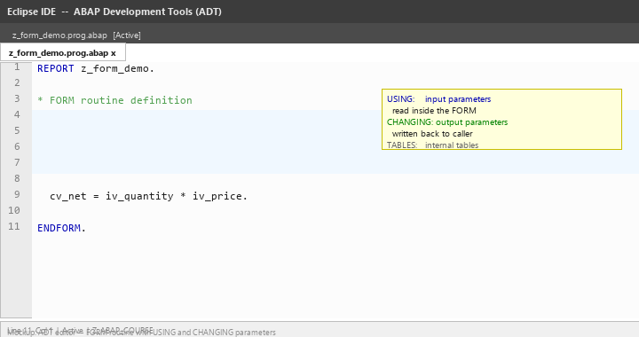
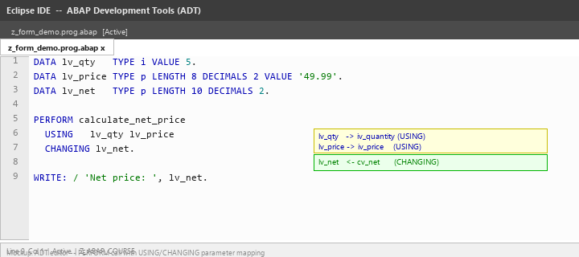
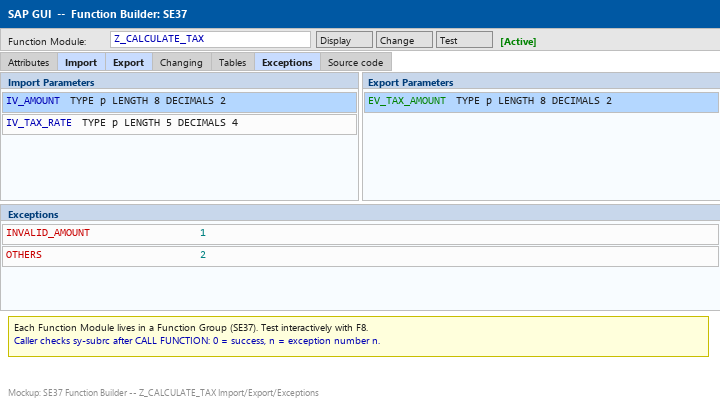
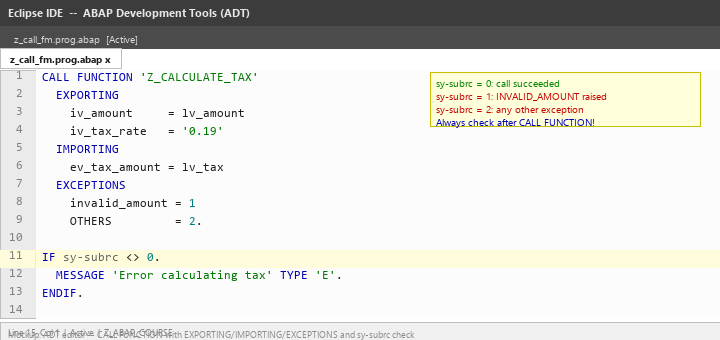
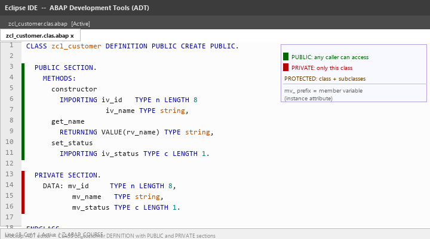
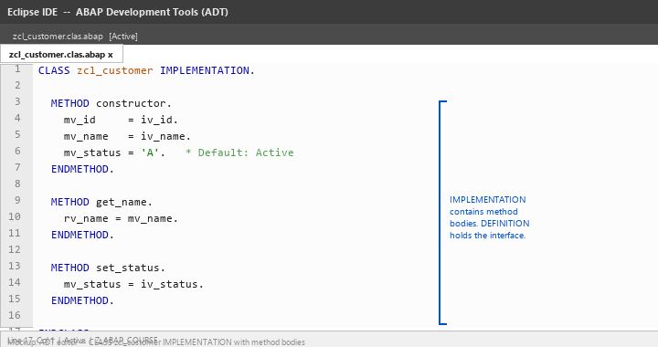
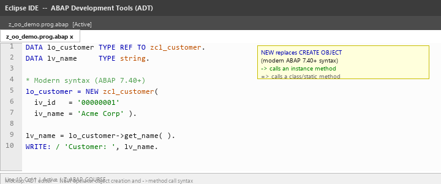
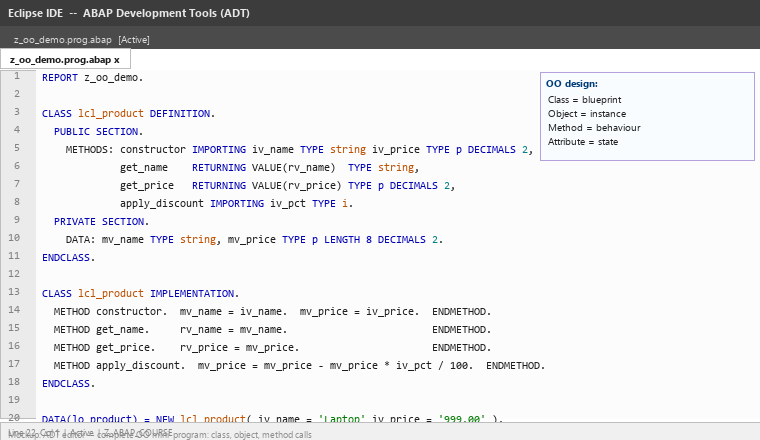

# Lecture 3 — Theory: Modularization Techniques

**Module:** M-SAP-WP-1.2 Client-Server Communication with SAP ABAP  
**Programme:** SAP Engineering and Analytics (M.Sc.)  
**Prerequisite:** Lecture 2 — Data Types and Data Objects

> Read this before the exercises. The goal is to understand how to write programs that branch and repeat (control structures), why breaking code into smaller units matters, and how ABAP's object-oriented features let you structure that code into reusable, maintainable methods.

---

## Learning Objectives

After this session, you should be able to:

1. Write conditional logic using `IF / ELSEIF / ELSE` and `CASE / WHEN`.
2. Write fixed repetition using `DO` and conditional repetition using `WHILE`.
3. Explain why modularization improves code quality.
4. Recognise FORM routines and function modules in existing legacy ABAP code.
5. Define a class with `PUBLIC`, `PROTECTED`, and `PRIVATE` sections.
6. Declare and implement static methods (`CLASS-METHODS`) and call them without an object.
7. Declare and implement instance methods (`METHODS`) with `IMPORTING` and `RETURNING` parameters.
8. Instantiate a class with `NEW` and call instance methods on the resulting object.

---

## Part A: Control Structures

A program that does the same thing every time is limited. Control structures let the program make decisions based on data and repeat actions a controlled number of times. Both are essential before writing meaningful methods.

---

## 1. IF / ELSEIF / ELSE

`IF` evaluates a condition. If it is true, the block runs. Additional conditions can be tested with `ELSEIF`. The `ELSE` block runs if no earlier condition was true.

```abap
DATA lv_score TYPE i VALUE 78.
DATA lv_grade TYPE string.

IF lv_score >= 90.
  lv_grade = 'A'.
ELSEIF lv_score >= 75.
  lv_grade = 'B'.
ELSEIF lv_score >= 60.
  lv_grade = 'C'.
ELSE.
  lv_grade = 'F — Needs improvement'.
ENDIF.

out->write( |Score { lv_score } → Grade: { lv_grade }| ).
```

Key rules:
- Every `IF` must end with `ENDIF`. A missing `ENDIF` is a syntax error.
- Once a condition is true, the remaining `ELSEIF` branches are skipped.
- `ELSEIF` and `ELSE` are both optional.

### Comparison Operators

| Symbol | Word Form | Meaning |
|---|---|---|
| `=` | `EQ` | Equal |
| `<>` | `NE` | Not equal |
| `<` | `LT` | Less than |
| `>` | `GT` | Greater than |
| `<=` | `LE` | Less than or equal |
| `>=` | `GE` | Greater than or equal |

Both forms are valid. `<` and `>` are common in modern ABAP. `LT` and `GT` appear frequently in older code.

### Combining Conditions

```abap
" AND — both conditions must be true
IF lv_age >= 18 AND lv_country = 'DE'.
  out->write( 'Eligible for domestic contract.' ).
ENDIF.

" OR — at least one condition must be true
IF lv_status = 'A' OR lv_status = 'P'.
  out->write( 'Account is active or pending.' ).
ENDIF.

" NOT — inverts a condition
IF NOT lv_name IS INITIAL.
  out->write( |Name: { lv_name }| ).
ENDIF.
```

`IS INITIAL` checks whether a variable holds its default (empty) value — an empty string, zero for integers, etc.

---

## 2. CASE / WHEN / OTHERS

`CASE` is cleaner than a long `IF / ELSEIF` chain when you are checking one variable against a set of exact values.

```abap
DATA lv_dept      TYPE c LENGTH 4 VALUE 'FIN'.
DATA lv_dept_name TYPE string.

CASE lv_dept.
  WHEN 'SALE'.
    lv_dept_name = 'Sales'.
  WHEN 'FIN'.
    lv_dept_name = 'Finance'.
  WHEN 'HR'.
    lv_dept_name = 'Human Resources'.
  WHEN 'IT'.
    lv_dept_name = 'Information Technology'.
  WHEN OTHERS.
    lv_dept_name = 'Unknown Department'.
ENDCASE.

out->write( |{ lv_dept } → { lv_dept_name }| ).
```

`WHEN OTHERS` is the catch-all — it runs if no earlier `WHEN` matched. Always include it to handle unexpected values cleanly.

> **IF vs. CASE:** Use `IF` for range comparisons (`>`, `<`, `>=`). Use `CASE` when checking one variable against a fixed set of values — it reads more clearly and compiles to more efficient code.

---

## 3. DO — Fixed Repetition

`DO n TIMES` repeats a block exactly n times. The system variable `sy-index` contains the current iteration number, starting at 1.

```abap
DATA lv_price TYPE p LENGTH 8 DECIMALS 2 VALUE '25.00'.
DATA lv_total TYPE p LENGTH 10 DECIMALS 2 VALUE 0.

DO 5 TIMES.
  lv_total = lv_total + lv_price.
  out->write( |Item { sy-index }: { lv_price } EUR   Running total: { lv_total } EUR| ).
ENDDO.
```

Output:
```
Item 1: 25.00 EUR   Running total: 25.00 EUR
Item 2: 25.00 EUR   Running total: 50.00 EUR
...
Item 5: 25.00 EUR   Running total: 125.00 EUR
```

You can exit a `DO` loop early with `EXIT`:

```abap
DO 100 TIMES.
  IF sy-index = 4.
    EXIT.   " Stop immediately — iterations 4–100 never run
  ENDIF.
  out->write( |Iteration { sy-index }| ).
ENDDO.
```

---

## 4. WHILE — Conditional Repetition

`WHILE` repeats a block as long as its condition is true. The condition is evaluated before each iteration.

```abap
DATA lv_balance      TYPE p LENGTH 10 DECIMALS 2 VALUE '1000.00'.
DATA lv_monthly_cost TYPE p LENGTH 8  DECIMALS 2 VALUE '250.00'.
DATA lv_months       TYPE i VALUE 0.

WHILE lv_balance > 0.
  lv_balance = lv_balance - lv_monthly_cost.
  lv_months  = lv_months + 1.
  out->write( |Month { lv_months }: remaining balance { lv_balance } EUR| ).
ENDWHILE.

out->write( |Budget exhausted after { lv_months } months.| ).
```

> **Infinite loop warning:** The `WHILE` condition must eventually become false. If it never does, the program loops forever. SAP will terminate a runaway program with a timeout dump. Before writing a `WHILE`, ask yourself: *what changes inside the loop that will eventually make the condition false?*

### DO vs. WHILE

| | `DO n TIMES` | `WHILE condition` |
|---|---|---|
| When to use | You know exactly how many repetitions are needed | You repeat until something changes |
| Iteration count | Fixed at start | Determined at runtime |
| Risk | None — n is known | Possible infinite loop |

---

## Part B: Why Modularize?

Consider writing all logic for an order processing program — price lookup, discount calculation, stock check, invoice creation, and email confirmation — as one long sequence of statements inside `main`.

| Problem | Consequence |
|---|---|
| Hard to read | You must scan hundreds of lines to understand what one part does |
| No reuse | Discount logic is copied everywhere it is needed — multiple places to fix when it changes |
| Bugs multiply | A bug in the discount logic exists in every copy |
| Hard to test | You cannot test one calculation in isolation |
| Hard to share | Multiple developers cannot work on overlapping sections without conflicts |

**Modularization** breaks code into named, focused units. In modern ABAP, the unit is a **method**.

> **Golden rule: one method, one purpose.**

A method that calculates a discount should only calculate a discount — not also check stock, format output, or send a message. When each method has a single, clear purpose, code becomes readable, testable, and reusable.

---

## Part C: Legacy Modularization

Before ABAP became object-oriented, developers used two patterns that you will encounter in existing SAP code. They are not available for new development in BTP ABAP Environment, but you must be able to read them.

---

## 5. FORM Routines — Legacy Subroutines

> **BTP ABAP note:** FORM routines cannot be used inside class methods. They exist on classic on-premise SAP systems only. This section is context for reading legacy code.

`FORM` routines were ABAP's original way to define reusable code blocks within a program. They are called with `PERFORM`.

```abap
" Legacy ABAP — NOT available in BTP ABAP class methods

FORM calculate_total
  USING    iv_price    TYPE p
           iv_quantity TYPE i
  CHANGING ev_total    TYPE p.

  ev_total = iv_price * iv_quantity.
ENDFORM.

" Call site — elsewhere in the same program:
PERFORM calculate_total
  USING    lv_price    lv_quantity
  CHANGING lv_total.
```





FORM routines have no visibility control — any code in the same program can call any FORM routine. SAP deprecated them in favour of methods. When you see `PERFORM` in existing code, read it as a method call.

---

## 6. Function Modules — Legacy Reusable Components

> **BTP ABAP note:** You cannot create new function modules in BTP ABAP Environment. Some SAP-released function modules can be called from BTP. For new development, always use classes and methods.

Function modules are stored in **function groups** and can be called from any program using `CALL FUNCTION`. They were the standard way to package reusable logic before OO ABAP.

```abap
" Calling an SAP standard function module — you will see this in on-premise code

CALL FUNCTION 'CONVERSION_EXIT_ALPHA_INPUT'
  EXPORTING
    input  = lv_raw_number
  IMPORTING
    output = lv_padded_number.
```





Function modules use `EXPORTING` for what they send in (confusingly named from the function module's perspective) and `IMPORTING` for what they return. This naming is the opposite of method parameter conventions — another reason the legacy patterns cause confusion.

---

## Part D: Object-Oriented ABAP

Object-Oriented ABAP is the correct approach for all new BTP development. A **class** bundles related data (attributes) and behaviour (methods) into one named unit. An **object** is a running instance of a class — it has its own values for all instance attributes.

---

## 7. Class Structure

Every global ABAP class has a DEFINITION section (what the class contains) and an IMPLEMENTATION section (the code inside each method).

```abap
CLASS z_my_class DEFINITION PUBLIC FINAL CREATE PUBLIC.
  PUBLIC SECTION.
    " Visible to all code — the class interface
  PROTECTED SECTION.
    " Visible to this class and any subclass
  PRIVATE SECTION.
    " Visible only inside this class
ENDCLASS.

CLASS z_my_class IMPLEMENTATION.
  " Method bodies go here
ENDCLASS.
```

### Visibility Sections

| Section | Who Can Read and Call It |
|---|---|
| `PUBLIC` | Any code anywhere in the system |
| `PROTECTED` | This class and any subclass |
| `PRIVATE` | This class only — fully hidden from callers |

**Design principle:** Declare the methods callers need in PUBLIC. Put all internal data and helper methods in PRIVATE. This is **encapsulation** — the class controls what is exposed and what is hidden.



---

## 8. Static Methods (CLASS-METHODS)

Static methods belong to the **class** itself — not to any individual object. They do not need an instance to run.

```abap
CLASS z_vat_calculator DEFINITION PUBLIC FINAL CREATE PUBLIC.
  PUBLIC SECTION.
    CLASS-METHODS calculate_vat
      IMPORTING
        iv_net_amount TYPE p LENGTH 8 DECIMALS 2
        iv_vat_rate   TYPE p LENGTH 5 DECIMALS 2
      RETURNING
        VALUE(rv_vat) TYPE p LENGTH 8 DECIMALS 2.
ENDCLASS.

CLASS z_vat_calculator IMPLEMENTATION.
  METHOD calculate_vat.
    rv_vat = iv_net_amount * iv_vat_rate / 100.
  ENDMETHOD.
ENDCLASS.
```

Calling a static method — no object is needed, only the class name and `=>`:

```abap
DATA lv_vat TYPE p LENGTH 8 DECIMALS 2.

lv_vat = z_vat_calculator=>calculate_vat(
  iv_net_amount = '100.00'
  iv_vat_rate   = '19.00'
).

out->write( |VAT: { lv_vat } EUR| ).
```

> **When to use static methods:** When the result depends only on the input parameters and no object state is involved. Pure calculations are the clearest fit — a tax calculation, a discount rate lookup, a string formatting helper.

---

## 9. Method Parameters

ABAP methods can declare four kinds of parameters:

| Keyword | Direction | Use |
|---|---|---|
| `IMPORTING` | Caller → method | Input values read by the method |
| `RETURNING VALUE(rv_...)` | Method → caller | Single return value — **preferred modern approach** |
| `EXPORTING` | Method → caller | One or more named output values — older style |
| `CHANGING` | Both directions | A value passed in, modified, and passed back |

### RETURNING — The Modern Standard

```abap
CLASS-METHODS double_price
  IMPORTING
    iv_price    TYPE p LENGTH 8 DECIMALS 2
  RETURNING
    VALUE(rv_result) TYPE p LENGTH 8 DECIMALS 2.
```

`VALUE(rv_result)` creates a return copy — the method assigns the result to `rv_result` and it is returned to the caller. This is the approach to use for any method that produces a single result.

### EXPORTING — Multiple Output Values

When a method must return more than one value, `EXPORTING` is available. In practice, the cleaner modern approach is to return a structure:

```abap
" Older style — two EXPORTING parameters
METHODS get_price_components
  IMPORTING iv_product_id TYPE n LENGTH 10
  EXPORTING ev_net_price  TYPE p LENGTH 8 DECIMALS 2
            ev_currency   TYPE c LENGTH 3.
```

You will encounter `EXPORTING` in existing code. For new methods, prefer returning a structure with `RETURNING`.

---

## 10. Instance Methods

Instance methods belong to a specific **object**. They are declared with `METHODS` (no `CLASS-` prefix) and have access to the object's private data through `me->`.

```abap
CLASS z_employee DEFINITION PUBLIC FINAL CREATE PUBLIC.
  PUBLIC SECTION.
    METHODS constructor
      IMPORTING
        iv_name   TYPE string
        iv_salary TYPE p LENGTH 8 DECIMALS 2.
    METHODS get_name
      RETURNING VALUE(rv_name) TYPE string.
    METHODS get_annual_salary
      RETURNING VALUE(rv_annual) TYPE p LENGTH 10 DECIMALS 2.
    METHODS apply_raise
      IMPORTING iv_percent TYPE p LENGTH 5 DECIMALS 2.
  PRIVATE SECTION.
    DATA mv_name   TYPE string.
    DATA mv_salary TYPE p LENGTH 8 DECIMALS 2.
ENDCLASS.
```

### Instance Attribute Naming

| Prefix | Meaning |
|---|---|
| `mv_` | Member variable (scalar instance attribute) |
| `mt_` | Member table (instance internal table) |
| `mo_` | Member object reference |

The `m` prefix distinguishes instance attributes from local variables (`lv_`, `lt_`) inside methods.

---

## 11. The Constructor

The constructor is a special instance method named `constructor`. It runs automatically whenever an object is created with `NEW`. Use it to set the object's initial state.

```abap
CLASS z_employee IMPLEMENTATION.
  METHOD constructor.
    mv_name   = iv_name.
    mv_salary = iv_salary.
  ENDMETHOD.

  METHOD get_name.
    rv_name = mv_name.
  ENDMETHOD.

  METHOD get_annual_salary.
    rv_annual = mv_salary * 12.
  ENDMETHOD.

  METHOD apply_raise.
    mv_salary = mv_salary * ( 1 + iv_percent / 100 ).
  ENDMETHOD.
ENDCLASS.
```

The constructor sets `mv_name` and `mv_salary` from the caller's inputs. After construction, the object's methods can read and modify those values.



---

## 12. Object Instantiation — NEW

Create an object with `NEW`. The result is a **reference** — a variable that points to the object in memory.

```abap
DATA lo_employee TYPE REF TO z_employee.

lo_employee = NEW z_employee(
  iv_name   = 'Maria Schneider'
  iv_salary = '3500.00'
).
```

`NEW #( )` uses type inference from the left-hand side variable. When the type is already declared with `TYPE REF TO`, `NEW #( )` is equivalent:

```abap
lo_employee = NEW #( iv_name = 'Maria Schneider'  iv_salary = '3500.00' ).
```

Calling instance methods on the object:

```abap
DATA lv_name   TYPE string.
DATA lv_annual TYPE p LENGTH 10 DECIMALS 2.

lv_name   = lo_employee->get_name( ).
lv_annual = lo_employee->get_annual_salary( ).
lo_employee->apply_raise( iv_percent = '5.00' ).

out->write( |{ lv_name }  Annual before raise: { lv_annual } EUR| ).
lv_annual = lo_employee->get_annual_salary( ).
out->write( |{ lv_name }  Annual after 5% raise: { lv_annual } EUR| ).
```

> Every object is independent. You can create ten `z_employee` objects — each has its own `mv_name` and `mv_salary`. Modifying one does not affect any other.



---

## 13. Calling Methods Within the Same Class

Inside a method, you can call other methods of the same object using `me->`. `me` is the implicit reference to the current object.

```abap
METHOD if_oo_adt_classrun~main.
  DATA lv_gross    TYPE p LENGTH 10 DECIMALS 2.
  DATA lv_tax      TYPE p LENGTH 10 DECIMALS 2.

  lv_gross = me->calculate_annual_gross( iv_monthly = '4500.00' ).
  lv_tax   = me->calculate_income_tax( iv_annual = lv_gross ).
ENDMETHOD.
```

You can also omit `me->` for instance method calls within the same class — ABAP resolves them automatically from context. The explicit `me->` is preferred when clarity matters.

For **static methods** called from within the same class, no prefix is needed at all:

```abap
METHOD calculate_order_total.
  " get_discount_rate is a CLASS-METHOD of the same class — call directly
  DATA lv_rate TYPE p LENGTH 5 DECIMALS 2.
  lv_rate = get_discount_rate( iv_quantity = iv_quantity ).
ENDMETHOD.
```



---

## Summary — Key Concepts from the Theory

| Concept | What to Remember |
|---|---|
| **IF / CASE** | `IF` for range comparisons; `CASE` for exact value matching; always close with `ENDIF` / `ENDCASE` |
| **DO / WHILE** | `DO n TIMES` for fixed count; `WHILE condition` for conditional repetition; guard against infinite loops |
| **sy-index** | Set by `DO` — holds current iteration number (1, 2, 3, …) |
| **Why modularize** | Readability, reuse, isolated bugs, testability |
| **FORM / Function modules** | Legacy patterns in on-premise code — not for new BTP development |
| **CLASS-METHODS** | Static — no instance needed; called as `class=>method( )` |
| **METHODS** | Instance — called as `object->method( )` |
| **RETURNING VALUE(rv_...)** | Single return value — the preferred modern pattern |
| **PRIVATE section** | Hides internal data; only the class itself can access it |
| **constructor** | Runs automatically at `NEW`; sets the object's initial state |
| **NEW** | Creates an object; `NEW #( )` infers the type from the variable declaration |
| **me->** | Reference to the current object inside an instance method |

---

## Before the Exercises

Make sure you can answer these before starting the exercise file:

1. You have `lv_score = 72`. Walk through this condition and state which branch runs:
   ```abap
   IF lv_score >= 90. ... ELSEIF lv_score >= 75. ... ELSEIF lv_score >= 60. ... ELSE. ... ENDIF.
   ```
2. A `WHILE` loop's condition never becomes false. What happens?
3. What is the difference between `CLASS-METHODS` and `METHODS`?
4. Write the DEFINITION signature for a static method `get_discount_rate` that takes `iv_quantity TYPE i` and returns `rv_rate TYPE p LENGTH 5 DECIMALS 2`.
5. You have `DATA lo_emp TYPE REF TO z_employee.` followed by `lo_emp = NEW #( iv_name = 'Anna' iv_salary = '3200.00' ).` What does `lo_emp` hold after this line?
6. Inside an instance method, what does `me->` refer to?

> **Continue to:** `Lecture_03_Exercises.md`
