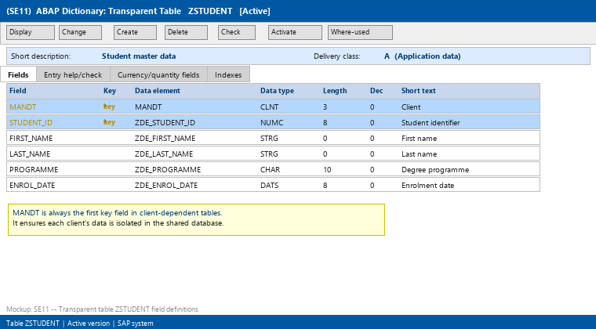
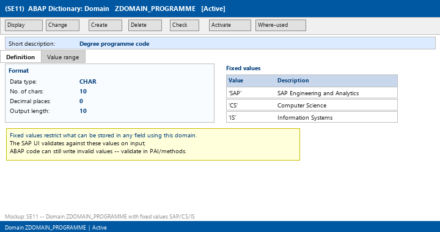
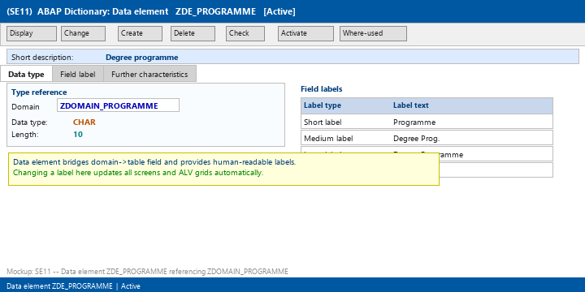
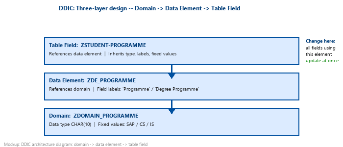
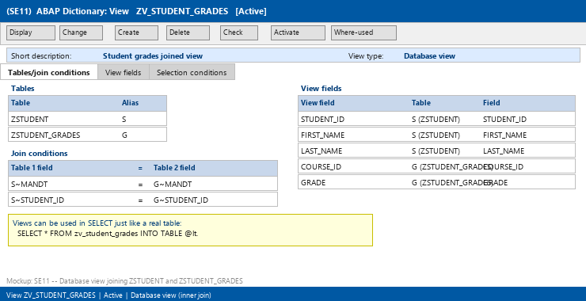
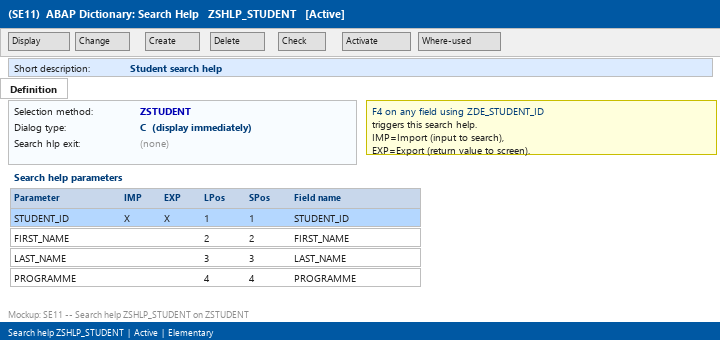
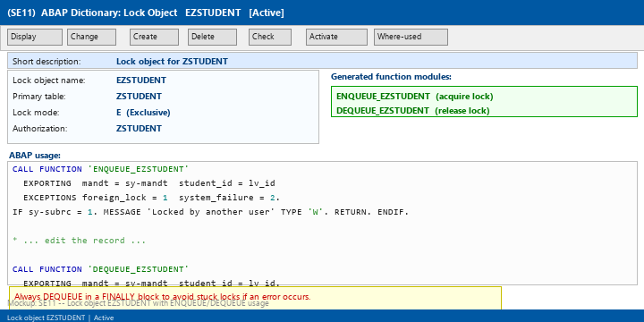
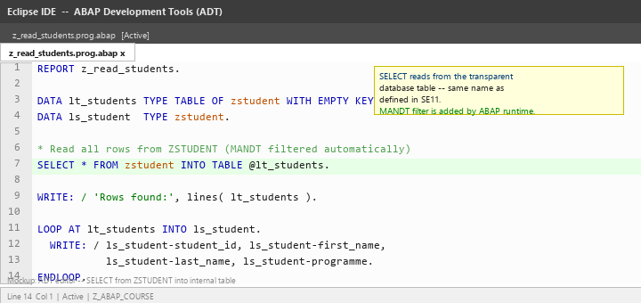

# Lecture 4: ABAP Data Dictionary (DDIC)

**Module:** M-SAP-WP-1.2 Client-Server Communication with SAP ABAP  
**Programme:** SAP Engineering and Analytics (M.Sc.)  
**Language:** English  
**Session duration:** 2 hours  
**Audience:** Students who have completed Lecture 3

---

## 1. Learning Objectives

After this session, you should be able to:

1. Explain the role of the ABAP Data Dictionary as SAP's central metadata repository.
2. Create a transparent database table in SE11 with appropriate field types and key fields.
3. Define a domain with a data type, length, and optional fixed values.
4. Create a data element that references a domain and carries field labels.
5. Build a database view that joins two tables on a shared key.
6. Explain when and how to create secondary indexes.
7. Create an elementary search help and attach it to a data element.
8. Explain what a lock object is and how it generates ENQUEUE/DEQUEUE function modules.

---

# Part A: What Is the DDIC?

## 2. The ABAP Data Dictionary

The **ABAP Data Dictionary (DDIC)** is SAP's central metadata repository. It stores the definitions of all data structures, tables, views, and types used across the ABAP system.

> **Key idea:** The DDIC does not store data — it stores the *descriptions* of where and how data is structured.

### Repository vs. Database

| Concept | Where it lives | What it contains |
|---|---|---|
| DDIC (Repository) | ABAP application layer | Table definitions, field types, views, locks |
| Database | Database layer | Actual rows of business data |

When you create a transparent table in SE11, SAP:
1. Stores the table definition in the repository.
2. Automatically creates the corresponding physical table in the database.
3. Keeps both in sync whenever you activate a change.

### Activation Concept

Every DDIC object has two versions:

- **Inactive version** — your work-in-progress, not yet visible to programs.
- **Active version** — the version all running programs use.

You must **activate** a DDIC object before programs can use it. This is the same save → activate pattern from Lecture 1, applied at the metadata level.

### Why the DDIC Matters

When a table field's data element is changed in SE11, every ABAP program that references that field automatically inherits the update after re-activation. This central control is one of SAP's key maintainability features.

---

# Part B: Database Tables

## 3. Transparent Tables

A **transparent table** in the DDIC corresponds 1:1 to a physical database table. Every field in SE11 maps directly to a column in the database.

The main transaction for DDIC work is:

- **SE11** — ABAP Dictionary (create/change/display all DDIC objects)



### Table Fields

Each field in a table definition has:

| Property | Meaning |
|---|---|
| Field name | Identifies the column (e.g. `STUDENT_ID`) |
| Key flag | Marks the field as part of the primary key |
| Data element | The DDIC type assigned (references a domain) |
| Data type | Derived from the data element/domain (e.g. CHAR, NUMC) |
| Length | Derived from the domain |
| Decimals | Relevant for numeric types |

### The MANDT Field

In client-dependent tables, the very first key field must always be **MANDT** (client number, type CLNT, length 3). This ensures each client's data is isolated within the same database.

```abap
" ABAP automatically fills MANDT from sy-mandt in most SELECT statements
" You normally do not need to specify it explicitly:
SELECT * FROM zstudent INTO TABLE @lt_students.
" The system adds WHERE mandt = sy-mandt automatically
```

### Delivery Class

The delivery class controls how the table behaves during system upgrades and transports:

| Class | Meaning |
|---|---|
| A | Application data — filled by customer |
| C | Customizing data — filled during implementation |
| G | Customizing, protected against SAP overwrite |
| E | System table — managed by SAP |
| S | System table |
| W | System table for temporary data |

For customer development, use **A** (application data) for transactional tables and **C** for configuration tables.

### Exercise Table: ZSTUDENT

We will use ZSTUDENT as our working example throughout this lecture:

| Field | Key | Data element | Type | Len |
|---|---|---|---|---|
| MANDT | ✓ | MANDT | CLNT | 3 |
| STUDENT_ID | ✓ | ZDE_STUDENT_ID | NUMC | 8 |
| FIRST_NAME | | ZDE_FIRST_NAME | STRG | 0 |
| LAST_NAME | | ZDE_LAST_NAME | STRG | 0 |
| PROGRAMME | | ZDE_PROGRAMME | CHAR | 10 |
| ENROL_DATE | | ZDE_ENROL_DATE | DATS | 8 |

---

# Part C: Domains

## 4. What Is a Domain?

A **domain** defines the technical properties of a data type — what kind of data it holds and how long it is. Domains are the lowest level in the DDIC type hierarchy.

A domain specifies:
- **Data type** (CHAR, NUMC, DEC, INT4, DATS, TIMS, etc.)
- **Length** and **decimal places**
- Optional **fixed values** (a list of allowed values)
- Optional **value table** (a table whose primary key entries are the allowed values)



### Example Domain with Fixed Values

```
Domain: ZDOMAIN_PROGRAMME
Data type: CHAR
Length:    10
Fixed values:
  'SAP'  SAP Engineering and Analytics
  'CS'   Computer Science
  'IS'   Information Systems
```

Any field that uses a data element referencing `ZDOMAIN_PROGRAMME` will only accept `SAP`, `CS`, or `IS` as valid values. The system enforces this at the UI level (not always at the database level — ABAP programs can bypass it, so use with care).

### Common DDIC Data Types

| DDIC type | ABAP type | Meaning |
|---|---|---|
| CHAR | c | Fixed-length character |
| NUMC | n | Numeric character |
| DEC | p | Packed decimal |
| INT4 | i | 4-byte integer |
| DATS | d | Date (YYYYMMDD) |
| TIMS | t | Time (HHMMSS) |
| STRG | string | Variable-length string |
| CLNT | c LENGTH 3 | Client (special: MANDT) |

---

# Part D: Data Elements

## 5. What Is a Data Element?

A **data element** sits between a domain and a table field. It references one domain and adds:

- **Field labels** (short, medium, long, heading) used on screens and ALV grids
- An optional **search help** reference
- An optional **parameter ID** for SET/GET PARAMETER memory



### The Three-Layer Design

The DDIC uses a deliberate three-layer hierarchy:



```
Domain (ZDOMAIN_PROGRAMME)
  └── technical type: CHAR(10), fixed values SAP/CS/IS

Data Element (ZDE_PROGRAMME)
  └── references domain + field labels: "Programme" / "Degree Programme"

Table Field (ZSTUDENT-PROGRAMME)
  └── references data element
```

**Why three layers?**

If you need to change the label "Programme" to "Study Programme" across 50 screens, you change it in one data element. All screens and ALV grids update automatically.

If you need to add a new fixed value to `ZDOMAIN_PROGRAMME`, it becomes valid for all 20 fields across all tables that share this domain.

### Example: ZDE_STUDENT_ID

```
Domain:        ZDOMAIN_STUDENT_ID (NUMC, length 8)
Data Element:  ZDE_STUDENT_ID
  Short label:  Stud.ID
  Medium label: Student ID
  Long label:   Student Identifier
  Heading:      Student ID
  Search help:  ZSHLP_STUDENT
```

---

# Part E: Views

## 6. Database Views

A **database view** in SE11 defines a virtual table that joins two or more physical tables. You can use a view in a `SELECT` statement just like a real table.

```abap
" Selecting from a view — same syntax as a table
SELECT student_id first_name last_name course_id grade
  FROM zv_student_grades
  INTO TABLE @lt_results
  WHERE grade < 5.
```



### Types of Views

| View type | Purpose |
|---|---|
| **Database view** | Read-only SELECT-like join of multiple tables |
| **Maintenance view** | Allows SM30 table maintenance across joined tables |
| **Projection view** | Subset of columns from a single table |
| **Help view** | Used as the selection method in a search help |

### Creating a Database View

In SE11, when creating a view you specify:
1. **Tables** — the base tables and optional aliases
2. **Join conditions** — how tables relate (e.g. `S~STUDENT_ID = G~STUDENT_ID`)
3. **View fields** — which fields to expose

> **Note:** Database views in SE11 use inner joins. If a student has no grades, they will not appear in the view. Use ABAP `LEFT OUTER JOIN` in a direct SELECT for outer join behaviour.

---

# Part F: Indexes

## 7. Primary and Secondary Indexes

When a transparent table is activated, SAP automatically creates a **primary index** based on the key fields (MANDT + key fields). This index is always present and covers most key-based lookups.

However, many business queries search on **non-key fields**, for example:

```abap
" Searching students by programme — PROGRAMME is not a key field
SELECT * FROM zstudent INTO TABLE @lt_students
  WHERE programme = 'SAP'.
```

Without an index on `PROGRAMME`, the database performs a **full table scan** — reading every row. For large tables this is extremely slow.

### Creating a Secondary Index

In SE11, select the table → Indexes → Create:

```
Index name:     ZSTUDENT~P01
Short text:     Index on PROGRAMME for fast programme lookups
Fields:         MANDT, PROGRAMME
```

### When to Create an Index

Create a secondary index when:
- A WHERE clause field is used frequently in SELECT statements.
- The table has or will have many rows (thousands or more).
- The field has **high cardinality** (many distinct values — e.g. name, date).

Do **not** create an index on:
- Low-cardinality fields (e.g. a status field with only 2–3 values).
- Rarely-queried fields.
- Very small tables (full scan may be faster than index lookup).

> **Rule:** Every additional index speeds up SELECT but slows INSERT, UPDATE, DELETE (the index must also be updated). Balance read and write requirements.

---

# Part G: Search Helps

## 8. What Is a Search Help?

A **search help** provides the list of values shown when a user presses F4 on an input field in a screen or selection screen. Without a search help, the user must know the exact key value.

### Elementary Search Help

An elementary search help searches one table or view. You define:
- **Selection method** — the table or view to search
- **Dialog type** — A (display before searching), B (display on request), C (display immediately)
- **Search help parameters** — which fields are shown, which are exported back to the screen



### Attaching a Search Help

You can attach a search help to a **data element** (applies to every field using that element) or directly to a **table field** (overrides the data element's search help for that specific field).

```
Data element ZDE_STUDENT_ID
  Search help: ZSHLP_STUDENT
  → Any screen field or selection-screen parameter using ZDE_STUDENT_ID
    will show the student search help on F4.
```

### Collective Search Help

A **collective search help** bundles multiple elementary search helps (e.g. search by ID, search by name, search by programme). The user can switch between them in the F4 dialog.

---

# Part H: Lock Objects

## 9. Lock Objects and Concurrency Control

In a multi-user SAP system, two users can attempt to edit the same student record simultaneously. Without locking, both changes could overwrite each other.

A **lock object** in SE11 defines which table(s) and key fields to lock, and what kind of lock to apply.

### Lock Modes

| Mode | Name | Effect |
|---|---|---|
| S | Shared | Multiple users can read simultaneously; no writer allowed |
| E | Exclusive | Only one user can hold the lock; others are rejected |
| X | Exclusive, not cumulative | Like E, but cannot be stacked in the same session |

### How Lock Objects Work

When you create lock object `EZSTUDENT` in SE11:
1. SAP generates two function modules automatically:
   - `ENQUEUE_EZSTUDENT` — acquire the lock
   - `DEQUEUE_EZSTUDENT` — release the lock
2. Your ABAP program calls these before and after editing the record.



```abap
" Acquire exclusive lock
CALL FUNCTION 'ENQUEUE_EZSTUDENT'
  EXPORTING
    mandt      = sy-mandt
    student_id = lv_student_id
  EXCEPTIONS
    foreign_lock   = 1
    system_failure = 2
    OTHERS         = 3.

IF sy-subrc = 1.
  MESSAGE 'Record is locked by another user.' TYPE 'W'.
  RETURN.
ENDIF.

" ... modify the record ...

" Release lock (always — even on error paths)
CALL FUNCTION 'DEQUEUE_EZSTUDENT'
  EXPORTING
    mandt      = sy-mandt
    student_id = lv_student_id.
```

> **Important:** Always release a lock — even when an error occurs. Use the `CLEANUP` event of a transaction or a `TRY ... FINALLY` block to guarantee the `DEQUEUE` call runs.

---

# Part I: Hands-On Exercises

## 10. Exercise 1: Create the ZSTUDENT Table

### Objective

Create and activate the ZSTUDENT database table in SE11.

### Steps

1. Start transaction **SE11**.
2. Select **Database table**, enter `ZSTUDENT`, click **Create**.
3. Enter short description: "Student master data".
4. Set delivery class: **A**.
5. Add fields as listed in Part B (Section 3).
6. Mark **MANDT** and **STUDENT_ID** as key fields.
7. Save and **Activate** (Ctrl+F3).
8. Verify: SE11 → Display → the active version shows all fields.

### Verification: Read the Table in ABAP

```abap
REPORT z_read_students.

DATA lt_students TYPE TABLE OF zstudent WITH EMPTY KEY.
DATA ls_student  TYPE zstudent.

SELECT * FROM zstudent INTO TABLE @lt_students.

WRITE: / 'Rows found:', lines( lt_students ).

LOOP AT lt_students INTO ls_student.
  WRITE: / ls_student-student_id,
           ls_student-first_name,
           ls_student-last_name,
           ls_student-programme.
ENDLOOP.
```



### Questions

1. Why is MANDT listed as the first key field?
2. What happens if you try to read `ZSTUDENT` before activating it?
3. What is the difference between **Save** and **Activate** in SE11?

---

## 11. Exercise 2: Domain and Data Element

### Objective

Create the domain `ZDOMAIN_PROGRAMME` and data element `ZDE_PROGRAMME`, then assign it to the `PROGRAMME` field of `ZSTUDENT`.

### Domain ZDOMAIN_PROGRAMME

In SE11 → Domain → Create:

```
Short text:  Programme code domain
Data type:   CHAR
Length:      10
Fixed values:
  SAP   SAP Engineering and Analytics
  CS    Computer Science
  IS    Information Systems
```

Activate the domain.

### Data Element ZDE_PROGRAMME

In SE11 → Data element → Create:

```
Short text:   Degree programme
Type:         Domain reference → ZDOMAIN_PROGRAMME
Field labels:
  Short:    Programme
  Medium:   Degree Prog.
  Long:     Degree Programme
  Heading:  Programme
```

Activate the data element.

### Assign to Table Field

Open `ZSTUDENT` in SE11 change mode. For the `PROGRAMME` field, change the data element from any placeholder to `ZDE_PROGRAMME`. Activate the table.

### Questions

1. If you change the fixed values of `ZDOMAIN_PROGRAMME`, which programs need to be changed?
2. What is the purpose of the "Short label" in a data element?
3. Can two different data elements reference the same domain?

---

## 12. Exercise 3: Search Help

### Objective

Create the elementary search help `ZSHLP_STUDENT` and attach it to data element `ZDE_STUDENT_ID`.

### Search Help Definition

In SE11 → Search help → Create:

```
Short text:        Student search help
Selection method:  ZSTUDENT
Dialog type:       C (display immediately)

Parameters:
  STUDENT_ID   Import X   Export X   LPos 1   SPos 1
  FIRST_NAME   Import     Export     LPos 2   SPos 2
  LAST_NAME    Import     Export     LPos 3   SPos 3
  PROGRAMME    Import     Export     LPos 4   SPos 4
```

Activate the search help.

### Attach to Data Element

Open `ZDE_STUDENT_ID` in SE11. Go to the **Search help** tab. Enter `ZSHLP_STUDENT`. Activate.

### Questions

1. What is the difference between **Import** and **Export** parameters in a search help?
2. What does **LPos** (list position) control?
3. How would you test that the F4 help is working?

---

## 13. Exercise 4: Report Using ZSTUDENT

Extend the report from Exercise 1 to:
1. Display only students in programme `'SAP'` using a WHERE clause.
2. Sort the results by `LAST_NAME`.
3. Display the count of students per programme using a loop with a counter.

### Example Solution

```abap
REPORT z_student_report.

DATA lt_students TYPE TABLE OF zstudent WITH EMPTY KEY.
DATA ls_student  TYPE zstudent.
DATA lv_count    TYPE i.

" Read only SAP students
SELECT * FROM zstudent
  INTO TABLE @lt_students
  WHERE programme = 'SAP'
  ORDER BY last_name.

lv_count = lines( lt_students ).
WRITE: / 'SAP students:', lv_count.

LOOP AT lt_students INTO ls_student.
  WRITE: / ls_student-student_id,
           ls_student-last_name,
           ls_student-first_name,
           ls_student-enrol_date.
ENDLOOP.
```

### Questions

1. What is the advantage of using `ORDER BY` in the SELECT rather than `SORT` in ABAP?
2. When would `SORT` in ABAP be preferred over `ORDER BY` in SELECT?

---

# Part J: Independent Challenge

## 14. Order Schema Design

Design and implement a two-table schema.

### Table ZORDER (order header)

Required fields:
- MANDT (key)
- ORDER_ID TYPE n LENGTH 10 (key)
- CUSTOMER_ID TYPE n LENGTH 8
- ORDER_DATE TYPE d
- STATUS TYPE c LENGTH 2

### Table ZORDER_ITEM (order line items)

Required fields:
- MANDT (key)
- ORDER_ID TYPE n LENGTH 10 (key)
- ITEM_NO TYPE n LENGTH 4 (key)
- PRODUCT_ID TYPE n LENGTH 8
- QUANTITY TYPE i
- UNIT_PRICE TYPE p LENGTH 8 DECIMALS 2
- TOTAL_VALUE TYPE p LENGTH 10 DECIMALS 2

### Design Tasks

1. Create domains for the key ID fields (ORDER_ID, CUSTOMER_ID, PRODUCT_ID).
2. Create data elements for each domain with appropriate field labels.
3. Create a database view `ZV_ORDER_FULL` joining both tables on MANDT + ORDER_ID.
4. Write an ABAP report that:
   - Inserts two orders with two items each using `INSERT INTO DBTAB`.
   - Reads them back via the view.
   - Displays order total per order.

### Bonus

Add a lock object `EZORDER` and add proper lock/unlock calls around the INSERT operations.

---

# Part K: Common Beginner Mistakes

## 15. Forgetting the MANDT Field

Incorrect — table without MANDT:

```
Fields: ORDER_ID (key), CUSTOMER_ID, ORDER_DATE
```

Correct — MANDT is always first:

```
Fields: MANDT (key), ORDER_ID (key), CUSTOMER_ID, ORDER_DATE
```

Without MANDT, the table is client-independent — all clients share the same data, which is almost never intended for application data.

---

## 16. Not Activating After a Change

A common workflow error:

1. You add a new field to `ZSTUDENT` in SE11.
2. You save — but forget to activate.
3. Your ABAP report cannot see the new field because the active version does not include it yet.

**Habit:** Always activate (Ctrl+F3) immediately after saving a DDIC change. Check the status indicator: it should show **[Active]**, not **[Revised]** or **[Inactive]**.

---

## 17. Using C Instead of N for IDs

Incorrect:

```
STUDENT_ID TYPE c LENGTH 8
Value stored: '42      ' (trailing spaces)
Comparison:   '42      ' ≠ '00000042'
```

Correct:

```
STUDENT_ID TYPE n LENGTH 8
Value stored: '00000042' (leading zeros)
```

IDs and document numbers should always use `NUMC` / ABAP type `n` so that sorting and comparison work correctly.

---

## 18. Index on a Low-Cardinality Field

Creating a secondary index on a field with very few distinct values (like a two-value status field) does more harm than good. The database optimizer may prefer a full table scan anyway, and every INSERT/UPDATE/DELETE must maintain the useless index.

---

# Part L: Knowledge Check

## 19. DDIC Fundamentals

1. What is the difference between the DDIC and the database?
2. What does activating a table definition in SE11 do?
3. What is a transparent table?
4. What is the purpose of the MANDT field?
5. Which delivery class is used for customer application data?

## 20. Domains and Data Elements

6. What does a domain define?
7. What additional information does a data element add on top of a domain?
8. Can multiple data elements reference the same domain?
9. What are "fixed values" in a domain, and what do they enforce?
10. If you change the long label of a data element, which other objects need to be changed?

## 21. Views, Indexes, Search Helps, Locks

11. What type of join does a database view in SE11 use by default?
12. When should you create a secondary index on a table?
13. Why should you NOT create an index on a low-cardinality field?
14. What is the difference between an elementary and a collective search help?
15. What two function modules does a lock object generate?
16. What happens if you call ENQUEUE and `sy-subrc = 1`?
17. Why must DEQUEUE always be called, even in error scenarios?

---

# Part M: Preparation for Lecture 5

## 22. Before the Next Session

Make sure you can independently:

1. Create a transparent table in SE11 with at least 4 fields including MANDT.
2. Activate it and verify the active version.
3. Write a SELECT statement that reads from your table.
4. Explain the domain → data element → table field layering.

You do not need to build a full screen transaction yet.

That is where Lecture 5 begins.

---

# Next Lecture

## Lecture 5: User Interface Programming

We will cover:

- Classical Dynpro (screen programming)
- Screen Painter and layout tools
- PBO (Process Before Output) and PAI (Process After Input) modules
- Screen flow logic syntax
- Selection screens (`PARAMETERS`, `SELECT-OPTIONS`)
- ALV Grid output using `CL_SALV_TABLE`
- Introduction to Web Dynpro ABAP

---

# Suggested References

**Mandatory reading from the module handbook:**

- Horst Keller, *ABAP Objects: Introduction to Programming SAP Applications*, 4th Edition, SAP PRESS, 2020.  
  Chapter 9 covers DDIC objects in depth.

**Further reading:**

- Thomas Schneider, *Getting Started with ABAP*, SAP PRESS, 2016. Chapter 6: Data Dictionary.
- SAP Help Portal — ABAP Dictionary documentation (SE11 online help).
- Paul Hardy, *ABAP to the Future*, 3rd Edition, SAP PRESS, 2019. Chapter 5: Database access and DDIC.

---

## Session Summary

After Lecture 4, the most important ideas to remember are:

1. The DDIC is SAP's metadata repository — it stores structure definitions, not data itself.
2. Always include MANDT as the first key field in client-dependent application tables.
3. The three-layer design (domain → data element → table field) enables centralized type management across the entire system.
4. A secondary index speeds up SELECT on non-key fields but adds overhead to write operations — create them deliberately.
5. Search helps provide F4 lookup dialogs; lock objects prevent concurrent editing conflicts.

**Next step:** In Lecture 5 we build the user interfaces that allow end users to interact with the data we have defined in the DDIC.
