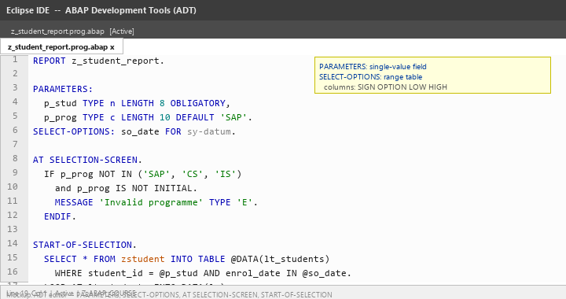
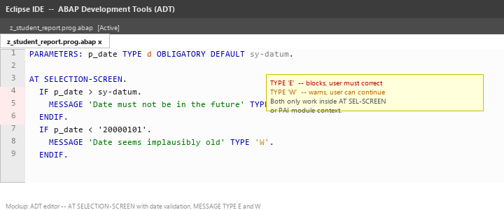
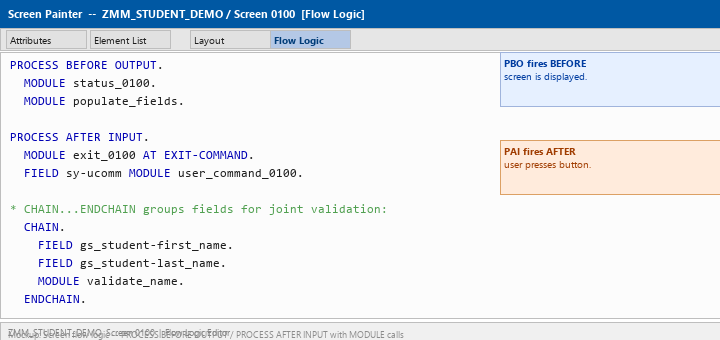
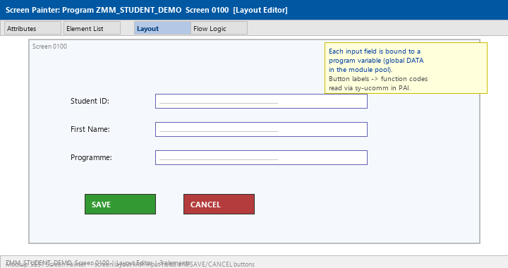
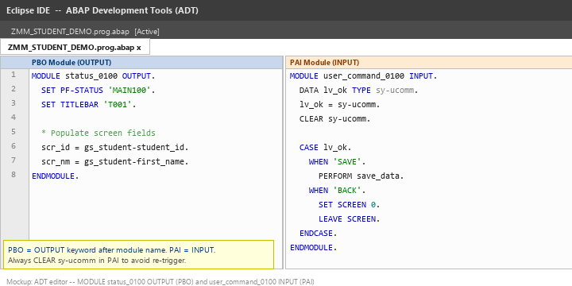
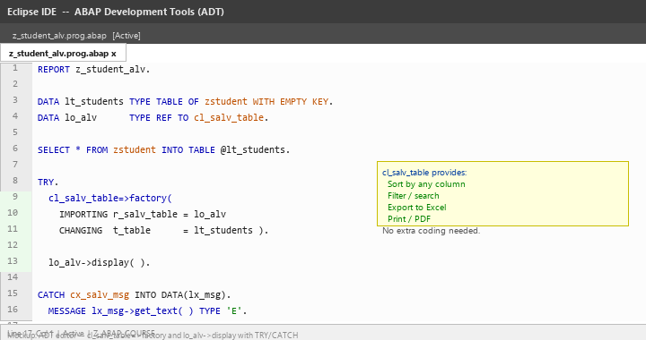
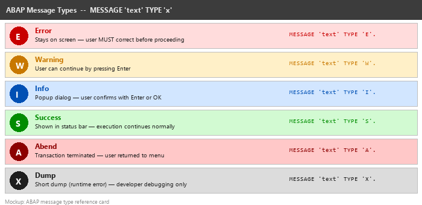
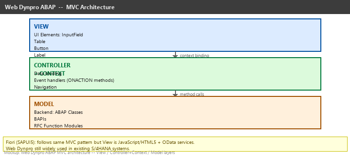

# Lecture 5: User Interface Programming

**Module:** M-SAP-WP-1.2 Client-Server Communication with SAP ABAP  
**Programme:** SAP Engineering and Analytics (M.Sc.)  
**Language:** English  
**Session duration:** 2 hours  
**Audience:** Students who have completed Lecture 4

---

## 1. Learning Objectives

After this session, you should be able to:

1. Explain the three main UI layers in SAP ABAP development.
2. Create selection screens using PARAMETERS and SELECT-OPTIONS.
3. Validate user input in the AT SELECTION-SCREEN event.
4. Explain the PBO/PAI processing model of Classical Dynpro.
5. Read screen flow logic code and identify PBO and PAI modules.
6. Display tabular data using ALV (cl_salv_table).
7. Use the correct MESSAGE type for different user-feedback scenarios.
8. Describe the MVC architecture of Web Dynpro ABAP at a conceptual level.

---

# Part A: The ABAP UI Landscape

## 2. Three UI Technologies

SAP ABAP supports multiple UI approaches, each suited to different eras and scenarios.

| Technology | Era | Where it runs | Key characteristic |
|---|---|---|---|
| **Classical Dynpro** | ECC / all | SAP GUI desktop | Screen-based, flow logic, still dominant in ECC |
| **Web Dynpro ABAP** | NetWeaver+ | Browser (SAP Web GUI) | MVC pattern, context binding, Java-style |
| **Fiori / SAPUI5** | S/4HANA | Browser / mobile | REST-based OData, modern UX, future direction |

For this lecture we focus on **Classical Dynpro** and **Selection Screens**, which every ABAP developer encounters regardless of the system version. Web Dynpro is covered conceptually. Fiori is introduced as the strategic direction.

> **Key idea:** Even in modern S/4HANA projects, developers maintain and extend existing Classical Dynpro transactions. Understanding PBO/PAI is therefore not optional.

---

# Part B: Selection Screens

## 3. PARAMETERS

`PARAMETERS` declares a single input field on the selection screen.

```abap
REPORT z_student_report.

PARAMETERS:
  p_stud  TYPE n LENGTH 8 OBLIGATORY,
  p_prog  TYPE c LENGTH 10 DEFAULT 'SAP',
  p_activ AS CHECKBOX DEFAULT 'X'.
```

| Keyword | Effect |
|---|---|
| `OBLIGATORY` | Field cannot be left blank |
| `DEFAULT 'x'` | Pre-fills the field |
| `AS CHECKBOX` | Renders as a tick box (value `'X'` or `' '`) |
| `AS LISTBOX` | Dropdown; use `VALUES` to provide options |

---

## 4. SELECT-OPTIONS

`SELECT-OPTIONS` generates a range field (low value, high value, inclusion/exclusion, comparison operator).

```abap
SELECT-OPTIONS:
  so_date FOR sy-datum,
  so_prog FOR zstudent-programme.
```

The result is an internal table with four columns: `SIGN`, `OPTION`, `LOW`, `HIGH`. Use it directly in a `WHERE ... IN so_date` clause.

---

## 5. SELECTION-SCREEN Blocks

Group related parameters visually:

```abap
SELECTION-SCREEN BEGIN OF BLOCK b1 WITH FRAME TITLE TEXT-001.
  PARAMETERS:
    p_stud TYPE n LENGTH 8 OBLIGATORY,
    p_prog TYPE c LENGTH 10 DEFAULT 'SAP'.
SELECTION-SCREEN END OF BLOCK b1.
```

---

## 6. AT SELECTION-SCREEN Validation

```abap
AT SELECTION-SCREEN.
  IF p_stud IS INITIAL.
    MESSAGE 'Student ID is required' TYPE 'E'.
  ENDIF.
  IF p_prog NOT IN ('SAP', 'CS', 'IS').
    MESSAGE 'Invalid programme code' TYPE 'E'.
  ENDIF.
```

`TYPE 'E'` keeps the user on the selection screen until the error is corrected.

```abap
START-OF-SELECTION.
  SELECT *
    FROM zstudent
    INTO TABLE @DATA(lt_students)
    WHERE student_id = @p_stud
      AND programme   IN @so_prog.

  LOOP AT lt_students INTO DATA(ls_student).
    WRITE: / ls_student-student_id,
             ls_student-first_name,
             ls_student-last_name.
  ENDLOOP.
```

The image below shows a selection screen program with PARAMETERS, SELECT-OPTIONS, and the START-OF-SELECTION event:



---

## 7. AT SELECTION-SCREEN — Date Validation Example

```abap
PARAMETERS: p_date TYPE d OBLIGATORY DEFAULT sy-datum.

AT SELECTION-SCREEN.
  IF p_date > sy-datum.
    MESSAGE 'Date must not be in the future' TYPE 'E'.
  ENDIF.
```

The image below shows this validation event in the ADT editor with a callout explaining MESSAGE TYPE 'E' behaviour:



---

# Part C: Classical Dynpro — Concepts

## 8. What Is a Dynpro?

A **Dynpro** (Dynamic Program) is SAP's screen technology. Every Classical Dynpro screen consists of:

1. **Screen attributes** — number, type (normal/subscreen/modal), title.
2. **Screen layout** — fields, buttons, labels defined in the Screen Painter (SE51).
3. **Flow logic** — a small language that controls which ABAP modules run at what point.

Programs that contain Dynpro screens are called **module pool programs** (program type `M`). They are assigned a transaction code via SE93.

---

## 9. PBO and PAI

The Dynpro runtime loop has two phases:

| Phase | When | Keyword in flow logic |
|---|---|---|
| **PBO** — Process Before Output | Before the screen is painted | `PROCESS BEFORE OUTPUT.` |
| **PAI** — Process After Input | After the user presses a button | `PROCESS AFTER INPUT.` |

Each phase calls one or more `MODULE` routines defined in the ABAP module pool.

```text
User sees screen
      ↑
   PBO runs
      ↑
Screen is displayed
      ↓
User presses button
      ↓
   PAI runs
      ↓
Next screen or same screen again
```

---

# Part D: Screen Flow Logic

## 10. Flow Logic Code

The flow logic is written in a dedicated editor within SE51 (or ADT for newer systems). It is **not** regular ABAP — it is a simplified control language.

```abap
PROCESS BEFORE OUTPUT.
  MODULE status_0100.
  MODULE populate_fields.

PROCESS AFTER INPUT.
  MODULE exit_0100 AT EXIT-COMMAND.
  FIELD sy-ucomm MODULE user_command_0100.
```

- `AT EXIT-COMMAND` makes the module run even when a back/cancel function code is used (needed for clean navigation).
- `FIELD fieldname MODULE modname` triggers `modname` only when `fieldname` changes.
- `CHAIN. FIELD f1. FIELD f2. ENDCHAIN.` groups fields so the module fires only when any of them changes.

The image below shows flow logic code in the screen flow logic editor alongside PBO and PAI labels:



---

## 11. CALL SCREEN and Screen Navigation

```abap
CALL SCREEN 200.           " open screen 200 as modal dialog
SET SCREEN 300.            " queue screen 300 as next screen
LEAVE TO SCREEN 100.       " jump to screen 100 immediately
LEAVE SCREEN.              " exit current screen, go to SET SCREEN target
SET SCREEN 0. LEAVE SCREEN." exit transaction
```

---

# Part E: Screen Painter Layout

## 12. Screen Elements

The SE51 Screen Painter provides a graphical layout editor. Common element types:

| Element | Purpose |
|---|---|
| Input/Output field | Bound to a program variable |
| Push button | Triggers a function code (PAI) |
| Check box | Boolean input |
| Radio button | Mutually exclusive options |
| Table control | Displays multiple rows of data |
| Sub-screen | Embeds another screen within this one |

The image below shows a simple SE51 screen layout with two input fields and Save/Cancel buttons:



---

# Part F: PBO and PAI Module Implementation

## 13. PBO Module — Set Status and Populate Fields

```abap
MODULE status_0100 OUTPUT.
  SET PF-STATUS 'MAIN100'.    " Assign menu/button bar
  SET TITLEBAR 'T001'.        " Set screen title
ENDMODULE.

MODULE populate_fields OUTPUT.
  " Copy program variables to screen fields
  scr_student_id = gs_student-student_id.
  scr_first_name = gs_student-first_name.
ENDMODULE.
```

## 14. PAI Module — Read OK Code and Branch

```abap
MODULE user_command_0100 INPUT.
  DATA lv_ok TYPE sy-ucomm.
  lv_ok = sy-ucomm.
  CLEAR sy-ucomm.

  CASE lv_ok.
    WHEN 'SAVE'.
      PERFORM save_student_data.
    WHEN 'BACK' OR 'EXIT'.
      LEAVE SCREEN.
    WHEN 'DISPLAY'.
      PERFORM display_student.
  ENDCASE.
ENDMODULE.
```

The image below shows both MODULE stubs — PBO on the left and PAI on the right — in the ADT editor:



---

# Part G: ALV — ABAP List Viewer

## 15. Why ALV?

`WRITE` produces simple flat-list output with no interactivity. The **ALV** (ABAP List Viewer) grid gives you sorting, filtering, column reordering, and Excel export automatically — with minimal code.

```abap
REPORT z_student_alv.

DATA lt_students TYPE TABLE OF zstudent WITH EMPTY KEY.
DATA lo_alv      TYPE REF TO cl_salv_table.

SELECT * FROM zstudent INTO TABLE @lt_students.

TRY.
  cl_salv_table=>factory(
    IMPORTING r_salv_table = lo_alv
    CHANGING  t_table      = lt_students ).

  lo_alv->display( ).

CATCH cx_salv_msg INTO DATA(lx_msg).
  MESSAGE lx_msg->get_text( ) TYPE 'E'.
ENDTRY.
```

### WRITE vs. ALV

| Feature | WRITE | cl_salv_table |
|---|---|---|
| Output type | Flat list | Interactive grid |
| Sort / filter | Manual SORT statement | User-controlled in grid |
| Excel export | Not available | Built-in toolbar button |
| Code complexity | Minimal | A few extra lines |
| Use case | Quick debug output | Real user-facing reports |

The image below shows the complete ALV report program in the ADT editor:



---

# Part H: Messages

## 16. MESSAGE Statement

```abap
MESSAGE 'Saved successfully'     TYPE 'S'.
MESSAGE 'Record not found'       TYPE 'W'.
MESSAGE 'Amount must be > 0'     TYPE 'E'.
MESSAGE 'Unexpected error'       TYPE 'A'.
```

Using a message class (defined in SE91):

```abap
MESSAGE e001(zmessages) WITH lv_student_id.
" e = type E, 001 = message number, zmessages = message class
" WITH provides up to 4 substitution values (&1, &2, &3, &4)
```

The image below shows a reference card of all six message types:



---

# Part I: Web Dynpro ABAP — Overview

## 17. Architecture

Web Dynpro ABAP follows the **Model-View-Controller** pattern:

- **View** — the UI layer: input fields, tables, buttons, labels defined in the Web Dynpro designer.
- **Controller** — handles events (ONACTION methods) and binds data via the **context**.
- **Context** — a tree of typed nodes that connects View UI elements to backend data automatically.
- **Model** — backend logic: ABAP classes, BAPIs, RFC function modules.

Unlike Dynpro, there is no flow logic file. Navigation is handled by **plugs** and **outbound plugs** between views.

The image below shows the Web Dynpro MVC architecture diagram:



### Fiori Direction

SAP's strategic UI framework is **Fiori**, built on **SAPUI5** (JavaScript/HTML5). Fiori apps consume OData services exposed from S/4HANA. While Fiori replaces Web Dynpro for new development, Web Dynpro remains in many existing S/4HANA systems and is still maintained.

---

# Part J: Hands-On Exercises

## 18. Exercise 1: Selection Screen Report

Create a report that:

1. Declares a `PARAMETERS` field for student ID (TYPE n LENGTH 8, OBLIGATORY).
2. Declares a `SELECT-OPTIONS` for the enrolment date.
3. In `START-OF-SELECTION`, selects from ZSTUDENT with WHERE student_id = p_stud AND enrol_date IN so_enrol.
4. Displays the results with WRITE.

```abap
REPORT z_student_selection.

PARAMETERS:   p_stud  TYPE n LENGTH 8 OBLIGATORY.
SELECT-OPTIONS: so_enrl FOR zstudent-enrol_date.

START-OF-SELECTION.
  SELECT *
    FROM zstudent
    INTO TABLE @DATA(lt_result)
    WHERE student_id  = @p_stud
      AND enrol_date IN @so_enrl.

  IF lt_result IS INITIAL.
    MESSAGE 'No records found' TYPE 'S'.
  ENDIF.

  LOOP AT lt_result INTO DATA(ls_row).
    WRITE: / ls_row-student_id,
             ls_row-first_name,
             ls_row-last_name,
             ls_row-enrol_date.
  ENDLOOP.
```

### Questions

1. What value does `sy-subrc` hold after the SELECT if no rows are found?
2. What does `SELECT-OPTIONS so_enrl FOR zstudent-enrol_date` generate in terms of internal table structure?

---

## 19. Exercise 2: AT SELECTION-SCREEN Date Validation

Extend the report from Exercise 1:

1. Add a second date parameter `p_date TYPE d`.
2. In `AT SELECTION-SCREEN`, raise a TYPE `'E'` message if `p_date` is in the future.
3. Test with a valid past date and an invalid future date.

```abap
PARAMETERS: p_date TYPE d OBLIGATORY DEFAULT sy-datum.

AT SELECTION-SCREEN.
  IF p_date > sy-datum.
    MESSAGE 'Date cannot be in the future' TYPE 'E'.
  ENDIF.
  IF p_date < '20000101'.
    MESSAGE 'Date is implausibly old' TYPE 'W'.
  ENDIF.
```

### Questions

1. What is the difference between MESSAGE TYPE 'E' and TYPE 'W' in the AT SELECTION-SCREEN event?
2. Can you raise TYPE 'E' inside START-OF-SELECTION? What happens if you do?

---

## 20. Exercise 3: Basic ALV Output

Replace the WRITE output from Exercise 1 with an ALV grid:

```abap
REPORT z_student_alv_report.

PARAMETERS: p_prog TYPE c LENGTH 10 DEFAULT 'SAP'.

START-OF-SELECTION.
  SELECT *
    FROM zstudent
    INTO TABLE @DATA(lt_students)
    WHERE programme = @p_prog.

  DATA lo_alv TYPE REF TO cl_salv_table.

  TRY.
    cl_salv_table=>factory(
      IMPORTING r_salv_table = lo_alv
      CHANGING  t_table      = lt_students ).

    " Optional: set column header for ENROL_DATE
    DATA(lo_cols) = lo_alv->get_columns( ).
    DATA(lo_col)  = lo_cols->get_column( 'ENROL_DATE' ).
    lo_col->set_long_text( 'Enrolment Date' ).

    lo_alv->display( ).

  CATCH cx_salv_msg cx_salv_not_found INTO DATA(lx).
    MESSAGE lx->get_text( ) TYPE 'E'.
  ENDTRY.
```

### Questions

1. What happens if `lt_students` is empty when you call `lo_alv->display( )`?
2. Which toolbar button in the ALV grid allows export to Microsoft Excel?

---

## 21. Exercise 4: Classical Dynpro Stub

This exercise is descriptive — perform it in your SAP system or follow the steps in your assigned environment.

**Steps:**

1. In SE80, create a new program `ZMM_STUDENT_DEMO` of type `M` (Module Pool).
2. Create screen `0100` in the Screen Painter. Add:
   - Input field bound to `ZMM_STUDENT_DEMO-GV_STUDENT_ID`
   - Input field bound to `ZMM_STUDENT_DEMO-GV_FIRST_NAME`
   - Push button with function code `SAVE` and label "Save"
   - Push button with function code `BACK` and label "Back"
3. Edit the screen flow logic:

```abap
PROCESS BEFORE OUTPUT.
  MODULE status_0100.

PROCESS AFTER INPUT.
  MODULE exit_0100 AT EXIT-COMMAND.
  MODULE user_command_0100.
```

4. Implement the modules in the module pool:

```abap
MODULE status_0100 OUTPUT.
  SET PF-STATUS 'MAIN100'.
  SET TITLEBAR 'TITLE100'.
ENDMODULE.

MODULE exit_0100 INPUT.
  LEAVE PROGRAM.
ENDMODULE.

MODULE user_command_0100 INPUT.
  CASE sy-ucomm.
    WHEN 'SAVE'.
      " insert save logic here
      MESSAGE 'Record saved' TYPE 'S'.
    WHEN 'BACK'.
      SET SCREEN 0.
      LEAVE SCREEN.
  ENDCASE.
ENDMODULE.
```

5. Create a transaction code `ZST1` in SE93 pointing to `ZMM_STUDENT_DEMO`, initial screen `0100`.
6. Test by running `/nZST1` in the SAP GUI command field.

---

# Part K: Independent Challenge

## 22. Full Filtered Student Transaction

Build a complete report that:

1. Has a selection screen with:
   - `SELECT-OPTIONS so_prog` for the programme field
   - `PARAMETERS p_sort TYPE c LENGTH 1 DEFAULT 'N'` (N = by name, D = by date)
2. In `AT SELECTION-SCREEN`, validate that every value in `so_prog` is one of `SAP`, `CS`, or `IS`. Issue a TYPE `'W'` warning for any unknown value.
3. In `START-OF-SELECTION`, read ZSTUDENT filtered by `so_prog`.
4. If `p_sort = 'N'`, sort by `last_name`. If `p_sort = 'D'`, sort by `enrol_date`.
5. Display in ALV.

### Bonus question

Add a calculated column "Years Enrolled" to the ALV output. You cannot add a column to a table type that does not have it — what are two approaches to include this calculated value in the ALV display?

---

# Part L: Common Beginner Mistakes

## 23. Missing ENDMODULE

Incorrect:

```abap
MODULE status_0100 OUTPUT.
  SET PF-STATUS 'MAIN100'.
" ENDMODULE.  <- forgotten
```

This causes a syntax error that can be hard to locate in a large module pool.

---

## 24. Using MESSAGE TYPE 'E' Outside PAI

Incorrect (causes a runtime dump if raised in START-OF-SELECTION):

```abap
START-OF-SELECTION.
  IF lt_result IS INITIAL.
    MESSAGE 'No data' TYPE 'E'.   " dumps outside of Dynpro context
  ENDIF.
```

Correct — use TYPE `'S'` in list context or raise before the event:

```abap
  IF lt_result IS INITIAL.
    MESSAGE 'No data found' TYPE 'S' DISPLAY LIKE 'W'.
    RETURN.
  ENDIF.
```

---

## 25. Forgetting SET SCREEN 0 / LEAVE SCREEN

If a PAI module for "Back" only contains `LEAVE SCREEN.` but there is no previous screen set, the system loops back to the same screen. Always pair:

```abap
SET SCREEN 0.
LEAVE SCREEN.
```

to exit a transaction cleanly.

---

# Part M: Knowledge Check

## 26. UI Landscape

1. Name three SAP ABAP UI technologies and one characteristic of each.
2. Which UI technology is SAP's current strategic direction for new Fiori apps?
3. In which tool do you create a Classical Dynpro screen layout?

## 27. Selection Screens

4. What keyword declares a single-value input field on the selection screen?
5. What does `SELECT-OPTIONS so_date FOR sy-datum` generate as a data object?
6. Which event fires for field validation before the main program logic runs?
7. What message type keeps the user on the selection screen after an error?
8. What is the purpose of `START-OF-SELECTION`?

## 28. Classical Dynpro

9. What does PBO stand for, and when does it fire?
10. What does PAI stand for, and when does it fire?
11. What is `sy-ucomm` and where do you read it?
12. What statement sets the button bar for a screen?
13. How do you navigate cleanly out of a transaction from a PAI module?
14. What is the difference between `LEAVE SCREEN` and `LEAVE TO SCREEN n`?

## 29. ALV and Messages

15. What class is used for the simple object-based ALV?
16. What method displays the ALV grid?
17. What exception class should you catch when using `cl_salv_table=>factory`?
18. List the six MESSAGE types and one-line descriptions for each.
19. Where are message texts stored (which transaction)?

---

# Part N: Preparation for Lecture 6

## 30. Before the Next Session

Make sure you can:

1. Create a basic selection screen report that reads from ZSTUDENT and displays results.
2. Explain what PBO and PAI mean without looking at your notes.
3. Write the two lines of code that exit a Classical Dynpro transaction cleanly.

Lecture 6 covers Enhancements and Modifications — how to extend standard SAP behaviour without changing SAP's own code. This is one of the most critical skills in real SAP projects.

---

# Next Lecture

## Lecture 6: Enhancements and Modifications

We will cover:

- Why modification of SAP standard code is discouraged
- User Exits (exit function modules in standard programs)
- Customer Exits (CMOD / SMOD)
- Enhancement Framework and Enhancement Points
- Business Add-Ins (BAdIs) — definition and implementation
- Enhancement Spots
- Practical BAdI implementation in ADT

---

# Suggested References

**Mandatory reading from the module handbook:**

- Horst Keller, *ABAP Objects: Introduction to Programming SAP Applications*, 4th Edition, SAP PRESS, 2020.  
  Chapter on Dynpro programming and selection screens.

**Further reading:**

- Paul Hardy, *ABAP to the Future*, 3rd Edition, SAP PRESS, 2019.  
  Modern UI approaches including ALV and Fiori integration.
- Thomas Schneider, *Getting Started with ABAP*, SAP PRESS, 2016.  
  Selection screens and basic Dynpro explained with screenshots.

---

## Session Summary

After Lecture 5, the most important ideas to remember are:

1. Selection screens use `PARAMETERS` (single value) and `SELECT-OPTIONS` (range) to collect user input.
2. `AT SELECTION-SCREEN` validates input before program execution — use `MESSAGE TYPE 'E'` to stop and correct.
3. Classical Dynpro follows a PBO/PAI loop: PBO prepares the screen, PAI reacts to user actions.
4. `cl_salv_table=>factory` + `display( )` gives a full interactive ALV grid with minimal code.
5. MESSAGE type determines whether the user must correct an error, can proceed, or sees a popup.

**Next step:** Lecture 6 shows how to extend SAP standard processes cleanly using the Enhancement Framework and BAdIs — without modifying SAP's own source code.
