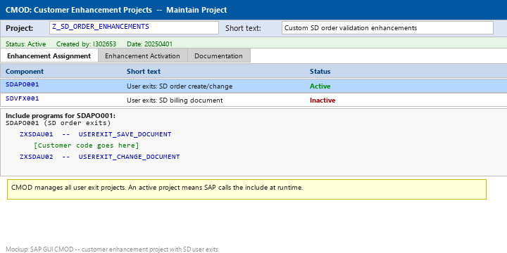
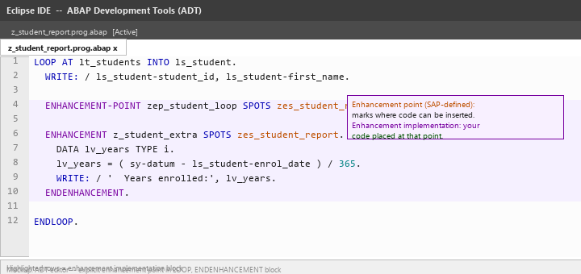
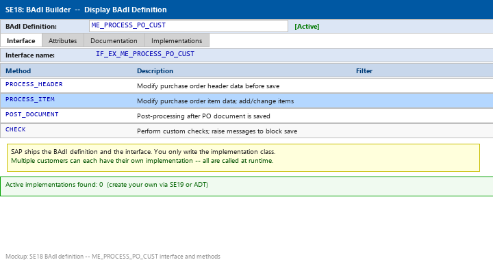
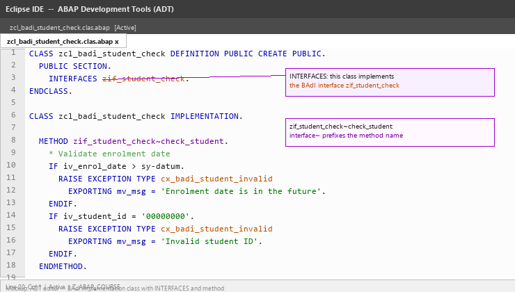
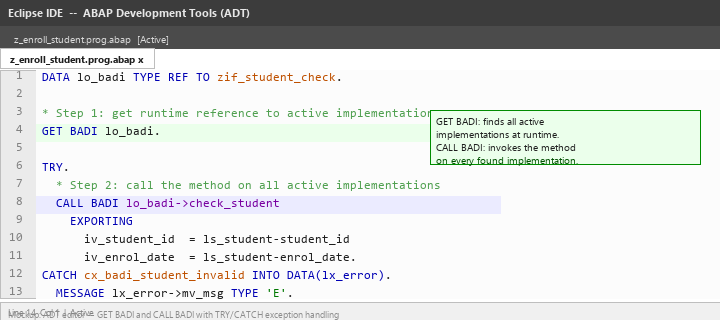
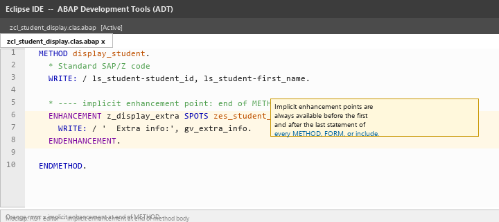
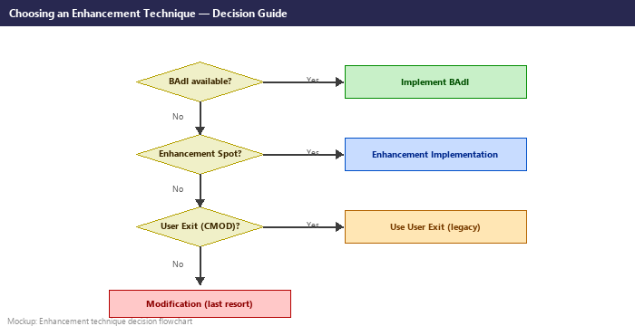
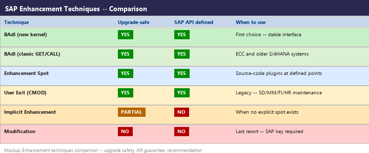

# Lecture 6: Enhancements and Modifications

**Module:** M-SAP-WP-1.2 Client-Server Communication with SAP ABAP  
**Programme:** SAP Engineering and Analytics (M.Sc.)  
**Language:** English  
**Session duration:** 2 hours  
**Audience:** Students who have completed Lecture 5

---

## 1. Learning Objectives

After this session, you should be able to:

1. Explain why SAP customers enhance rather than modify standard software.
2. Describe the difference between a modification and an upgrade-safe enhancement.
3. Identify and use classic user exits via CMOD.
4. Explain what a BAdI is and how it differs from a user exit.
5. Create a BAdI implementation class that implements a BAdI interface.
6. Use GET BADI and CALL BADI syntax (classic) to call a BAdI at runtime.
7. Distinguish between explicit and implicit enhancement points.
8. Select the appropriate enhancement technique for a given scenario.

---

# Part A: Why Enhancements?

## 2. The Core Problem

SAP ships standard software used by thousands of organisations worldwide. Every company has unique processes, and no standard product can cover every requirement. Customers therefore need to add or change business logic.

However, **modifying SAP standard source code directly is dangerous**:

- SAP support packages and upgrades overwrite modified programs.
- Modified code requires a **modification key** from SAP, creating a formal record.
- Modifications break during system upgrades unless re-applied manually.
- Modified code is no longer supported by SAP.

### The Golden Rule

> **Enhance, don't modify.**

An **enhancement** adds custom logic at a point SAP has designed specifically for extensions. Enhancements are upgrade-safe: when SAP ships a new support package, the enhancement points remain, and your logic stays intact.

### Modification vs. Enhancement

| | Modification | Enhancement |
|---|---|---|
| What you change | SAP source code directly | Customer logic at defined extension points |
| Upgrade behaviour | Overwritten — must be re-applied | Preserved automatically |
| SAP key required | Yes | No |
| Risk | High | Low |
| SAP support | Lost | Maintained |

---

# Part B: Classic User Exits

## 3. What Are User Exits?

User exits were SAP's original extension mechanism, introduced before the Enhancement Framework. They come in several forms:

- **Source code exits** — SAP includes empty ABAP include programs (e.g. `ZXSDAU01`) inside standard function modules. You add your code to the include.
- **Function module exits** — SAP calls a customer-defined function module at a defined point.
- **Menu exits** — add items to SAP standard menus.
- **Screen exits** — add custom subscreen areas to standard screens.

### CMOD — Customer Enhancement Projects

All user exits are managed via transaction **CMOD**. A **project** groups related exit components:

1. Go to CMOD and create a new project (e.g. `Z_SD_ORDER_ENH`).
2. Assign the relevant SAP exit component (e.g. `SDAPO001` for SD order processing).
3. Navigate to the include program (e.g. `ZXSDAU01`) and add your ABAP code.
4. Activate the project.

```abap
* Include ZXSDAU01 — user exit for SD order SAVE
* This include is called by SAP's USEREXIT_SAVE_DOCUMENT

DATA lv_order_id TYPE vbeln.
lv_order_id = vbap-vbeln.

" Custom validation: reject orders with zero quantity
IF vbap-kwmeng = 0.
  MESSAGE 'Order item quantity must not be zero.' TYPE 'E'.
ENDIF.
```

The image below shows a CMOD project with an assigned exit component:



> **Note:** User exits are a legacy technique. They still exist in many ECC and S/4HANA systems and are worth understanding. However, BAdIs and the Enhancement Framework are the modern replacement.

---

# Part C: Customer Exits

## 4. Function Module Exits

SAP provides **customer exits** — empty function modules that SAP calls at specific points using the `CALL CUSTOMER-FUNCTION` statement inside its own code:

```abap
* Inside SAP standard code (not editable by customer):
CALL CUSTOMER-FUNCTION '001'
  EXPORTING
    i_vbeln = vbak-vbeln
  CHANGING
    c_approval = lv_approval.
```

SAP generates an include program `ZXVBCKxx` (the naming pattern is `ZX` + module prefix + two-digit suffix). The customer fills in this include.

### Difference from Enhancement Spots

| | Customer Exit | Enhancement Spot |
|---|---|---|
| Defined by | SAP (in older releases) | SAP (Enhancement Framework) |
| Mechanism | Empty function module | Source code plug-in |
| Typing | Formal IMPORTING/EXPORTING | Any ABAP code |
| Modern equivalent | BAdI | Explicit enhancement point |

Customer exits and user exits collectively cover thousands of extension points across SD, MM, FI, CO, and HR modules.

---

# Part D: Enhancement Framework — Spots and Implementations

## 5. Enhancement Points and Spots

The **Enhancement Framework** (introduced with SAP NetWeaver 7.0) provides a structured, repository-managed approach to enhancements.

### Key Concepts

- **Enhancement spot** — a named location in source code where extensions are allowed. SAP defines these in standard programs.
- **Enhancement point** — a specific point within a spot where code can be inserted.
- **Enhancement implementation** — the customer-written ABAP code that is placed at an enhancement point.

### Syntax in Source Code

SAP-defined enhancement point (you see this in standard code):

```abap
ENHANCEMENT-POINT zesp_before_save SPOTS zes_sd_order_save.
```

Customer-written implementation (you create this in ADT or SE80):

```abap
ENHANCEMENT z_sd_order_custom_check SPOTS zes_sd_order_save.
  " Your custom ABAP code here
  IF ls_order-total_value > 100000.
    MESSAGE 'Large order requires manager approval' TYPE 'W'.
  ENDIF.
ENDENHANCEMENT.
```

### Types of Enhancement Implementations

| Type | What you can do |
|---|---|
| Source code plug-in | Insert arbitrary ABAP statements |
| New method | Add a method to an existing SAP class |
| New attribute | Add a data attribute to an existing SAP class |
| Method override | Replace the implementation of a final method (restricted) |

The image below shows an explicit enhancement point in an ABAP program:



---

# Part E: BAdIs — Business Add-Ins

## 6. What Is a BAdI?

A **BAdI (Business Add-In)** is the most important and most commonly used SAP enhancement technique.

### How a BAdI Works

1. SAP defines an **interface** (e.g. `IF_EX_ME_PROCESS_PO_CUST`) with methods.
2. SAP calls all **active implementations** of that interface at a defined point in its code.
3. You create a **class** that implements the interface and activate it.
4. At runtime, SAP's code finds your class and calls your method.

```
SAP Standard Code
      |
      | calls BAdI
      v
BAdI Runtime Engine
      |
      | finds all active implementations
      v
YOUR implementation class (ZCL_MY_BADI_IMPL)
      |
      | your method executes
      v
control returns to SAP
```

### Classic BAdI vs. New BAdI (Kernel BAdI)

| | Classic BAdI (SAP_BADI) | New BAdI (ABAP OO kernel) |
|---|---|---|
| Transaction | SE18 / SE19 | ADT or SE18 |
| Calling syntax | GET BADI / CALL BADI | Direct interface reference |
| Multiple instances | Yes | Yes |
| Recommended for | ECC and legacy S/4HANA | Modern S/4HANA development |

The image below shows a BAdI definition in SE18:



---

## 7. Finding a BAdI

To find available BAdIs for a process:

1. **ADT**: In the Project Explorer, navigate to a package, right-click → New → BAdI Implementation.
2. **SE18**: Enter the BAdI name or search by description.
3. **Runtime trace**: Use transaction `SAAB` or runtime analysis to identify BAdIs called during a transaction.
4. **SAP documentation and community**: BAdIs are documented in the ABAP Workbench tools.

---

# Part F: Implementing a BAdI

## 8. Steps to Implement a BAdI

1. Find the BAdI definition (SE18 or ADT).
2. Note the interface name (e.g. `ZIF_STUDENT_CHECK`).
3. Create an implementation class that uses `INTERFACES` to implement the BAdI interface.
4. Write the method logic.
5. Create the BAdI implementation in SE19 or ADT (link your class to the BAdI).
6. Activate the implementation.

### Implementation Class Example

```abap
CLASS zcl_badi_student_check DEFINITION
  PUBLIC
  CREATE PUBLIC.

  PUBLIC SECTION.
    INTERFACES zif_student_check.

ENDCLASS.

CLASS zcl_badi_student_check IMPLEMENTATION.

  METHOD zif_student_check~check_student.
    " Validate that enrolment date is not in the future
    IF iv_enrol_date > sy-datum.
      RAISE EXCEPTION TYPE cx_badi_student_invalid
        EXPORTING
          mv_msg = 'Enrolment date must not be in the future'.
    ENDIF.

    " Validate student ID format
    IF iv_student_id = '00000000'.
      RAISE EXCEPTION TYPE cx_badi_student_invalid
        EXPORTING
          mv_msg = 'Student ID 00000000 is not valid'.
    ENDIF.
  ENDMETHOD.

ENDCLASS.
```

The image below shows the BAdI implementation class in the ADT editor:



---

## 9. Calling the BAdI — Classic Syntax

```abap
DATA lo_badi TYPE REF TO zif_student_check.

" GET BADI retrieves all active implementations at runtime
GET BADI lo_badi.

TRY.
  " CALL BADI invokes the method on all implementations
  CALL BADI lo_badi->check_student
    EXPORTING
      iv_student_id  = ls_student-student_id
      iv_enrol_date  = ls_student-enrol_date.

CATCH cx_badi_student_invalid INTO DATA(lx_error).
  MESSAGE lx_error->mv_msg TYPE 'E'.
ENDTRY.
```

The image below shows the GET BADI and CALL BADI pattern:



---

# Part G: Enhancement Spots — Explicit and Implicit

## 10. Explicit Enhancement Points

An **explicit enhancement point** is one that SAP has deliberately placed in source code with a named spot. These are the safest and most stable because:

- SAP guarantees the point will remain across upgrades.
- The interface (what data is available at that point) is documented.
- Conflicts between multiple enhancements at the same point are manageable.

```abap
" SAP standard code (illustrative)
LOOP AT lt_orders INTO ls_order.
  PERFORM process_order USING ls_order.

  " Explicit enhancement point defined by SAP
  ENHANCEMENT-POINT zesp_after_order_process SPOTS zes_order_processing.

ENDLOOP.
```

```abap
" Your implementation
ENHANCEMENT z_custom_order_log SPOTS zes_order_processing.
  " Log all processed orders to a Z-table
  ls_log-order_id   = ls_order-vbeln.
  ls_log-process_ts = sy-datum.
  APPEND ls_log TO lt_log.
ENDENHANCEMENT.
```

---

## 11. Implicit Enhancement Points

**Implicit enhancement points** are automatically available at the beginning and end of every:

- Include program
- Function module
- Method
- Form routine

They do not require SAP to explicitly define them. This means you can always add code even where no explicit spot exists. However:

- They are less stable — code structure changes in upgrades can affect them.
- No interface guarantee — the variables available depend on the surrounding code.
- Use only when no explicit point covers your need.

The image below shows an implicit enhancement at the end of a method:



---

# Part H: Choosing the Right Technique

## 12. Enhancement Technique Decision Guide

When starting a custom enhancement project, work through this decision process:

**Step 1:** Is there a **BAdI** for the process?
- Yes → Implement the BAdI. This is the recommended approach for all modern SAP development.

**Step 2:** Is there an **enhancement spot** or **enhancement point**?
- Yes → Create an enhancement implementation at that spot.

**Step 3:** Is there a **user exit** or **customer exit** (CMOD)?
- Yes → Use the user exit. This is legacy but still valid and commonly found in SD, MM, FI, HR.

**Step 4:** No structured extension point exists?
- Consider an **implicit enhancement point** at the begin/end of the relevant include or method.

**Last resort:** **Modification** (changing SAP standard source directly).
- Requires a modification key from SAP.
- Must be re-applied after every support package.
- SAP support is no longer available for modified areas.
- Only justified when no other option exists and the business need is critical.

The decision flowchart below summarises this:



The reference table below compares all techniques:



---

# Part I: Hands-On Exercises

## 13. Exercise 1: Research a Real BAdI

### Objective

Explore the BAdI `ME_PROCESS_PO_CUST` in your SAP system or using SAP documentation.

### Steps

1. Open transaction SE18 (or use ADT) and display the BAdI definition for `ME_PROCESS_PO_CUST`.
2. Note the interface name.
3. List all methods and write a one-sentence description of what each method does.
4. Identify what importing/exporting parameters the method `PROCESS_ITEM` has.

### Questions

1. How many methods does this BAdI define?
2. At what point in a purchase order transaction would this BAdI be called?
3. What is the difference between `PROCESS_HEADER` and `PROCESS_ITEM`?

---

## 14. Exercise 2: BAdI Implementation Class

### Objective

Write a complete BAdI implementation class `ZCL_BADI_STUDENT_CHECK` that validates a student record.

```abap
" First define the interface (BAdI definition — done by SAP; here we simulate it)
INTERFACE zif_student_check.
  METHODS check_student
    IMPORTING
      iv_student_id TYPE n LENGTH 8
      iv_enrol_date TYPE d
    RAISING
      cx_badi_student_invalid.
ENDINTERFACE.

" Now create the implementation class
CLASS zcl_badi_student_check DEFINITION
  PUBLIC
  CREATE PUBLIC.
  PUBLIC SECTION.
    INTERFACES zif_student_check.
ENDCLASS.

CLASS zcl_badi_student_check IMPLEMENTATION.
  METHOD zif_student_check~check_student.
    IF iv_enrol_date > sy-datum.
      RAISE EXCEPTION TYPE cx_badi_student_invalid
        EXPORTING
          mv_msg = 'Enrolment date is in the future'.
    ENDIF.
    IF iv_student_id = '00000000'.
      RAISE EXCEPTION TYPE cx_badi_student_invalid
        EXPORTING
          mv_msg = 'Invalid student ID: 00000000'.
    ENDIF.
  ENDMETHOD.
ENDCLASS.
```

### Questions

1. What does the `~` operator signify in `zif_student_check~check_student`?
2. Why is `RAISE EXCEPTION` used instead of `MESSAGE ... TYPE 'E'`?
3. How would you add a second validation rule — for example, checking that the student's programme is valid?

---

## 15. Exercise 3: Explicit Enhancement

### Objective

Add an explicit enhancement to the student report from Exercise 4 (Lecture 4).

### Steps

1. Open your `z_student_alv` or `z_read_students` program.
2. Add an enhancement point directly after the LOOP AT statement:

```abap
LOOP AT lt_students INTO ls_student.
  " Existing display code
  WRITE: / ls_student-student_id, ls_student-first_name.

  ENHANCEMENT-POINT zep_student_loop SPOTS zes_student_report.

ENDLOOP.
```

3. Create the enhancement spot `zes_student_report` in SE80 or ADT.
4. Create an enhancement implementation `z_student_extra`:

```abap
ENHANCEMENT z_student_extra SPOTS zes_student_report.
  " Calculate years enrolled
  DATA lv_years TYPE i.
  lv_years = ( sy-datum - ls_student-enrol_date ) / 365.
  WRITE: '  Years enrolled:', lv_years.
ENDENHANCEMENT.
```

5. Activate and execute the program.

### Questions

1. Where does the enhancement code execute relative to the WRITE statement inside the LOOP?
2. What would happen if you deactivated the enhancement implementation?
3. What is the difference between this and simply editing the source code directly?

---

## 16. Exercise 4: CMOD User Exit Simulation

### Objective

Understand the CMOD user exit workflow by following these steps in your SAP system.

### Steps

1. Go to transaction **CMOD**.
2. Enter project name `Z_STUDENT_EXITS` and click **Create**.
3. Enter a short description: "Student management user exits".
4. Click **Enhancement Assignments** and search for a suitable exit component.
5. Find the include program for the exit and open it.
6. Add a simple WRITE statement as a placeholder:

```abap
* Z-include for user exit
WRITE: / 'User exit called at:', sy-datum, sy-uzeit.
```

7. Activate the project.

### Questions

1. What is the difference between activating the include and activating the project?
2. How would you temporarily disable the exit without deleting your code?
3. Why is it important to document which exits a project uses?

---

# Part J: Independent Challenge

## 17. Full BAdI-Based Course Enrollment Enhancement

Design and implement a complete BAdI-based enhancement for a **course enrollment** process.

### Requirements

Define a BAdI interface `ZIF_ENROLLMENT_CHECK` with two methods:

- `CHECK_ENROLLMENT` — validates whether a student may enroll (maximum 30 students per course, student must not already be enrolled).
- `LOG_ENROLLMENT` — writes an entry to a Z-table `ZENROLLMENT_LOG` after successful enrollment.

### Implementation Class

```abap
INTERFACE zif_enrollment_check.
  METHODS:
    check_enrollment
      IMPORTING
        iv_student_id TYPE n LENGTH 8
        iv_course_id  TYPE c LENGTH 10
      RAISING
        cx_enrollment_rejected,

    log_enrollment
      IMPORTING
        iv_student_id TYPE n LENGTH 8
        iv_course_id  TYPE c LENGTH 10
        iv_enrol_date TYPE d.
ENDINTERFACE.

CLASS zcl_enrollment_badi DEFINITION PUBLIC CREATE PUBLIC.
  PUBLIC SECTION.
    INTERFACES zif_enrollment_check.
  PRIVATE SECTION.
    METHODS get_enrollment_count
      IMPORTING iv_course_id  TYPE c LENGTH 10
      RETURNING VALUE(rv_count) TYPE i.
ENDCLASS.

CLASS zcl_enrollment_badi IMPLEMENTATION.

  METHOD zif_enrollment_check~check_enrollment.
    DATA lv_count TYPE i.

    " Check maximum capacity
    lv_count = get_enrollment_count( iv_course_id ).
    IF lv_count >= 30.
      RAISE EXCEPTION TYPE cx_enrollment_rejected
        EXPORTING mv_msg = 'Course is full (max 30 students)'.
    ENDIF.

    " Check if already enrolled
    SELECT COUNT(*) FROM zenrollment_log
      INTO @DATA(lv_enrolled)
      WHERE student_id = @iv_student_id
        AND course_id  = @iv_course_id.
    IF lv_enrolled > 0.
      RAISE EXCEPTION TYPE cx_enrollment_rejected
        EXPORTING mv_msg = 'Student is already enrolled in this course'.
    ENDIF.
  ENDMETHOD.

  METHOD zif_enrollment_check~log_enrollment.
    DATA ls_log TYPE zenrollment_log.
    ls_log-student_id  = iv_student_id.
    ls_log-course_id   = iv_course_id.
    ls_log-enrol_date  = iv_enrol_date.
    ls_log-created_by  = sy-uname.
    ls_log-created_at  = sy-datum.
    INSERT zenrollment_log FROM ls_log.
    IF sy-subrc <> 0.
      " Log failure is non-critical — continue
    ENDIF.
  ENDMETHOD.

  METHOD get_enrollment_count.
    SELECT COUNT(*) FROM zenrollment_log
      INTO @rv_count
      WHERE course_id = @iv_course_id.
  ENDMETHOD.

ENDCLASS.
```

### Test Harness

```abap
REPORT z_test_enrollment_badi.

DATA lo_badi TYPE REF TO zif_enrollment_check.
GET BADI lo_badi.

TRY.
  CALL BADI lo_badi->check_enrollment
    EXPORTING
      iv_student_id = '00000042'
      iv_course_id  = 'SAP_ABAP'.

  CALL BADI lo_badi->log_enrollment
    EXPORTING
      iv_student_id = '00000042'
      iv_course_id  = 'SAP_ABAP'
      iv_enrol_date = sy-datum.

  WRITE: / 'Enrollment successful.'.

CATCH cx_enrollment_rejected INTO DATA(lx_err).
  MESSAGE lx_err->mv_msg TYPE 'E'.
ENDTRY.
```

### Bonus Question

Why is the `log_enrollment` method separated from `check_enrollment` rather than combined into one method? What design principle does this follow?

---

# Part K: Common Beginner Mistakes

## 18. Implementing a BAdI but Forgetting to Activate

The most common mistake. The class compiles without errors, but at runtime nothing happens because the BAdI implementation is inactive.

**Always check:** In SE19 or ADT, verify that the implementation status shows **Active**.

---

## 19. Creating a Modification Instead of an Enhancement

Editing SAP standard code in SE38 without a clear justification. Signs this happened:

- The system asked for a **modification key** and you entered one.
- The object now shows `M` (modified) in its status.

**Prevention:** Always search SE18 (BAdIs) and enhancement spots before touching SAP standard code.

---

## 20. Using an Implicit Enhancement When an Explicit One Exists

Implicit enhancements are available everywhere, which makes them tempting. But if SAP has defined an explicit enhancement point for the same location, that point is more stable and better documented. Always check for explicit points first.

---

## 21. Leaving a BAdI Inactive in Production

A BAdI implementation that is inactive in development but accidentally transported active to production (or vice versa) causes inconsistent behaviour. Always verify transport request contents before release.

---

# Part L: Knowledge Check

## 22. Enhancements vs. Modifications

You should be able to answer:

1. What is the main risk of modifying SAP standard code?
2. What does "upgrade-safe" mean in the context of enhancements?
3. When is a modification key required?
4. What is the golden rule of SAP development?

## 23. User Exits and CMOD

5. What transaction is used to manage user exit projects?
6. What is the difference between a source code exit and a function module exit?
7. Where do you add code for a user exit?
8. How do you temporarily disable a user exit project without deleting code?

## 24. BAdIs

9. What is the difference between a BAdI definition and a BAdI implementation?
10. What ABAP statement is used to retrieve a BAdI reference at runtime (classic syntax)?
11. What does `IF_EX~method_name` mean in an implementation class?
12. How can multiple customer implementations of the same BAdI coexist?
13. What happens if a BAdI implementation is inactive?

## 25. Enhancement Framework

14. What is the difference between an explicit and an implicit enhancement point?
15. In which three types of program objects are implicit enhancement points always available?
16. Which technique is preferred when both a BAdI and an enhancement spot exist?

---

# Part M: Preparation for Lecture 7

## 26. Before the Next Session

Reflect on the following question:

> An ABAP developer complains that a report runs for 20 minutes and times out in production. Where would you look first, and what tools would you use?

You do not need to have a complete answer yet. Lecture 7 covers exactly this: how to find and fix performance problems in ABAP programs.

Make sure you can independently:

1. Write a simple LOOP AT with ASSIGNING that modifies rows in place.
2. Write a SELECT statement with a WHERE clause.
3. Describe what the application server does vs. what the database does.

These concepts are the foundation for understanding SQL and internal table performance.

---

# Next Lecture

## Lecture 7: Performance Tuning and Best Practices

We will cover:

- Why performance matters in SAP (shared resources, large data volumes)
- SQL optimisation: SELECT field lists, WHERE clauses, JOINs vs. nested SELECTs
- `SELECT ... FOR ALL ENTRIES IN` pattern
- Internal table optimisation: sorted tables, hashed tables, secondary keys
- Buffering: table buffer, program buffer, shared objects
- Runtime analysis tools: ST05 SQL Trace, SAT (ABAP runtime analysis)
- Reading and interpreting a performance trace
- Best practices checklist

---

# Suggested References

For technical reference during the module, students should use SAP's official ABAP documentation and the reading list provided in the module description.

**Mandatory reading from the module handbook:**

- Horst Keller, *ABAP Objects: Introduction to Programming SAP Applications*, 4th Edition, SAP PRESS, 2020.  
  Chapter on Enhancements covers BAdIs and the Enhancement Framework in depth.

**Further reading:**

- Paul Hardy, *ABAP to the Future*, 3rd Edition, SAP PRESS, 2019.  
  Chapter on enhancements and BAdIs with modern ABAP patterns.
- SAP Help Portal — BAdI documentation:  
  Search "Business Add-In" in help.sap.com for the authoritative reference.
- Community resources at community.sap.com for real-world BAdI examples.

---

## Session Summary

After Lecture 6, the most important ideas to remember are:

1. **Enhance, don't modify** — modifications are overwritten by upgrades; enhancements survive them.
2. **BAdIs** are the preferred extension mechanism: SAP ships an interface; you implement it in a class.
3. **GET BADI / CALL BADI** (classic syntax) or direct interface instantiation (new BAdI) finds and calls your implementation at runtime.
4. **Enhancement spots** allow source-code plug-ins at SAP-defined locations; implicit enhancement points are always available as a fallback.
5. **CMOD user exits** are legacy but still found throughout ECC and S/4HANA — understanding them is essential for maintenance work.

**Next step:** In Lecture 7 we shift focus from correctness to efficiency — learning to find, analyse, and fix performance problems in ABAP programs.
