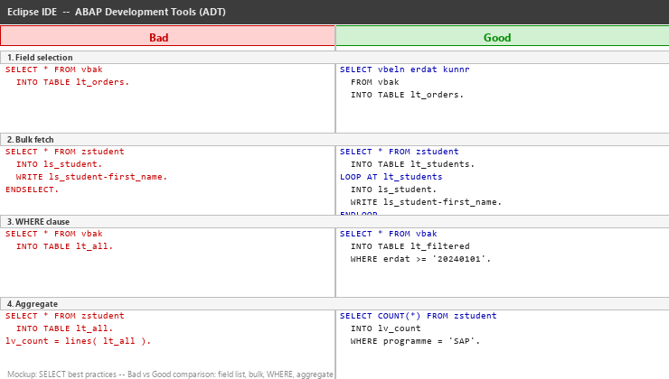
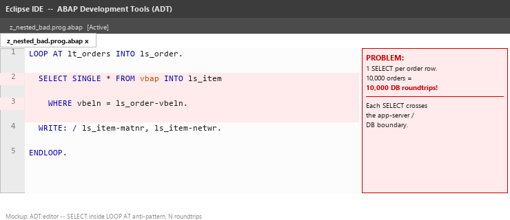
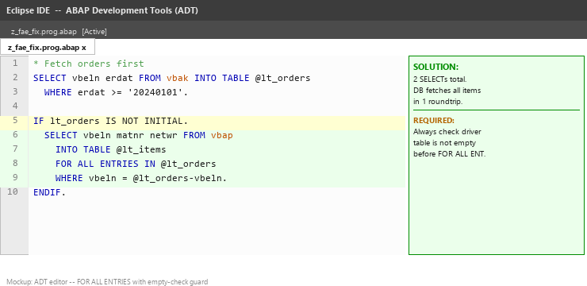
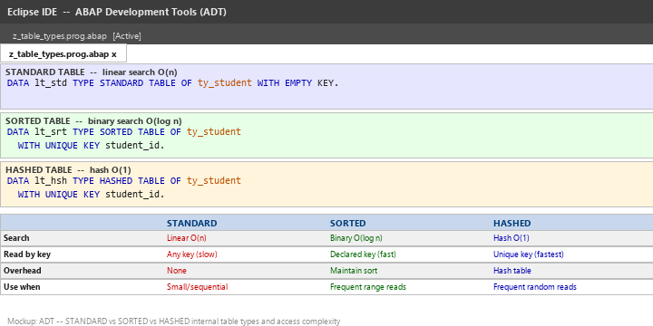
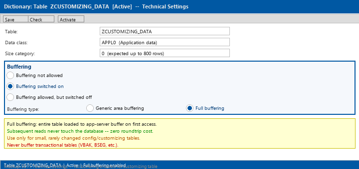
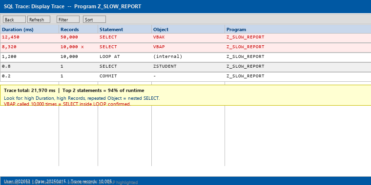
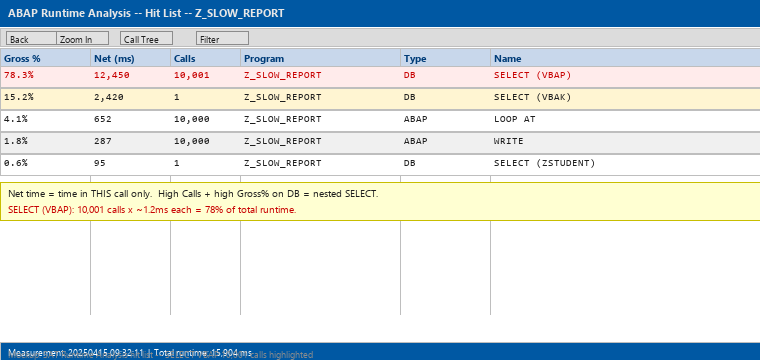
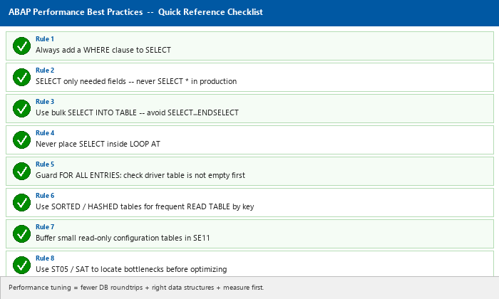

# Lecture 7: Performance Tuning and Best Practices

**Module:** M-SAP-WP-1.2 Client-Server Communication with SAP ABAP  
**Programme:** SAP Engineering and Analytics (M.Sc.)  
**Language:** English  
**Session duration:** 2 hours  
**Audience:** Students who have completed Lectures 1–6

---

## 1. Learning Objectives

After this session, you should be able to:

1. Explain why database access is the primary performance bottleneck in ABAP programs.
2. Apply SELECT best practices: field lists, WHERE clauses, bulk fetching.
3. Identify and eliminate nested SELECT anti-patterns using JOIN or FOR ALL ENTRIES.
4. Choose the correct internal table type (STANDARD, SORTED, HASHED) for a given access pattern.
5. Describe table buffering and when to apply it.
6. Use ST05 (SQL Trace) and SAT (Runtime Analysis) to locate performance bottlenecks.
7. Refactor a slow program applying the best-practice checklist.

---

# Part A: Why Performance Matters in SAP

## 2. The Cost of Slow Code

SAP systems can hold hundreds of millions of business records — orders, deliveries, financial postings. A single report that runs a few seconds for a developer can run for hours in production against full data volumes.

### Why the Application Server / Database Boundary Is Critical

Recall the three-tier architecture from Lecture 1:

```text
CLIENT / USER INTERFACE
        |
ABAP APPLICATION SERVER   <-- ABAP code runs here
        |
DATABASE                  <-- Data lives here
```

Every `SELECT` statement crosses the network boundary between the application server and the database. This roundtrip has a fixed overhead cost regardless of how many rows are returned.

> **The single most important performance rule:** reduce the number of database roundtrips.

### Common Performance Killers

| Problem | Impact |
|---|---|
| SELECT inside a LOOP | 1 roundtrip per table row — catastrophic |
| SELECT * (all fields) | Transfers unnecessary data across the network |
| No WHERE clause | Full table scan; database reads every row |
| ABAP-side filtering | Fetches too much, discards most in ABAP |
| Wrong internal table type | O(n) search on large tables |

---

# Part B: SQL Optimization — SELECT Best Practices

## 3. Rule 1 — Always Use a WHERE Clause

Never read an entire large table into memory without filtering first.

Incorrect:

```abap
SELECT * FROM vbak INTO TABLE lt_orders.   " Full table scan — millions of rows
```

Correct:

```abap
SELECT * FROM vbak INTO TABLE lt_orders
  WHERE erdat >= '20240101'
    AND vkorg = '1000'.
```

---

## 4. Rule 2 — SELECT Only the Fields You Need

Transferring unused fields wastes network bandwidth and memory.

Incorrect:

```abap
SELECT * FROM vbak INTO TABLE lt_orders.
```

Correct:

```abap
SELECT vbeln erdat kunnr netwr
  FROM vbak
  INTO TABLE @DATA(lt_orders)
  WHERE erdat >= '20240101'.
```

---

## 5. Rule 3 — Use Bulk Fetch, Not SELECT … ENDSELECT

`SELECT … ENDSELECT` issues one roundtrip per row.

Incorrect:

```abap
SELECT * FROM zstudent INTO ls_student.   " One DB call per row
  WRITE: / ls_student-first_name.
ENDSELECT.
```

Correct:

```abap
SELECT * FROM zstudent INTO TABLE lt_students   " One DB call total
  WHERE programme = 'SAP'.
LOOP AT lt_students INTO ls_student.
  WRITE: / ls_student-first_name.
ENDLOOP.
```

---

## 6. Rules 4 and 5 — Sort and Aggregate in the Database

```abap
" Rule 4: Sort in SQL, not ABAP (for large result sets)
SELECT vbeln erdat FROM vbak
  INTO TABLE lt_orders
  ORDER BY erdat DESCENDING.

" Rule 5: Use aggregate functions instead of fetching all rows
SELECT programme COUNT(*) AS student_count MIN( enrol_date ) AS first_enrolled
  FROM zstudent
  INTO TABLE @DATA(lt_stats)
  GROUP BY programme.
```

The image below shows the before/after comparison for each rule:



---

# Part C: Avoiding Nested SELECTs

## 7. The Anti-Pattern — SELECT Inside LOOP

```abap
LOOP AT lt_orders INTO ls_order.
  SELECT SINGLE * FROM vbap INTO ls_item
    WHERE vbeln = ls_order-vbeln.       " 1 SELECT per order row
  WRITE: / ls_item-matnr, ls_item-netwr.
ENDLOOP.
```

For 10,000 orders this issues **10,000 database roundtrips**. This is the most common severe performance problem in ABAP code.

The image below highlights the anti-pattern:



---

## 8. Solution 1 — JOIN

```abap
SELECT a~vbeln a~erdat b~matnr b~netwr
  FROM vbak AS a
  INNER JOIN vbap AS b ON b~vbeln = a~vbeln
  INTO TABLE @DATA(lt_combined)
  WHERE a~erdat >= '20240101'.
```

One roundtrip. The database performs the join. Use when you always need both tables.

---

## 9. Solution 2 — FOR ALL ENTRIES

```abap
" Step 1: fetch driver table
SELECT vbeln erdat FROM vbak INTO TABLE @lt_orders
  WHERE erdat >= '20240101'.

" Step 2: guard against empty driver table (MANDATORY)
IF lt_orders IS NOT INITIAL.
  SELECT vbeln matnr netwr FROM vbap
    INTO TABLE @lt_items
    FOR ALL ENTRIES IN @lt_orders
    WHERE vbeln = @lt_orders-vbeln.
ENDIF.
```

One roundtrip for each step. The database fetches exactly the items belonging to the selected orders.

### FOR ALL ENTRIES — Mandatory Rules

| Rule | Why |
|---|---|
| Check driver table is not empty | Empty driver table = full table scan (fetches everything) |
| Deduplicate result if needed | FAE may return duplicates — SORT + DELETE ADJACENT DUPLICATES |
| Only equality on driver fields | Range conditions on driver fields are not supported |

The image below shows the correct FOR ALL ENTRIES pattern:



---

# Part D: FOR ALL ENTRIES — Complete Example

## 10. Full Working Example

```abap
REPORT z_fae_demo.

DATA lt_orders TYPE TABLE OF vbak WITH EMPTY KEY.
DATA lt_items  TYPE TABLE OF vbap WITH EMPTY KEY.
DATA ls_order  TYPE vbak.
DATA ls_item   TYPE vbap.

" Step 1: fetch orders for this year
SELECT vbeln erdat kunnr
  FROM vbak INTO TABLE @lt_orders
  WHERE erdat >= '20240101'.

" Step 2: guard + fetch items
IF lt_orders IS NOT INITIAL.
  SELECT vbeln posnr matnr netwr
    FROM vbap INTO TABLE @lt_items
    FOR ALL ENTRIES IN @lt_orders
    WHERE vbeln = @lt_orders-vbeln.

  " Step 3: deduplicate if key is not unique in result
  SORT lt_items BY vbeln posnr.
  DELETE ADJACENT DUPLICATES FROM lt_items
    COMPARING vbeln posnr.
ENDIF.

" Step 4: display
LOOP AT lt_items INTO ls_item.
  WRITE: / ls_item-vbeln, ls_item-matnr, ls_item-netwr.
ENDLOOP.
```

---

# Part E: Internal Table Optimization

## 11. Three Table Types and Their Performance

```abap
" Standard: default, linear search O(n) — use for small tables or APPEND-heavy workloads
DATA lt_std TYPE STANDARD TABLE OF ty_student WITH EMPTY KEY.

" Sorted: binary search O(log n) — requires key defined at declaration
DATA lt_srt TYPE SORTED TABLE OF ty_student
  WITH UNIQUE KEY student_id.

" Hashed: hash lookup O(1) — best for frequent random access by unique key
DATA lt_hsh TYPE HASHED TABLE OF ty_student
  WITH UNIQUE KEY student_id.
```

### READ TABLE Performance Comparison

```abap
" Standard — full scan (slow for large tables)
READ TABLE lt_std INTO ls_student
  WITH KEY student_id = '00000042'.

" Sorted — binary search (fast, key must match declaration)
READ TABLE lt_srt INTO ls_student
  WITH TABLE KEY student_id = '00000042'.

" Hashed — hash lookup (fastest, constant time)
READ TABLE lt_hsh INTO ls_student
  WITH TABLE KEY student_id = '00000042'.
```

The image below shows all three declarations with an access-pattern comparison table:



---

## 12. Secondary Keys (ABAP 7.4+)

When you need a standard table but frequently read by a non-primary field:

```abap
DATA lt_students TYPE TABLE OF ty_student
  WITH EMPTY KEY
  WITH NON-UNIQUE SORTED KEY by_dept
    COMPONENTS department.

" Use the secondary key for fast access
READ TABLE lt_students INTO ls_student
  WITH TABLE KEY by_dept COMPONENTS department = 'SALE'.
```

---

# Part F: Buffering

## 13. Table Buffering in SE11

Small, read-mostly tables (customizing tables, code lists) can be buffered in the application server memory. Once loaded, subsequent reads never reach the database.

### Buffering Types

| Type | Behaviour | Use When |
|---|---|---|
| No buffering | Every read goes to DB | Large transactional tables |
| Generic buffering | Buffer rows matching leading key fields | Partially static, keyed by client/plant |
| Full buffering | Entire table loaded to buffer on first access | Small, rarely changed config tables |

Full buffering is set in SE11 → Technical Settings:

```text
Buffering:  (o) Buffering switched on
            ( ) Full buffering
```

The image below shows the SE11 Technical Settings screen with full buffering enabled:



---

# Part G: Runtime Analysis Tools

## 14. ST05 — SQL Trace

ST05 records every SQL statement sent by ABAP to the database during a specific period.

### How to Use ST05

1. Run transaction `ST05`.
2. Click **Activate Trace**.
3. In a separate session, execute the program you want to analyse.
4. Return to ST05 and click **Deactivate Trace**.
5. Click **Display Trace**.
6. Look for: high **Duration**, high **Records**, repeated **Object** names (signals nested SELECT).

The image below shows a ST05 trace result for the slow report:



---

## 15. SAT — ABAP Runtime Analysis

SAT (transaction `SAT`) profiles ABAP statement execution — useful for finding slow ABAP logic beyond just SQL.

### How to Use SAT

1. Run transaction `SAT`.
2. Enter the program name. Click **Execute + Trace**.
3. The program runs with profiling enabled.
4. Return to SAT → **Display last measurement**.
5. Examine the **Hit List**: statements sorted by gross time.

The image below shows a SAT hit list:



### Key Columns in SAT Hit List

| Column | Meaning |
|---|---|
| Gross time % | % of total runtime including called sub-calls |
| Net time | Time in this statement only |
| Calls | How many times this statement was executed |
| Type | DB (database), ABAP (internal), RFC (remote) |

A high **Calls** count combined with high **Gross time** on a DB type confirms a nested SELECT loop.

---

# Part H: Best Practices Summary

## 16. Performance Checklist

The image below shows the complete checklist as a reference card:



| # | Rule |
|---|---|
| 1 | Always add a WHERE clause to SELECT |
| 2 | SELECT only needed fields — never SELECT * in production |
| 3 | Use SELECT INTO TABLE (bulk) — avoid SELECT…ENDSELECT |
| 4 | Never place SELECT inside LOOP AT |
| 5 | Guard FOR ALL ENTRIES: always check driver table is not empty |
| 6 | Use SORTED or HASHED tables for frequent READ TABLE by key |
| 7 | Buffer small read-only configuration tables |
| 8 | Use ST05 and SAT to locate bottlenecks before optimizing |

### Additional Development Best Practices

- Use `TRY … CATCH` for recoverable runtime errors.
- Activate all development objects before testing.
- Follow Z-naming conventions (`Z_`, `ZCL_`, `ZDE_`, etc.).
- Use field symbols (`ASSIGNING`) for modification loops — avoids copy.
- Prefer `APPEND LINES OF lt_source TO lt_target` over row-by-row APPEND in a LOOP.
- Use `INSERT lt_target FROM TABLE lt_source` for bulk inserts to the database.

---

# Part I: Hands-On Exercises

## 17. Exercise 1 — Refactor a Nested SELECT

The following program has a nested SELECT. Rewrite it using FOR ALL ENTRIES.

**Starting code:**

```abap
REPORT z_nested_bad.

DATA lt_students TYPE TABLE OF zstudent WITH EMPTY KEY.
DATA ls_student  TYPE zstudent.
DATA lt_grades   TYPE TABLE OF zstudent_grades WITH EMPTY KEY.
DATA ls_grade    TYPE zstudent_grades.

SELECT * FROM zstudent INTO TABLE lt_students
  WHERE programme = 'SAP'.

LOOP AT lt_students INTO ls_student.
  SELECT * FROM zstudent_grades INTO TABLE lt_grades     " Nested!
    WHERE student_id = ls_student-student_id.
  LOOP AT lt_grades INTO ls_grade.
    WRITE: / ls_student-first_name, ls_grade-course_id, ls_grade-grade.
  ENDLOOP.
ENDLOOP.
```

### Questions

1. How many SELECT statements does the original program execute if there are 50 students?
2. How many does your refactored version execute?
3. Where must the empty-table guard go in your refactored version?

---

## 18. Exercise 2 — Aggregate SELECT

Write a single SELECT that calculates for each programme in ZSTUDENT:

- The number of enrolled students.
- The earliest enrolment date.

Display the results using WRITE. No LOOP over individual student rows should be needed.

### Expected output shape:

```text
SAP    42   20210901
CS     28   20200301
IS     15   20220601
```

### Hint:

```abap
SELECT programme COUNT(*) AS cnt MIN( enrol_date ) AS earliest
  FROM zstudent
  INTO TABLE @DATA(lt_stats)
  GROUP BY programme.
```

---

## 19. Exercise 3 — Internal Table Types

Declare the ZSTUDENT structure in all three table types and write a READ TABLE for each:

```abap
REPORT z_table_types.

TYPES ty_student TYPE zstudent.

DATA lt_std TYPE STANDARD TABLE OF ty_student WITH EMPTY KEY.
DATA lt_srt TYPE SORTED  TABLE OF ty_student WITH UNIQUE KEY student_id.
DATA lt_hsh TYPE HASHED  TABLE OF ty_student WITH UNIQUE KEY student_id.

DATA ls_result TYPE ty_student.

" Populate all three tables from DB
SELECT * FROM zstudent INTO TABLE @lt_std.
lt_srt = lt_std.
lt_hsh = lt_std.

" READ by student_id = '00000005'
READ TABLE lt_std INTO ls_result WITH KEY student_id = '00000005'.
READ TABLE lt_srt INTO ls_result WITH TABLE KEY student_id = '00000005'.
READ TABLE lt_hsh INTO ls_result WITH TABLE KEY student_id = '00000005'.
```

### Questions

1. Which READ is fastest for random access on a large table?
2. When would SORTED TABLE be preferable to HASHED TABLE?
3. What happens if you try to APPEND a duplicate row to a HASHED table?

---

## 20. Exercise 4 — ST05 Trace Analysis

Use ST05 to trace the execution of `z_student_alv` (built in Lecture 5).

### Steps to follow:

1. Open transaction `ST05`.
2. Click **Activate Trace**.
3. In a new session, run `z_student_alv`.
4. Return to ST05. Click **Deactivate Trace**, then **Display Trace**.
5. Filter by your user ID.

### Questions to answer:

1. Which table was accessed most often?
2. What is the total duration in milliseconds?
3. Is there any evidence of a missing index (look for full table scans)?
4. How many roundtrips did the program make?

---

# Part J: Independent Challenge

## 21. Performance Refactoring Project

The program below deliberately uses every performance anti-pattern covered in this lecture. Your task is to rewrite it applying all best practices.

**The slow program — do not run on a production system:**

```abap
REPORT z_slow_report.

DATA lt_orders  TYPE TABLE OF vbak WITH EMPTY KEY.
DATA lt_items   TYPE TABLE OF vbap WITH EMPTY KEY.
DATA ls_order   TYPE vbak.
DATA ls_item    TYPE vbap.
DATA lv_total   TYPE p LENGTH 10 DECIMALS 2.

SELECT * FROM vbak INTO TABLE lt_orders.   " No WHERE — full scan

LOOP AT lt_orders INTO ls_order.
  SELECT * FROM vbap INTO TABLE lt_items   " Nested SELECT — N roundtrips
    WHERE vbeln = ls_order-vbeln.
  LOOP AT lt_items INTO ls_item.
    lv_total = lv_total + ls_item-netwr.
  ENDLOOP.
ENDLOOP.

SORT lt_orders BY erdat.   " ABAP sort after full fetch
LOOP AT lt_orders INTO ls_order.
  WRITE: / ls_order-vbeln, ls_order-erdat.
ENDLOOP.
```

### Requirements

Produce a refactored version that:

1. Adds a WHERE clause to the VBAK SELECT (e.g. current year only).
2. Selects only the fields actually used (`vbeln erdat` from VBAK; `vbeln netwr` from VBAP).
3. Eliminates the nested SELECT using FOR ALL ENTRIES (with empty guard).
4. Moves ORDER BY into the SQL instead of sorting in ABAP.
5. Uses an aggregate SELECT to compute `lv_total` instead of a LOOP.

### Documentation

For each change, write one sentence explaining:

- Which rule it applies.
- The expected reduction in roundtrips or data volume.

### Bonus Question

How would you use SAT to confirm that the refactored version is faster? Describe the exact steps and which metric to compare.

---

# Part K: Common Beginner Mistakes

## 22. Empty Driver Table Before FOR ALL ENTRIES

Incorrect:

```abap
SELECT * FROM vbap INTO TABLE lt_items
  FOR ALL ENTRIES IN lt_orders         " lt_orders may be empty!
  WHERE vbeln = lt_orders-vbeln.
```

Correct:

```abap
IF lt_orders IS NOT INITIAL.
  SELECT * FROM vbap INTO TABLE lt_items
    FOR ALL ENTRIES IN lt_orders
    WHERE vbeln = @lt_orders-vbeln.
ENDIF.
```

---

## 23. SELECT * in Production Reports

A report that runs `SELECT *` on a table with 200 columns transfers 199 unnecessary columns for every row. On a table with millions of rows, this can saturate the network.

Always name the fields you need:

```abap
SELECT vbeln erdat kunnr netwr
  FROM vbak ...
```

---

## 24. Using STANDARD TABLE for Frequent Random READ

```abap
DATA lt_million TYPE STANDARD TABLE OF ty_product WITH EMPTY KEY.

" This is O(n) — scans up to 1,000,000 rows every time
READ TABLE lt_million INTO ls_product WITH KEY matnr = lv_matnr.
```

If you perform many random reads on a large table, switch to `HASHED TABLE WITH UNIQUE KEY matnr`.

---

# Part L: Knowledge Check — All Seven Lectures

## 25. Lecture 7 — Performance

You should be able to answer:

1. Why is a SELECT inside a LOOP AT dangerous?
2. What is the mandatory guard before FOR ALL ENTRIES?
3. What is the difference between FOR ALL ENTRIES and JOIN?
4. What search complexity does a HASHED table provide?
5. When should you use full table buffering in SE11?
6. What does ST05 record, and how do you activate it?
7. In the SAT hit list, what do high Calls + high Gross time on a DB entry indicate?

## 26. Recap — Lectures 1–6

8. (Lecture 1) Where does ABAP code execute in the three-tier architecture?
9. (Lecture 2) Which ABAP type is appropriate for a monetary amount with two decimal places?
10. (Lecture 2) What is the difference between LOOP AT … INTO and LOOP AT … ASSIGNING?
11. (Lecture 3) What is the difference between a FORM routine and a method?
12. (Lecture 3) What keyword instantiates an object in modern ABAP (7.40+)?
13. (Lecture 4) What is the purpose of a domain in the ABAP Dictionary?
14. (Lecture 4) Why must MANDT always be the first key field in a client-dependent table?
15. (Lecture 5) What is the difference between PBO and PAI in classical Dynpro?
16. (Lecture 5) Which cl_salv_table method displays an ALV grid?
17. (Lecture 6) What is the difference between a modification and an enhancement?
18. (Lecture 6) What are the two steps to call a BAdI (classic syntax)?

---

# Part M: Preparation and Course Wrap-Up

## 27. Course Wrap-Up

Over the seven lectures of this module you have covered:

| Lecture | Topic | Key Skill |
|---|---|---|
| 1 | Introduction to SAP and ABAP | First program, variables, output |
| 2 | Data Types and Data Objects | Structures, internal tables, field symbols |
| 3 | Modularization | FORM, function modules, OO classes and methods |
| 4 | ABAP Data Dictionary | Custom tables, domains, data elements, search helps |
| 5 | User Interface Programming | Selection screens, Dynpro, ALV, messages |
| 6 | Enhancements and Modifications | BAdIs, enhancement spots, user exits |
| 7 | Performance Tuning | SQL best practices, FOR ALL ENTRIES, ST05, SAT |

These topics map directly to the roles you will encounter on a real SAP project:

- **ABAP developer:** Lectures 1–3 and 7 are daily tools.
- **Basis / DDIC:** Lecture 4 is central.
- **Functional consultant with development knowledge:** Lectures 5–6 explain how standard SAP is extended without modification.

## 28. Next Step — Project Report

The module assessment requires a written project report (10–15 pages). Refer to the Assessment document for topic options, evaluation criteria, and submission guidelines.

---

# Next Lecture

There is no Lecture 8. This is the final session of the module.

Refer to the **Assessment / Project Report** document for the submission requirements.

---

# Suggested References

**Mandatory reading from the module handbook:**

- Horst Keller, *ABAP Objects: Introduction to Programming SAP Applications*, 4th Edition, SAP PRESS, 2020.  
  Part IV covers performance and optimization in depth.

**Further reading:**

- Thomas Schneider, *SAP Performance Optimization Guide*, 9th Edition, SAP PRESS, 2019.  
  The definitive reference for ABAP and database performance tuning.
- Paul Hardy, *ABAP to the Future*, 3rd Edition, SAP PRESS, 2019.  
  Chapter 8 covers modern ABAP optimization and open SQL improvements.
- SAP Help Portal: *ABAP — Performance Notes*, available at help.sap.com.

---

## Session Summary

After Lecture 7, the most important ideas to remember are:

1. Every SELECT crosses the application-server / database boundary — minimize roundtrips.
2. Never place a SELECT inside a LOOP; replace with FOR ALL ENTRIES or JOIN.
3. Always guard FOR ALL ENTRIES: check the driver table is not empty first.
4. Choose your internal table type based on your access pattern: HASHED for O(1) random access, SORTED for range scans, STANDARD for sequential processing.
5. Measure before you optimize: use ST05 to find slow SQL and SAT to find slow ABAP.

**You have now completed all seven lectures. Proceed to the Project Report.**
